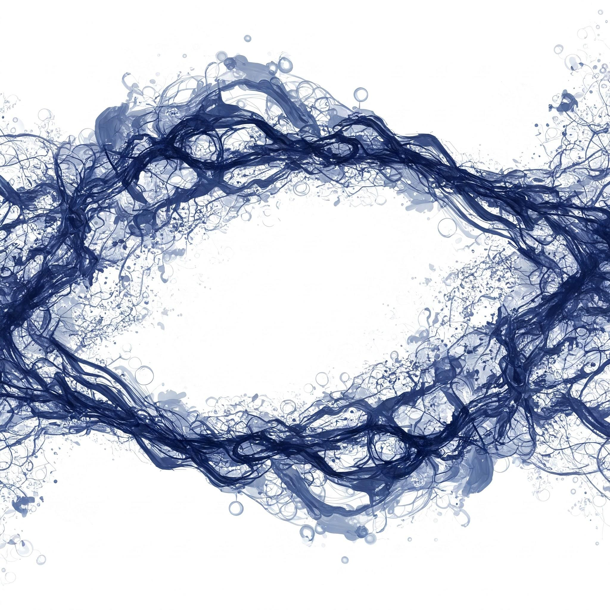

[Agentic Design Patterns ]

 

[*A Hands-On Guide to Building Intelligent Systems*][*1*][*,* ][[*Antonio Gulli*](https://www.linkedin.com/in/searchguy/)] [Table of Contents - total 424 pages = 1+2+1+1+4+9+103+61+34+114+74+5+4 11 ]

[[Dedication](https://docs.google.com/document/d/1cQ61mNpiWn6eSORmWjEjF44vN2Lpba8kyKmNwIC60ig/edit?usp=sharing)][, 1 page ]

[[Acknowledgment](https://docs.google.com/document/d/1u2y6tY48bw8nriDUuwWEf9s8g66vyIqBKSKZDOS-n0s/edit?tab=t.0#heading=h.y1l1kh7vu0qi)][,][ *2 pages* ][\[][final, last read done][\]]

[[Foreword][,]](https://docs.google.com/document/d/18Q9kfZuCTL37ztrSjLxwf8Elr5UfAiAavmnj0IqSpbU/edit?tab=t.0#heading=h.5wi2c0amdd0f) 1 page [\[][final, last read done][\] ]

[[A Thought Leader\'s Perspective: Power and Responsibility](https://docs.google.com/document/d/1PWhaXD_UNKgJaxYe3JBxRFRt3_B8Wm67CFxtSBQ4LkU/edit?tab=t.0#heading=h.2v348nrvaqww)] [\[][final, last read done][\] ]

[[Introduction][,]](https://docs.google.com/document/d/1K5jwqB6jh20uHL0TTWxqWOxFk-dzFxRvHzrRRV79hrg/edit?tab=t.0) 4 pages \[[final, last read done][\] ]

[[What makes an AI system an \"agent\"?](https://docs.google.com/document/d/1Nw6hRa7ItdLr_Tj5hF2q-OH8B_uPKb--RLn8SXZKA94/edit?usp=sharing)][, 9 pages \[][final, last read done][\] ]

 

[Part One, (Total: 103 pages) ]

[1. ] [[Chapter 1: Prompt Chaining](https://docs.google.com/document/d/1flxKGrbnF2g8yh3F-oVD5Xx7ZumId56HbFpIiPdkqLI/edit?usp=sharing)][  (][[code](https://colab.research.google.com/drive/15XCzDOvBhIQaZ__xkvruf5sP9OznAbK9)][), 12 pages ][\[][final, last read done, code ok][\] ]

[2. ] [[Chapter 2: Routing](https://docs.google.com/document/d/1ux_n8n3T4bYndOjs1DKW5ccpC802KISdy2IWnlvYbas/edit?tab=t.0)][  (][[code](https://drive.google.com/drive/u/0/folders/1Y3U3IrYCiJ3E45Z8okR5eCg7OPnWQtPV)][), 13 pages \[][fina, last read done, code ok][\] ]

[3. ] [[Chapter 3: Parallelization](https://docs.google.com/document/d/1XVMp4RcRkoUJTVbrP2foWZX703CUJpWkrhyFU2cfUOA/edit?tab=t.0)][ [(](https://drive.google.com/drive/u/0/folders/1Y3U3IrYCiJ3E45Z8okR5eCg7OPnWQtPV)][[code](https://drive.google.com/drive/u/0/folders/1Y3U3IrYCiJ3E45Z8okR5eCg7OPnWQtPV)][[)](https://drive.google.com/drive/u/0/folders/1Y3U3IrYCiJ3E45Z8okR5eCg7OPnWQtPV), 15 pages \[][final, last read done, code okl][\] ]

[4. ] [[Chapter 4: Reflection](https://docs.google.com/document/d/1HXXJOQIMWowtLw4WMiSR360caDAlZPtl5dPPgvq9IT4/edit?tab=t.0#heading=h.a7nkedxjnyap) ][(][[code](https://drive.google.com/drive/u/0/folders/1Y3U3IrYCiJ3E45Z8okR5eCg7OPnWQtPV)][), 13 pages \[][final, last read done, code okl][\] ]

[5. ] [[Chapter 5: Tool Use](https://docs.google.com/document/d/1bE4iMljhppqGY1p48gQWtZvk6MfRuJRCiba1yRykGNE/edit?usp=sharing)][  ][[(code](https://drive.google.com/drive/u/0/folders/1Y3U3IrYCiJ3E45Z8okR5eCg7OPnWQtPV)][), 20 pages \[][final, last read done, code ok][\] ]

[6. ] [[Chapter 6: Planning](https://docs.google.com/document/d/18vvNESEwHnVUREzIipuaDNCnNAREGqEfy9MQYC9wb4o/edit?usp=sharing)][  [(](https://drive.google.com/drive/u/0/folders/1Y3U3IrYCiJ3E45Z8okR5eCg7OPnWQtPV)][[code](https://drive.google.com/drive/u/0/folders/1Y3U3IrYCiJ3E45Z8okR5eCg7OPnWQtPV)][), 13 pages ][\[][final, last read done, code ok][\]]

[To my son, Bruno, ]

 

[who at two years old, brought a new and brilliant light into my life. As I explore the systems that ][will define our tomorrow, it is the world you will inherit that is foremost in my thoughts. ]

 

[To my sons, Leonardo and Lorenzo, and my daughter Aurora, ]

 

[My heart is filled with pride for the women and men you have become and the wonderful world ][you are building. ]

 

[This book is about how to build intelligent tools, but it is dedicated to the profound hope that ][your generation will guide them with wisdom and compassion. The future is incredibly bright, for ][you and for us all, if we learn to use these powerful technologies to serve humanity and help it ][progress. ]

[Acknowledgment ]

 

I would like to express my sincere gratitude to the many individuals and teams who made this book possible.

 

First and foremost, I thank Google for adhering to its mission, empowering Googlers, and respecting the opportunity to innovate.

 

I am grateful to the Office of the CTO for giving me the opportunity to explore new areas, for adhering to its mission of \"practical magic,\" and for its capacity to adapt to new emerging opportunities.

 

I would like to extend my heartfelt thanks to Will Grannis, our VP, for the trust he puts in initial interest in 1994, and to Lee Boonstra for your amazing work on prompt engineering.

 

My thanks also go to the 5 Days of GenAI team, including our VP Alison Wagonfeld for the trust put in the team, Anant Nawalgaria for always delivering, and Paige Bailey for her can-do attitude and leadership.

 

I am also deeply grateful to Mike Styer, Turan Bulmus, and [Kanchana Patlolla] for helping me ship three Agents at Google I/O 2025. Thank you for your immense work.

 

I want to express my sincere gratitude to Thomas Kurian for his unwavering leadership, passion, and trust in driving the Cloud and AI initiatives. I also deeply appreciate Emanuel Taropa, whose inspiring \"can-do\" attitude made him the most exceptional colleague I\'ve encountered at Google, setting a truly profound example. Finally, thanks to Fiona Cicconi for our engaging discussions about Google.

Jain, Aldo Pahor, Gaurav Verma, Pavithra Sainath, Mariusz Koczwara, Abhijit Kumar, Armstrong Foundjem, Haiming Ran, Udita Patel, and Kaurnakar Kotha.

 

This project truly would not have been possible without you. All the credit goes to you, and all the mistakes are mine.

 
