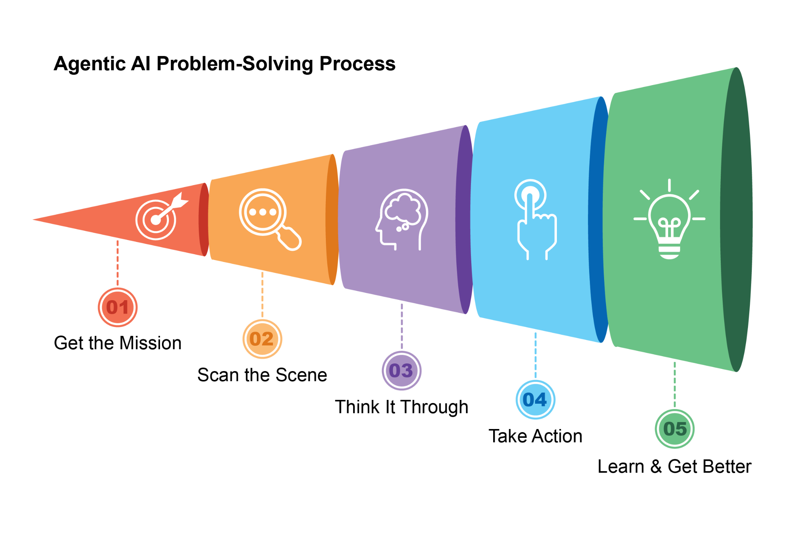
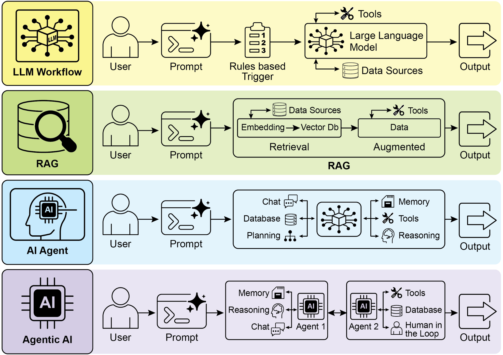
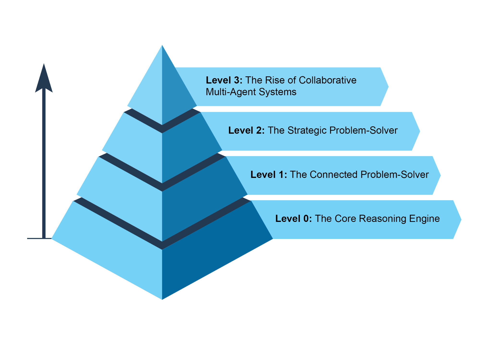

A great question I hear is, \'With AI changing so fast, why write a book that could be quickly outdated?\' My motivation was actually the opposite. It\'s precisely because things are moving so quickly that we need to step back and identify the underlying principles that are solidifying. Patterns like RAG, Reflection, Routing, Memory and the others I discuss, are becoming fundamental building blocks. This book is an invitation to reflect on these core ideas, which provide the foundation we need to build upon. Humans need these reflection moments on foundation patterns

 

[Introduction to the Frameworks Used ]

 

To provide a tangible \"canvas\" for our code examples (see also Appendix), we will primarily utilize three prominent agent development frameworks. **LangChain**, along with its stateful extension **LangGraph**, provides a flexible way to chain together language models and other components, offering a robust canvas for building complex sequences [What makes an AI system an Agent? ]

 

In simple terms, an **AI agent** is a system designed to perceive its environment and take actions to achieve a specific goal. It\'s an evolution from a standard Large Language Model (LLM), enhanced with the abilities to plan, use tools, and interact with its surroundings. Think of an Agentic AI as a smart assistant that learns on the job. It follows a simple, five-step loop to get things done (see Fig.1):

 

1\. **Get the Mission:** You give it a goal, like \"organize my schedule.\" 2. **Scan the Scene:** It gathers all the necessary information---reading emails,

checking calendars, and accessing contacts---to understand what\'s happening.

3\. **Think It Through:** It devises a plan of action by considering the optimal

approach to achieve the goal.

4\. **Take Action:** It executes the plan by sending invitations, scheduling meetings,

Fig.1: Agentic AI functions as an intelligent assistant, continuously learning through

experience. It operates via a straightforward five-step loop to accomplish tasks.

 

Agents are becoming increasingly popular at a stunning pace. According to recent studies, a majority of large IT companies are actively using these agents, and a fifth of them just started within the past year. The financial markets are also taking notice. By the end of 2024, AI agent startups had raised more than \$2 billion, and the market was valued at \$5.2 billion. It\'s expected to explode to nearly \$200 billion in value by 2034. In short, all signs point to AI agents playing a massive role in our future economy.

 

In just two years, the AI paradigm has shifted dramatically, moving from simple automation to sophisticated, autonomous systems (see Fig. 2). Initially, workflows relied on basic prompts and triggers to process data with LLMs. This evolved with Retrieval-Augmented Generation (RAG), which enhanced reliability by grounding models on factual information. We then saw the development of individual AI Agents Fig 2.: Transitioning from LLMs to RAG, then to Agentic RAG, and finally to Agentic AI.

 

The intent of this book is to discuss the design patterns of how specialized agents can work in concert and collaborate to achieve complex goals, and you will see one paradigm of collaboration and interaction in each chapter.

 

Before doing that, let\'s examine examples that span the range of agent complexity (see Fig. 3).

 

[Level 0: The Core Reasoning Engine ]

 

While an LLM is not an agent in itself, it can serve as the reasoning core of a basic agentic system. In a \'Level 0\' configuration, the LLM operates without tools, memory, or environment interaction, responding solely based on its pretrained knowledge. Its strength lies in leveraging its extensive training data to explain established concepts. performs context engineering: the strategic process of selecting, packaging, and managing the most relevant information for each step. For example, to find a coffee shop between two locations, it first uses a mapping tool. It then engineers this output, curating a short, focused context---perhaps just a list of street names---to feed into a local search tool, preventing cognitive overload and ensuring the second step is efficient and accurate. To achieve maximum accuracy from an AI, it must be given a short, focused, and powerful context. Context engineering is the discipline that accomplishes this by strategically selecting, packaging, and managing the most critical information from all available sources. It effectively curates the model\'s limited attention to prevent overload and ensure high-quality, efficient performance on any given task. For detailed information, refer to the Appendix A.

 

This level leads to proactive and continuous operation. A travel assistant linked to your email demonstrates this by engineering the context from a verbose flight confirmation

While this vision of autonomous, team-based automation is already being developed, it\'s important to acknowledge the current hurdles. The effectiveness of such multi-agent systems is presently constrained by the reasoning limitations of LLMs they are using. Furthermore, their ability to genuinely learn from one another and improve as a cohesive unit is still in its early stages. Overcoming these technological bottlenecks is the critical next step, and doing so will unlock the profound promise of this level: the ability to automate entire business workflows from start to finish.

 

[The Future of Agents: Top 5 Hypotheses ]

 
