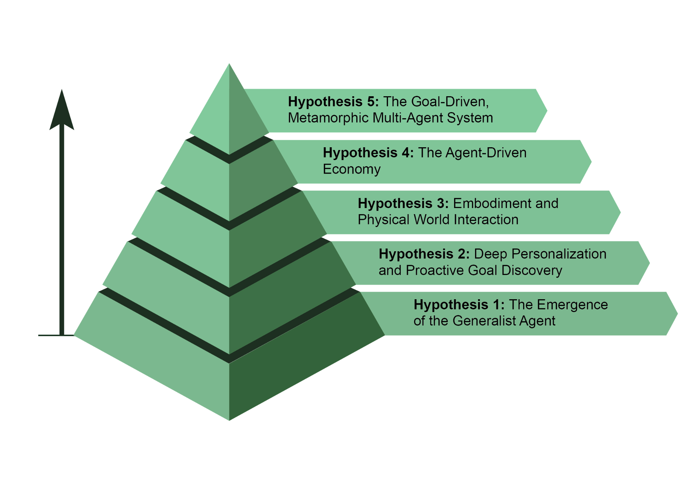

AI agent development is progressing at an unprecedented pace across domains such as software automation, scientific research, and customer service among others. While current systems are impressive, they are just the beginning. The next wave of innovation will likely focus on making agents more reliable, collaborative, and deeply operate as agents when they move beyond simply responding to chats or instructions. They initiate and execute tasks on behalf of the user, actively collaborating in the process. This moves beyond simple task execution into the realm of proactive goal discovery.

 

For instance, if you\'re exploring sustainable energy, the agent might identify your latent goal and proactively support it by suggesting courses or summarizing research. While these systems are still developing, their trajectory is clear. They will become increasingly proactive, learning to take initiative on your behalf when highly confident that the action will be helpful. Ultimately, the agent becomes an indispensable ally, helping you discover and achieve ambitions you have yet to fully articulate.

access a library of plumbing knowledge to formulate a plan, and then control its robotic manipulators with precision to perform the repair. This would represent a monumental step, bridging the gap between digital intelligence and physical action, and transforming everything from manufacturing and logistics to elder care and home maintenance.

 

[Hypothesis 4: The Agent-Driven Economy ]

 

The fourth hypothesis is that highly autonomous agents will become active participants in the economy, creating new markets and business models. We could see agents acting as independent economic entities, tasked with maximising a specific outcome, such as profit. An entrepreneur could launch an agent to run an entire e-commerce business. The agent would identify trending products by analysing social media, generate marketing copy and visuals, manage supply chain logistics by interacting with other automated systems, and dynamically adjust pricing based on real-time demand. This shift would create a new, hyper-efficient \"agent economy\" operating at a speed and the branding agent and spawn three new specialized agents: a \"Logo Design\" agent, a \"Webstore Platform\" agent, and a \"Supply Chain\" agent. It would constantly tune their internal prompts for better performance. If the webstore agent becomes a bottleneck, the system might duplicate it into three parallel agents to work on different parts of the site, effectively re-architecting its own structure on the fly to best achieve the declared goal.

 

[Conclusion ]

 

In essence, an AI agent represents a significant leap from traditional models, functioning as an autonomous system that perceives, plans, and acts to achieve specific goals. The evolution of this technology is advancing from single, tool-using agents to complex, collaborative multi-agent systems that tackle multifaceted objectives. Future hypotheses predict the emergence of generalist, personalized, and even
