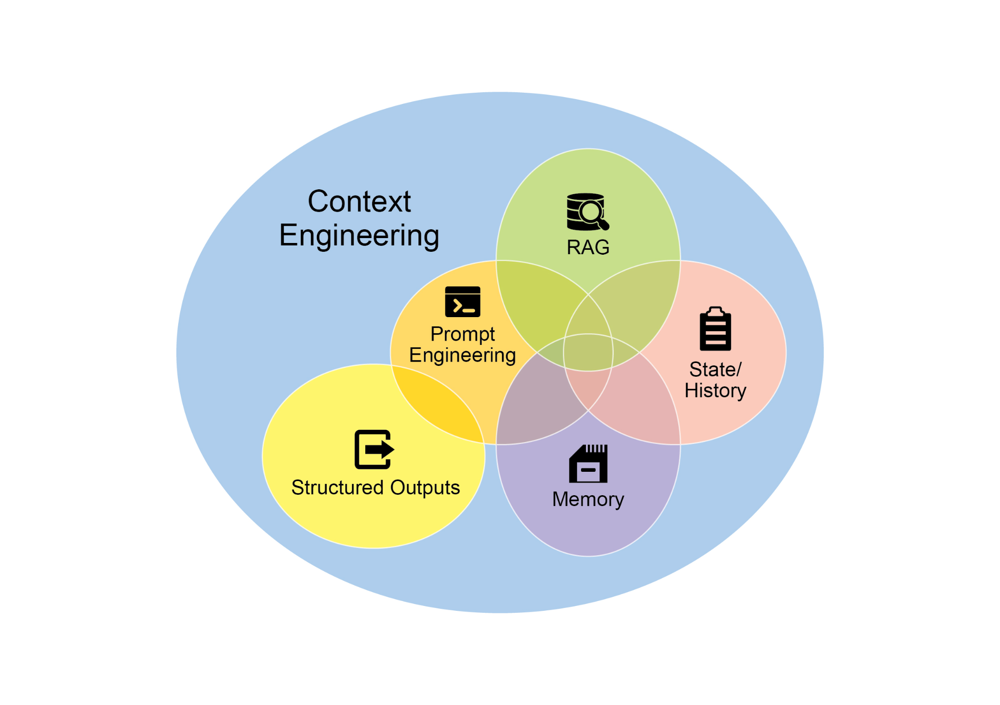
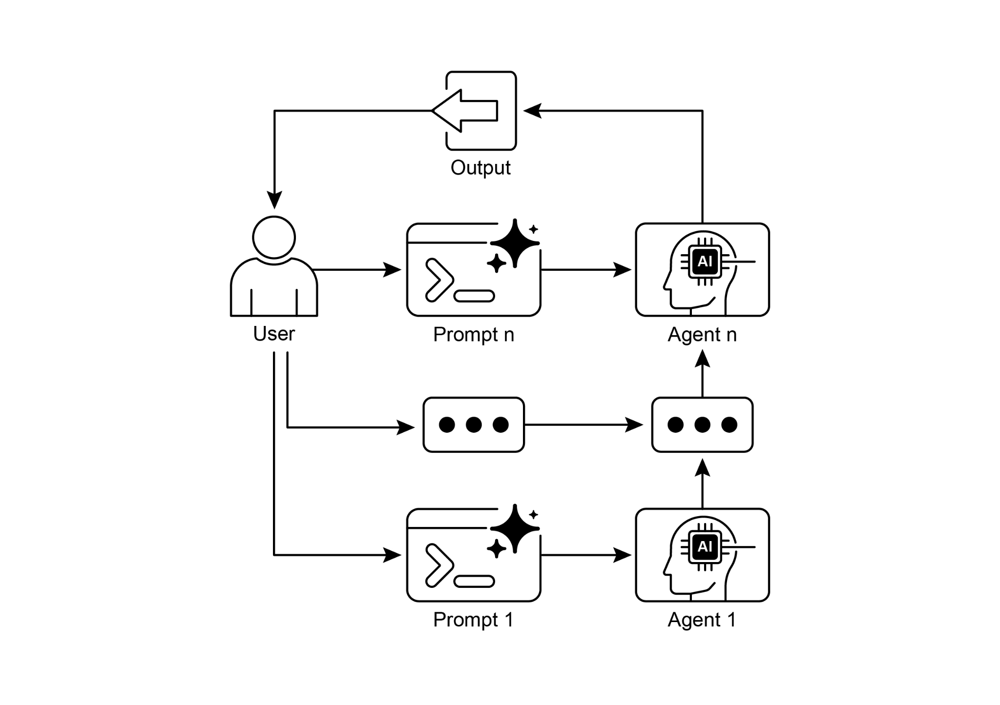

[\# Initialize the Language Model (using ChatOpenAI is recommended) ][llm = ChatOpenAI(temperature=0) ]

 

[\# \-\-- Prompt 1: Extract Information \-\-- ]

[prompt_extract = ChatPromptTemplate.from_template( ]

[\"Extract the technical specifications from the following ][text:\\n\\n{text_input}\" ]

[) ]

 

[\# \-\-- Prompt 2: Transform to JSON \-\-- ]

[prompt_transform = ChatPromptTemplate.from_template( ]

[\"Transform the following specifications into a JSON object with ][\'cpu\', \'memory\', and \'storage\' as keys:\\n\\n{specifications}\" ]format. The LangChain Expression Language (LCEL) is used to elegantly chain these prompts and the language model together. The first chain, extraction_chain, extracts the specifications. The full_chain then takes the output of the extraction and uses it as input for the transformation prompt. A sample input text describing a laptop is provided. The full_chain is invoked with this text, processing it through both steps. The final result, a JSON string containing the extracted and formatted specifications, is then printed.

 

[Context Engineering and Prompt Engineering ]

 

Context Engineering (see Fig.1) is the systematic discipline of designing, constructing, and delivering a complete informational environment to an AI model prior to token generation. This methodology asserts that the quality of a model\'s output is less dependent on the model\'s architecture itself and more on the richness of the context provided. parameters---for instance, *\"You are a technical writer; your tone must be formal and precise.\"* The context is further enriched with external data. This includes retrieved documents, where the AI actively fetches information from a knowledge base to inform its response, such as pulling technical specifications for a project. It also incorporates tool outputs, which are the results from the AI using an external API to obtain real-time data, like querying a calendar to determine a user\'s availability. This explicit data is combined with critical implicit data, such as user identity, interaction history, and environmental state. The core principle is that even advanced models underperform when provided with a limited or poorly constructed view of the operational environment.

 

This practice, therefore, reframes the task from merely answering a question to building a comprehensive operational picture for the agent. For example, a context-engineered agent would not just respond to a query but would first integrate the user\'s calendar availability (a tool output), the professional relationship with an email\'s recipient (implicit the likelihood of errors such as overlooking instructions, losing context, and generating incorrect information. A monolithic prompt struggles to manage multiple constraints and sequential reasoning steps effectively. This results in unreliable and inaccurate outputs, as the LLM fails to address all facets of the multifaceted request.

 

**Why:** Prompt chaining provides a standardized solution by breaking down a complex problem into a sequence of smaller, interconnected sub-tasks. Each step in the chain uses a focused prompt to perform a specific operation, significantly improving reliability and control. The output from one prompt is passed as the input to the next, creating a logical workflow that progressively builds towards the final solution. This modular, divide-and-conquer strategy makes the process more manageable, easier to debug, and allows for the integration of external tools or structured data formats between steps. This pattern is foundational for developing sophisticated, multi-step Agentic systems that can plan, reason, and execute complex workflows.

[Conclusion ]

 

By deconstructing complex problems into a sequence of simpler, more manageable sub-tasks, prompt chaining provides a robust framework for guiding large language models. This \"divide-and-conquer\" strategy significantly enhances the reliability and control of the output by focusing the model on one specific operation at a time. As a foundational pattern, it enables the development of sophisticated AI agents capable of multi-step reasoning, tool integration, and state management. Ultimately, mastering prompt chaining is crucial for building robust, context-aware systems that can execute intricate workflows well beyond the capabilities of a single prompt.

 

[References ]

 

1\. LangChain Documentation on LCEL:
