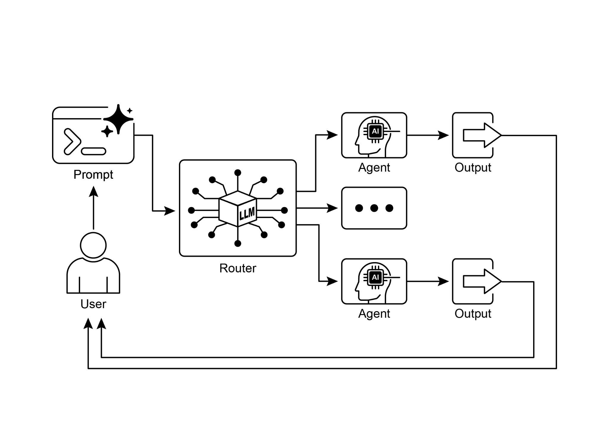

[print(\"\-\-\-\-\-\-\-\-\-\-\-\-\-\-\-\-\-\-\-\-\-\-\-\-\-- Info Handler Called ][\-\-\-\-\-\-\-\-\-\-\-\-\-\-\-\-\-\-\-\-\-\-\-\-\-\-\--\") ]

[return f\"Information request for \'{request}\'. Result: Simulated ][information retrieval.\" ]

 

[def unclear_handler(request: str) -\> str: ]

[\"\"\"Handles requests that couldn\'t be delegated.\"\"\" ]

[return f\"Coordinator could not delegate request: \'{request}\'. ][Please clarify.\" ]

 

[\# \-\-- Create Tools from Functions \-\-- ]

[booking_tool = FunctionTool(booking_handler) ][the \'Info\' agent.\" ]

[), ]

[description=\"A coordinator that routes user requests to the ]

[correct specialist agent.\", ]

[\# The presence of sub_agents enables LLM-driven delegation ][(Auto-Flow) by default. ]

[sub_agents=\[booking_agent, info_agent\] ]

[) ]

 

[\# \-\-- Execution Logic \-\-- ]

 

[async ]

[ def run_coordinator(runner: InMemoryRunner, request: str): ]

[\"\"\"Runs the coordinator agent with a given request and ][delegates.\"\"\" ]

[print(f\"\\n\-\-- Running Coordinator with request: \'{request}\' \-\--\") ][response ]

[break ]

 

[print(f\"Coordinator Final Response: {final_result}\") ]

[return final_result ]

[except Exception as e: ]

[print(f\"An error occurred while processing your request: {e}\") ]

[return f\"An error occurred while processing your request: {e}\" ]

 

[async ]

[ def main(): ]

[\"\"\"Main function to run the ADK example.\"\"\" ]

[print(\"\-\-- Google ADK Routing Example (ADK Auto-Flow Style) \-\--\") ]

[print(\"Note: This requires Google ADK installed and ][authenticated.\") ]

The Coordinator agent\'s primary role, as defined in its instruction, is to analyze

incoming user messages and delegate them to either the Booker or Info agent. This delegation is handled automatically by the ADK\'s Auto-Flow mechanism because the

Coordinator has sub_agents defined. The run_coordinator function sets up an

InMemoryRunner, creates a user and session ID, and then uses the runner to process

the user\'s request through the coordinator agent. The runner.run method processes the request and yields events, and the code extracts the final response text from the

event.content.

 

The main function demonstrates the system\'s usage by running the coordinator with

different requests, showcasing how it delegates booking requests to the Booker and information requests to the Info agent.

 

[At a Glance ]

empower our agents to make intelligent decisions about how to process information,

respond to user input, and utilize available tools or sub-agents.

 

We\'ve seen how routing can be applied in various domains, from customer service

chatbots to complex data processing pipelines. The ability to analyze input and

conditionally direct the workflow is fundamental to creating agents that can handle

the inherent variability of real-world tasks.

 

The code examples using LangChain and Google ADK demonstrate two different, yet

effective, approaches to implementing routing. LangGraph\'s graph-based structure

provides a visual and explicit way to define states and transitions, making it ideal for

complex, multi-step workflows with intricate routing logic. Google ADK, on the other hand, often focuses on defining distinct capabilities (Tools) and relies on the

framework\'s ability to route user requests to the appropriate tool handler, which can
