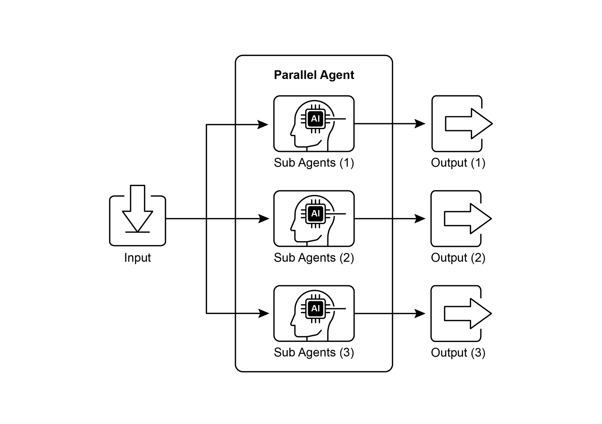

## [Chapter 3: Parallelization ]

 

[Parallelization Pattern Overview ]

 

In the previous chapters, we\'ve explored Prompt Chaining for sequential workflows

and Routing for dynamic decision-making and transitions between different paths.

While these patterns are essential, many complex agentic tasks involve multiple sub-tasks that can be executed *simultaneously* rather than one after another. This is

where the **Parallelization** pattern becomes crucial.

 

Parallelization involves executing multiple components, such as LLM calls, tool usages,

or even entire sub-agents, concurrently (see Fig.1). Instead of waiting for one step to complete before starting the next, parallel execution allows independent tasks to run

at the same time, significantly reducing the overall execution time for tasks that can designed with asynchronous operations in mind, allowing you to easily define steps

that can run in parallel.

The Parallelization pattern is vital for improving the efficiency and responsiveness of

agentic systems, especially when dealing with tasks that involve multiple independent lookups, computations, or interactions with external services. It\'s a key technique for

optimizing the performance of complex agent workflows.

 

[Practical Applications & Use Cases ]

 

Parallelization is a powerful pattern for optimizing agent performance across various applications:

 

1\. Information Gathering and Research:

Collecting information from multiple sources simultaneously is a classic use case.

● **Use Case:** An agent researching a company.

○ **Parallel Tasks:** Search news articles, pull stock data, check social media Performing multiple independent checks or validations concurrently.

● **Use Case:** An agent verifying user input.

○ **Parallel Tasks:** Check email format, validate phone number, verify address

against a database, and check for profanity simultaneously.

○ **Benefit:** Provides faster feedback on input validity.

 

6\. Multi-Modal Processing:

Processing different modalities (text, image, audio) of the same input concurrently.

● **Use Case:** An agent analyzing a social media post with text and an image.

○ **Parallel Tasks:** Analyze the text for sentiment and keywords *and* analyze the

image for objects and scene description simultaneously.

○ **Benefit:** Integrates insights from different modalities more quickly.

 

7\. A/B Testing or Multiple Options Generation:

Generating multiple variations of a response or output in parallel to select the best independent operations concurrently in response to a single user query. These

parallel processes are instantiated as distinct chains or functions, and their respective outputs are subsequently aggregated into a unified result.

 

The prerequisites for this implementation include the installation of the requisite

Python packages, such as langchain, langchain-community, and a model provider

library like langchain-openai. Furthermore, a valid API key for the chosen language model must be configured in the local environment for authentication.

 

[import os ]

[import asyncio ]

[from typing import Optional ]

 

[from langchain_openai import ChatOpenAI ]

[from langchain_core.prompts import ChatPromptTemplate ]

[(\"system\", \"Generate three interesting questions about the ][following topic:\"), ]

[(\"user\", \"{topic}\") ]

[\]) ]

[\| llm ]

[\| StrOutputParser() ]

[) ]

 

[terms_chain: Runnable = ( ]

[ChatPromptTemplate.from_messages(\[ ]

[(\"system\", \"Identify 5-10 key terms from the following topic, ][separated by commas:\"), ]

[(\"user\", \"{topic}\") ]

[\]) ]

[\| llm ]

[\| StrOutputParser() ][full_parallel_chain = map_chain \| synthesis_prompt \| llm \| ][StrOutputParser() ]

 

[\# \-\-- Run the Chain \-\-- ]

[async def run_parallel_example(topic: str) -\> None: ]

[\"\"\" ]

[Asynchronously invokes the parallel processing chain with a ][specific topic ]

[and prints the synthesized result. ]

 

[Args: ]

[topic: The input topic to be processed by the LangChain ][chains. ]

[\"\"\" ]

[if not llm: ]

[print(\"LLM not initialized. Cannot run example.\") ]

The code begins by importing essential modules from langchain_openai and

langchain_core, including components for language models, prompts, output parsing, and runnable structures. The code attempts to initialize a ChatOpenAI instance,

specifically using the \"gpt-4o-mini\" model, with a specified temperature for

controlling creativity. A try-except block is used for robustness during the language

model initialization. Three independent LangChain \"chains\" are then defined, each designed to perform a distinct task on the input topic. The first chain is for

summarizing the topic concisely, using a system message and a user message

containing the topic placeholder. The second chain is configured to generate three

interesting questions related to the topic. The third chain is set up to identify between 5 and 10 key terms from the input topic, requesting them to be comma-separated.

Each of these independent chains consists of a ChatPromptTemplate tailored to its

specific task, followed by the initialized language model and a StrOutputParser to

format the output as a string.

ParallelAgent and SequentialAgent, can be applied to build an agent flow that

leverages concurrent execution for improved efficiency.

 

[from google.adk.agents import LlmAgent, ParallelAgent, ][SequentialAgent ]

[from google.adk.tools import google_search ][GEMINI_MODEL=\"gemini-2.0-flash\" ]

 

[\# \-\-- 1. Define Researcher Sub-Agents (to run in parallel) \-\-- ]

 

[\# Researcher 1: Renewable Energy ]

[researcher_agent_1 = LlmAgent( ]

[name=\"RenewableEnergyResearcher\", ]

[model=GEMINI_MODEL, ]

[instruction=\"\"\"You are an AI Research Assistant specializing in ][energy. ]

[name=\"CarbonCaptureResearcher\", ]

[model=GEMINI_MODEL, ]

[instruction=\"\"\"You are an AI Research Assistant specializing in ][climate solutions. ]

[Research the current state of \'carbon capture methods\'. ][Use the Google Search tool provided. ]

[Summarize your key findings concisely (1-2 sentences). ][Output \*only\* the summary. ]

[\"\"\", ]
