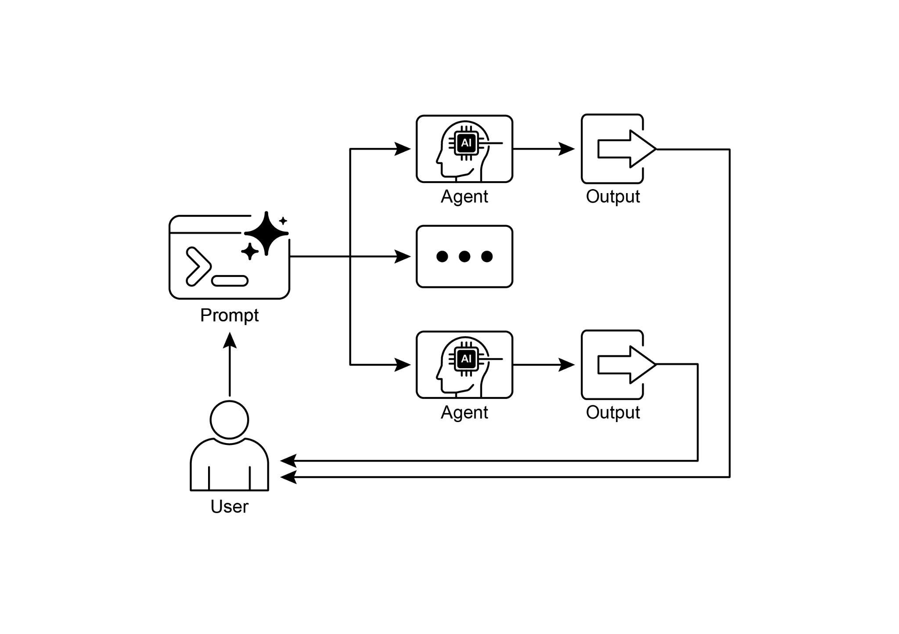

## [\-\-- ]

[\# This is the main agent that will be run. It first executes the ][ParallelAgent ]

[\# to populate the state, and then executes the MergerAgent to produce ][the final output. ]

[sequential_pipeline_agent = SequentialAgent( ]

[name=\"ResearchAndSynthesisPipeline\", ]

[\# Run parallel research first, then merge ]

[sub_agents=\[parallel_research_agent, merger_agent\], ]

[description=\"Coordinates parallel research and synthesizes the ][results.\" ]

[) ]

[root_agent = sequential_pipeline_agent ]

 

This code defines a multi-agent system used to research and synthesize information is designed to efficiently gather information from multiple sources in parallel and then

combine it into a single, structured report.

 

[At a Glance ]

 

**What:** Many agentic workflows involve multiple sub-tasks that must be completed to

achieve a final goal. A purely sequential execution, where each task waits for the

previous one to finish, is often inefficient and slow. This latency becomes a significant

bottleneck when tasks depend on external I/O operations, such as calling different APIs or querying multiple databases. Without a mechanism for concurrent execution,

the total processing time is the sum of all individual task durations, hindering the

system\'s overall performance and responsiveness.

 

**Why:** The Parallelization pattern provides a standardized solution by enabling the

● Google ADK can facilitate parallel execution through LLM-Driven Delegation,

where a Coordinator agent\'s LLM identifies independent sub-tasks and triggers their concurrent handling by specialized sub-agents.

● Parallelization helps reduce overall latency and makes agentic systems more

responsive for complex tasks.

 

[Conclusion]

 

The parallelization pattern is a method for optimizing computational workflows by

concurrently executing independent sub-tasks. This approach reduces overall latency,

particularly in complex operations that involve multiple model inferences or calls to

external services.

 

Frameworks provide distinct mechanisms for implementing this pattern. In LangChain,
