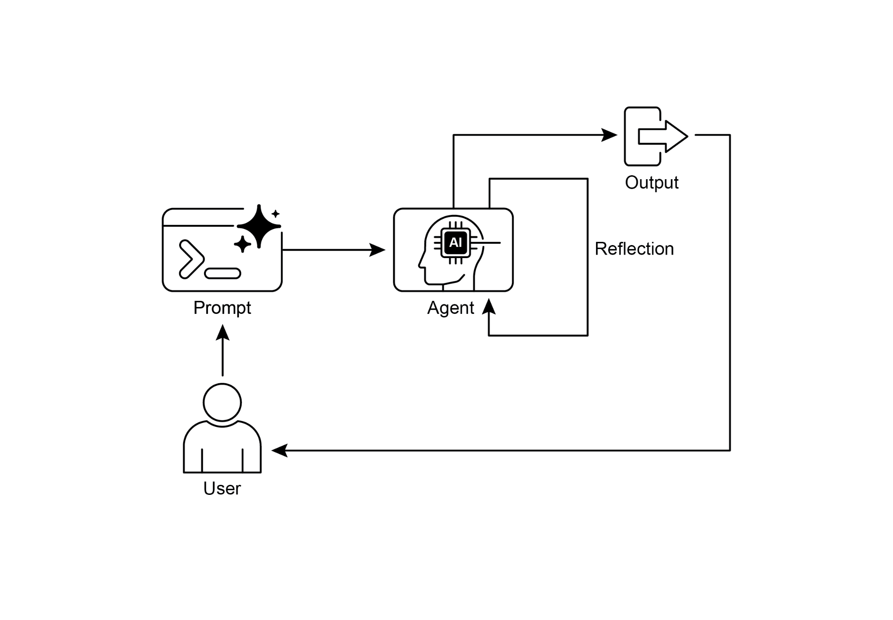
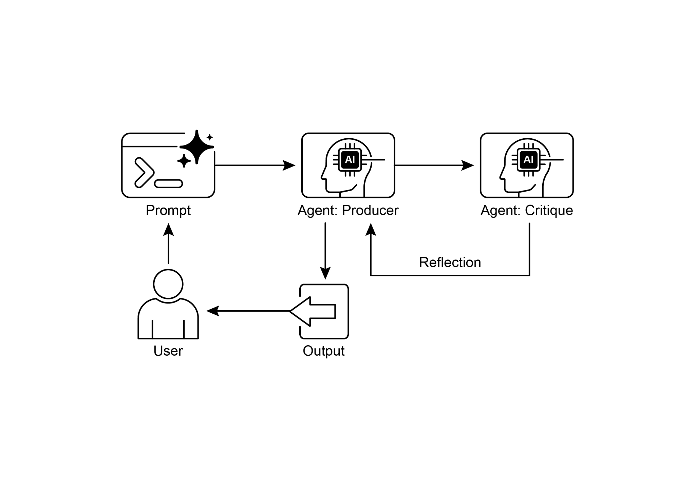

The conversation history is maintained and passed to the language model in each

step to provide context for both generation/refinement and reflection stages. Finally,

the script prints the last generated code version after the loop concludes.

 

[Hands-On Code Example (ADK) ]

 

Let\'s now look at a conceptual code example implemented using the Google ADK.

[\"\"\", ]

[output_key=\"review_output\" \# The structured dictionary is saved ][here. ]

[) ]

 

[\# The SequentialAgent ensures the generator runs before the reviewer. ][review_pipeline = SequentialAgent( ]

[name=\"WriteAndReview_Pipeline\", ]

[sub_agents=\[generator, reviewer\] ]

[) ]

 

[\# Execution Flow: ]

[\# 1. generator runs -\> saves its paragraph to state\[\'draft_text\'\]. ][\# 2. reviewer runs -\> reads state\[\'draft_text\'\] and saves its ][dictionary output to state\[\'review_output\'\]. ]

[At Glance ]

 

 

**What:**[ An agent\'s initial output is often suboptimal, suffering from inaccuracies, incompleteness, ][or a failure to meet complex requirements. Basic agentic workflows lack a built-in process for ][the agent to recognize and fix its own errors. This is solved by having the agent evaluate its own ][work or, more robustly, by introducing a separate logical agent to act as a critic, preventing the ][initial response from being the final one regardless of quality. ]

 

**Why:**[ The Reflection pattern offers a solution by introducing a mechanism for self-correction and ][refinement. It establishes a feedback loop where a \"producer\" agent generates an output, and ][then a \"critic\" agent (or the producer itself) evaluates it against predefined criteria. This critique ][is then used to generate an improved version. This iterative process of generation, evaluation, ][and refinement progressively enhances the quality of the final result, leading to more accurate, ][coherent, and reliable outcomes. ]

● However, these benefits come at the cost of increased latency and

computational expense, along with a higher risk of exceeding the model\'s context window or being throttled by API services.

● While full iterative reflection often requires stateful workflows (like LangGraph),

a single reflection step can be implemented in LangChain using LCEL to pass

output for critique and subsequent refinement.

● Google ADK can facilitate reflection through sequential workflows where one

agent\'s output is critiqued by another agent, allowing for subsequent

refinement steps.

● This pattern enables agents to perform self-correction and enhance their

performance over time.

 

[Conclusion ]

4\. Google Agent Developer Kit (ADK) Documentation (Multi-Agent Systems):

<https://google.github.io/adk-docs/agents/multi-agents/>
