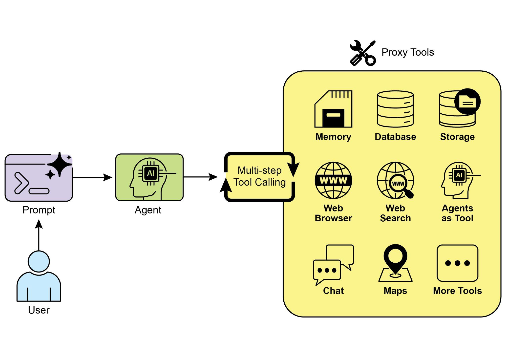

## [Chapter 5: Tool Use (Function Calling) ]

 

[Tool Use Pattern Overview ]

 

So far, we\'ve discussed agentic patterns that primarily involve orchestrating

interactions between language models and managing the flow of information within

the agent\'s internal workflow (Chaining, Routing, Parallelization, Reflection). However, for agents to be truly useful and interact with the real world or external systems, they

need the ability to use Tools.

 

The Tool Use pattern, often implemented through a mechanism called Function

Calling, enables an agent to interact with external APIs, databases, services, or even execute code. It allows the LLM at the core of the agent to decide when and how to

use a specific external function based on the user\'s request or the current state of the calling is the technical mechanism that bridges the gap between the LLM\'s reasoning

capabilities and the vast array of external functionalities available.

 

While \"function calling\" aptly describes invoking specific, predefined code functions,

it\'s useful to consider the more expansive concept of \"tool calling.\" This broader term

acknowledges that an agent\'s capabilities can extend far beyond simple function

execution. A \"tool\" can be a traditional function, but it can also be a complex API endpoint, a request to a database, or even an instruction directed at another

specialized agent. This perspective allows us to envision more sophisticated systems

where, for instance, a primary agent might delegate a complex data analysis task to a

dedicated \"analyst agent\" or query an external knowledge base through its API. Thinking in terms of \"tool calling\" better captures the full potential of agents to act as

orchestrators across a diverse ecosystem of digital resources and other intelligent

entities.

Performing queries, updates, or other operations on structured data.

● **Use Case:** An e-commerce agent.

○ **Tools:** API calls to check product inventory, get order status, or process

payments.

○ **Agent Flow:** User asks \"Is product X in stock?\", LLM calls the inventory API,

tool returns stock count, LLM tells the user the stock status.

 

3\. Performing Calculations and Data Analysis:

Using external calculators, data analysis libraries, or statistical tools.

● **Use Case:** A financial agent.

○ **Tools:** A calculator function, a stock market data API, a spreadsheet tool. ○ **Agent Flow:** User asks \"What\'s the current price of AAPL and calculate the

potential profit if I bought 100 shares at \$150?\", LLM calls stock API, gets

current price, then calls calculator tool, gets result, formats response.

selected language model service, typically via an API key configured in the local

environment, is a necessary prerequisite.

 

[import os, getpass ]

[import asyncio ]

[import nest_asyncio ]

[from typing import List ]

[from dotenv import load_dotenv ]

[import logging ]

 

[from langchain_google_genai import ChatGoogleGenerativeAI ][from langchain_core.prompts import ChatPromptTemplate ][from langchain_core.tools import tool as langchain_tool ][from langchain.agents import create_tool_calling_agent, AgentExecutor ]

 

[\# UNCOMMENT ]

[\"capital of france\": \"The capital of France is Paris.\", ]

[\"population of earth\": \"The estimated population of Earth is ][around 8 billion people.\", ]

[\"tallest mountain\": \"Mount Everest is the tallest mountain ][above sea level.\", ]

[\"default\": f\"Simulated search result for \'{query}\': No specific ][information found, but the topic seems interesting.\" ][ } ]

[ result = simulated_results.get(query.lower(), ][simulated_results\[\"default\"\]) ]

[ print(f\"\-\-- TOOL RESULT: {result} \-\--\") ][ return result ]

 

[tools = \[search_information\] ]

 

[\# \-\-- Create a Tool-Calling Agent \-\-- ][ \"\"\"Runs all agent queries concurrently.\"\"\" ][ tasks = \[ ]

[run_agent_with_tool(\"What is the capital of France?\"), ]

[run_agent_with_tool(\"What\'s the weather like in London?\"), ]

[run_agent_with_tool(\"Tell me something about dogs.\") \# Should ][trigger the default tool response ]

[ \] ]

[ await asyncio.gather(\*tasks) ]

 

[nest_asyncio.apply() ]

[asyncio.run(main())]

 

The code sets up a tool-calling agent using the LangChain library and the Google

Gemini model. It defines a search_information tool that simulates providing factual

answers to specific queries. The tool has predefined responses for \"weather in

[\# \-\-- Best Practice: Configure Logging \-\-- ][\# A basic logging setup helps in debugging and tracking the crew\'s ][execution. ]

 

[logging.basicConfig(level=logging.INFO, format=\'%(asctime)s - ][%(levelname)s - %(message)s\') ]

 

[\# \-\-- Set up your API Key \-\-- ]

[\# For production, it\'s recommended to use a more secure method for ][key management ]

[\# like environment variables loaded at runtime or a secret manager. ][\# ]

[\# Set the environment variable for your chosen LLM provider (e.g., ][OPENAI_API_KEY) ]

[\# os.environ\[\"OPENAI_API_KEY\"\] = \"YOUR_API_KEY\" ][\# os.environ\[\"OPENAI_MODEL_NAME\"\] = \"gpt-4o\" ]

[\# \-\-- 2. Define the Agent \-\-- ]

[\# The agent definition remains the same, but it will now leverage the ][improved tool. ]

[financial_analyst_agent = Agent( ]

[ role=\'Senior Financial Analyst\', ]

[ goal=\'Analyze stock data using provided tools and report key ][prices.\', ]

[ backstory=\"You are an experienced financial analyst adept at using ][data sources to find stock information. You provide clear, direct ][answers.\", ]

[ verbose=True, ]

[ tools=\[get_stock_price\], ]

[ \# Allowing delegation can be useful, but is not necessary for this ][simple task. ]

[ allow_delegation=False, ]

[) ]

[\# Using a \_\_name\_\_ == \"\_\_main\_\_\": block is a standard Python best ][practice. ]

[def main(): ]

[\"\"\"Main function to run the crew.\"\"\" ]

[\# Check for API key before starting to avoid runtime errors. ]

[if not os.environ.get(\"OPENAI_API_KEY\"): ]

[print(\"ERROR: The OPENAI_API_KEY environment variable is not ][set.\") ]

[print(\"Please set it before running the script.\") ]

[return ]

 
