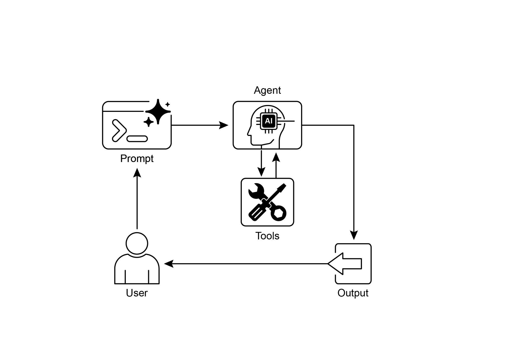

[print(\"\\n## Starting the Financial Crew\...\") ]

[print(\"\-\-\-\-\-\-\-\-\-\-\-\-\-\-\-\-\-\-\-\-\-\-\-\-\-\-\-\-\-\-\-\--\") ]

 

[\# The kickoff method starts the execution. ]

[result = financial_crew.kickoff() ]production environments. In short, the core logic showcases how to define tools,

agents, and tasks to create a collaborative workflow in Crew.ai.

 

[Hands-on code (Google ADK) ]

 

The Google Agent Developer Kit (ADK) includes a library of natively integrated tools

that can be directly incorporated into an agent\'s capabilities.

 

**Google search:** A primary example of such a component is the Google Search tool.

This tool serves as a direct interface to the Google Search engine, equipping the agent with the functionality to perform web searches and retrieve external

information.

[ session_service = InMemorySessionService() ][ session = await session_service.create_session(app_name=APP_NAME, ][user_id=USER_ID, session_id=SESSION_ID) ]

[ runner = Runner(agent=root_agent, app_name=APP_NAME, ][session_service=session_service) ]

 

[ content = types.Content(role=\'user\', ]

[parts=\[types.Part(text=query)\]) ]

[ events = runner.run(user_id=USER_ID, session_id=SESSION_ID, ][new_message=content) ]

 

[ for event in events: ]

[if event.is_final_response(): ]

[final_response = event.content.parts\[0\].text ]

[print(\"Agent Response: \", final_response) ]

**Code execution:** The Google ADK features integrated components for specialized

tasks, including an environment for dynamic code execution. The built_in_code_execution tool provides an agent with a sandboxed Python interpreter.

This allows the model to write and run code to perform computational tasks,

manipulate data structures, and execute procedural scripts. Such functionality is

critical for addressing problems that require deterministic logic and precise calculations, which are outside the scope of probabilistic language generation alone.

 

[import os, getpass ]

[import asyncio ]

[import nest_asyncio ]

[from typing import List ]

[from dotenv import load_dotenv ]

[import logging ][ session = await session_service.create_session(app_name=APP_NAME, ][user_id=USER_ID, session_id=SESSION_ID) ]

[ runner = Runner(agent=code_agent, app_name=APP_NAME, ][session_service=session_service) ]

 

[ content = types.Content(role=\'user\', ]

[parts=\[types.Part(text=query)\]) ]

[ print(f\"\\n\-\-- Running Query: {query} \-\--\") ][ final_response_text = \"No final text response captured.\" ][ try: ]

[\# Use run_async ]

[async for event in runner.run_async(user_id=USER_ID, ][session_id=SESSION_ID, new_message=content): ]

[print(f\"Event ID: {event.id}, Author: {event.author}\") ]

 

[\# \-\-- Check for specific parts FIRST \-\-- ][ print(\"-\" \* 30) ]

 

[\# Main async function to run the examples ][async def main(): ]

[ await call_agent_async(\"Calculate the value of (5 + 7) \* 3\") ][ await call_agent_async(\"What is 10 factorial?\") ]

 

[\# Execute the main async function ]

[try: ]

[ nest_asyncio.apply() ]

[ asyncio.run(main()) ]

[except RuntimeError as e: ]

[ \# Handle specific error when running asyncio.run in an already ][running loop (like Jupyter/Colab) ]

[ if \"cannot be called from a running event loop\" in str(e): ]

[print(\"\\nRunning in an existing event loop (like ]history. An asynchronous function call_vsearch_agent_async is defined to interact

with the agent. This function takes a query, constructs a message content object, and calls the runner\'s run_async method to send the query to the agent. The function then

streams the agent\'s response back to the console as it arrives. It also prints

information about the final response, including any source attributions from the

datastore. Error handling is included to catch exceptions during the agent\'s execution, providing informative messages about potential issues like an incorrect datastore ID

or missing permissions. Another asynchronous function run_vsearch_example is

provided to demonstrate how to call the agent with example queries. The main

execution block checks if the DATASTORE_ID is set and then runs the example using asyncio.run. It includes a check to handle cases where the code is run in an

environment that already has a running event loop, like a Jupyter notebook.

[) ]

 

[\# \-\-- Runner and Session Initialization \-\-- ][runner = Runner( ]

[agent=vsearch_agent, ]

[app_name=APP_NAME, ]

[session_service=InMemorySessionService(), ][) ]

 

[\# \-\-- Agent Invocation Logic \-\-- ]

[async def call_vsearch_agent_async(query: str): ]

[\"\"\"Initializes a session and streams the agent\'s response.\"\"\" ]

[print(f\"User: {query}\") ]

[print(\"Agent: \", end=\"\", flush=True) ]

 

[try: ]

[service account has the necessary permissions.\") ]

[print(\"-\" \* 30) ]

 

[\# \-\-- Run Example \-\-- ]

[async def run_vsearch_example(): ]

[\# Replace with a question relevant to YOUR datastore content ]

[await call_vsearch_agent_async(\"Summarize the main points about ][the Q2 strategy document.\") ]

[await call_vsearch_agent_async(\"What safety procedures are ][mentioned for lab X?\") ]

 

[\# \-\-- Execution \-\-- ]

[if \_\_name\_\_ == \"\_\_main\_\_\": ]

[if not DATASTORE_ID: ]

[print(\"Error: DATASTORE_ID environment variable is not set.\") ]

[else: ]enterprise controls and seamless integration with other Google products. The key

difference between extensions and function calling lies in their execution: Vertex AI automatically executes extensions, whereas function calls require manual execution

by the user or client.

 

[At a Glance ]

 

**What:** LLMs are powerful text generators, but they are fundamentally disconnected

from the outside world. Their knowledge is static, limited to the data they were trained on, and they lack the ability to perform actions or retrieve real-time information. This

inherent limitation prevents them from completing tasks that require interaction with

external APIs, databases, or services. Without a bridge to these external systems,

their utility for solving real-world problems is severely constrained.

