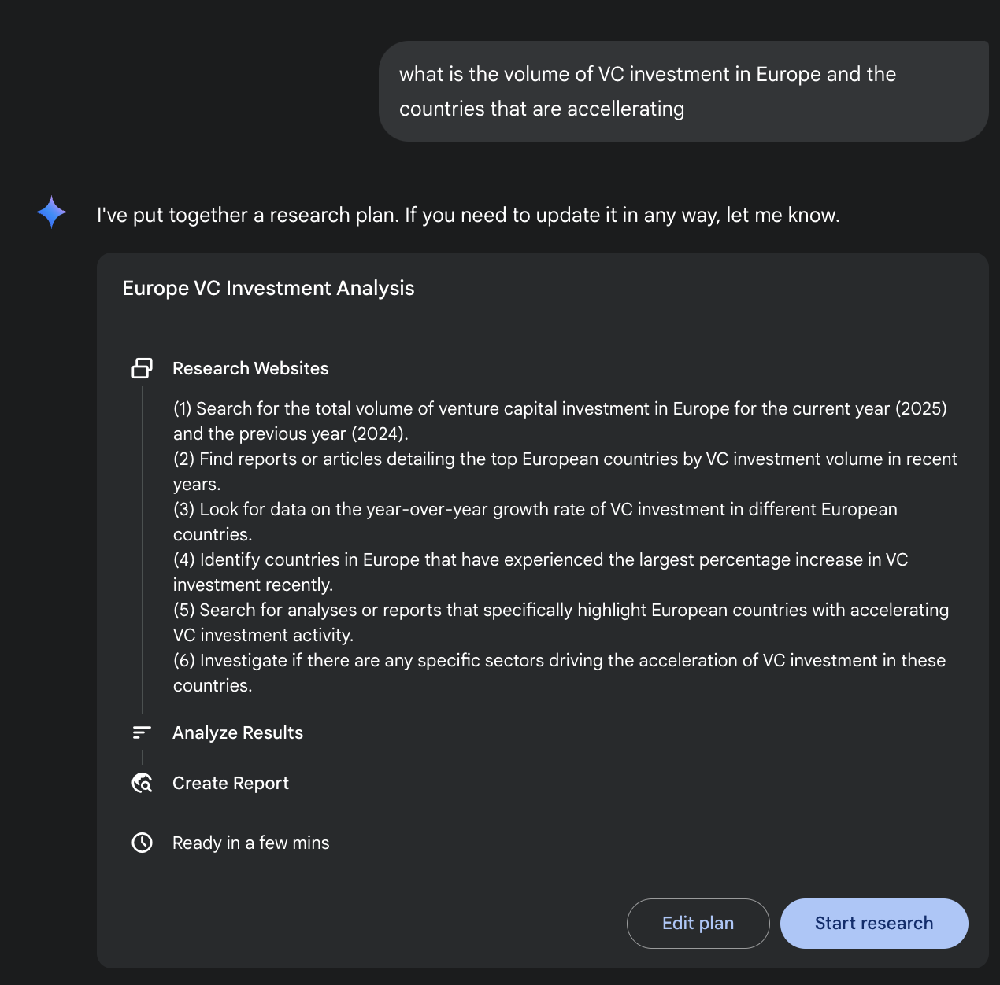
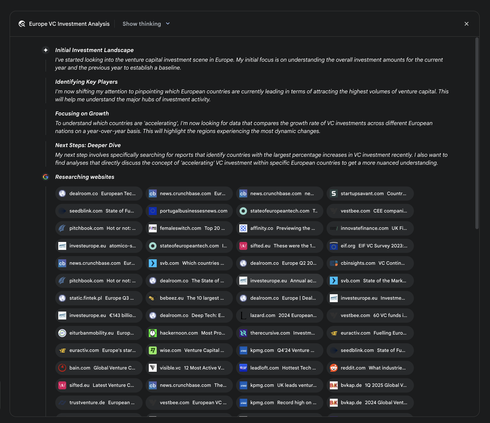
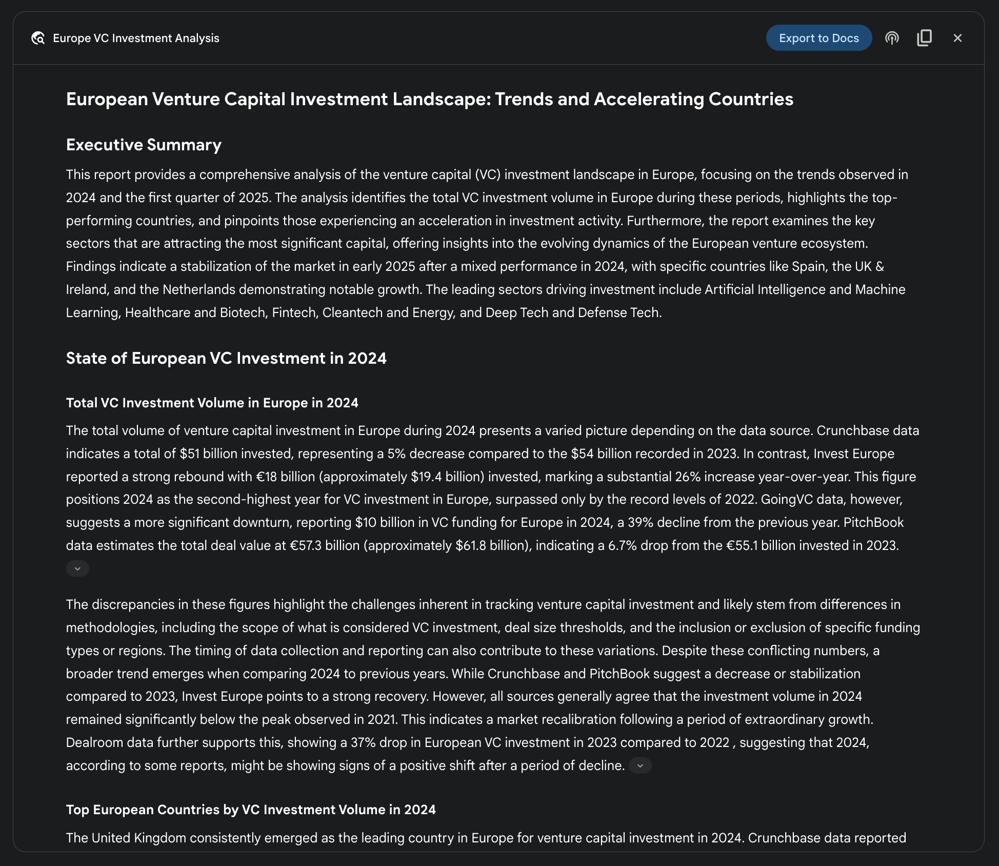

## [Chapter 6: Planning ]

 

Intelligent behavior often involves more than just reacting to the immediate input. It

requires foresight, breaking down complex tasks into smaller, manageable steps, and strategizing how to achieve a desired outcome. This is where the Planning pattern

comes into play. At its core, planning is the ability for an agent or a system of agents

to formulate a sequence of actions to move from an initial state towards a goal state.

 

[Planning Pattern Overview ]

 

In the context of AI, it\'s helpful to think of a planning agent as a specialist to whom

you delegate a complex goal. When you ask it to \"organize a team offsite,\" you are

defining the what---the objective and its constraints---but not the how. The agent\'s particularly within dynamic or complex environments. This process transforms a

high-level objective into a structured plan composed of discrete, executable steps.

 

In domains such as procedural task automation, planning is used to orchestrate

complex workflows. For example, a business process like onboarding a new employee

can be decomposed into a directed sequence of sub-tasks, such as creating system

accounts, assigning training modules, and coordinating with different departments. The agent generates a plan to execute these steps in a logical order, invoking

necessary tools or interacting with various systems to manage dependencies.

 

Within robotics and autonomous navigation, planning is fundamental for state-space

traversal. A system, whether a physical robot or a virtual entity, must generate a path or sequence of actions to transition from an initial state to a goal state. This involves

optimizing for metrics such as time or energy consumption while adhering to

[\# 1. Explicitly define the language model for clarity ][llm = ChatOpenAI(model=\"gpt-4-turbo\") ]

 

 

[\# 2. Define a clear and focused agent ]

[planner_writer_agent = Agent( ]

[role=\'Article Planner and Writer\', ]

[goal=\'Plan and then write a concise, engaging summary on a ][specified topic.\', ]

[backstory=( ]

[\'You are an expert technical writer and content strategist. \' ]

[\'Your strength lies in creating a clear, actionable plan ][before writing, \' ]

[\'ensuring the final summary is both informative and easy to ][digest.\' ]

[), ]

[) ]

 

[\# Execute the task ]

[print(\"## Running the planning and writing task ##\") ][result = crew.kickoff() ]

 

[print(\"\\n\\n\-\--\\n## Task Result ##\\n\-\--\") ]

[print(result) ]

 

This code uses the CrewAI library to create an AI agent that plans and writes a

summary on a given topic. It starts by importing necessary libraries, including Crew.ai

and langchain_openai, and loading environment variables from a .env file. A

ChatOpenAI language model is explicitly defined for use with the agent. An Agent named planner_writer_agent is created with a specific role and goal: to plan and then

write a concise summary. The agent\'s backstory emphasizes its expertise in planning information it gathers, actively identifying knowledge gaps, corroborating data points,

and resolving discrepancies.

user-provided documents, combining information from private sources with its

web-based research. The final output is not merely a concatenated list of findings but a structured, multi-page report. During the synthesis phase, the model performs a

critical evaluation of the collected information, identifying major themes and organizing

the content into a coherent narrative with logical sections. The report is designed to be

interactive, often including features like an audio overview, charts, and links to the original cited sources, allowing for verification and further exploration by the user. In

addition to the synthesized results, the model explicitly returns the full list of sources it

searched and consulted (see Fig.2). These are presented as citations, providing

complete transparency and direct access to the primary information. This entire process transforms a simple query into a comprehensive, synthesized body of

knowledge.

Fig. 2: An example of Deep Research plan being executed, resulting in Google Search

being used as a tool to search various web sources.

 

By mitigating the substantial time and resource investment required for manual data

acquisition and synthesis, Gemini DeepResearch provides a more structured and

exhaustive method for information discovery. The system\'s value is particularly evident in complex, multi-faceted research tasks across various domains.

 

For instance, in competitive analysis, the agent can be directed to systematically gather

and collate data on market trends, competitor product specifications, public sentiment from diverse online sources, and marketing strategies. This automated process

replaces the laborious task of manually tracking multiple competitors, allowing analysts

to focus on higher-order strategic interpretation rather than data collection (see Fig. 3).

Fig. 3: Final output generated by the Google Deep Research agent, analyzing on our

behalf sources obtained using Google Search as a tool.

 

Similarly, in academic exploration, the system serves as a powerful tool for conducting

extensive literature reviews. It can identify and summarize foundational papers, trace

the development of concepts across numerous publications, and map out emerging research fronts within a specific field, thereby accelerating the initial and most

time-consuming phase of academic inquiry.

 

The efficiency of this approach stems from the automation of the iterative search-and-filter cycle, which is a core bottleneck in manual research.

Comprehensiveness is achieved by the system\'s capacity to process a larger volume

and variety of information sources than is typically feasible for a human researcher

within a comparable timeframe. This broader scope of analysis helps to reduce the

● **Transparency:** Unlike the abstracted process in ChatGPT, the API exposes all
