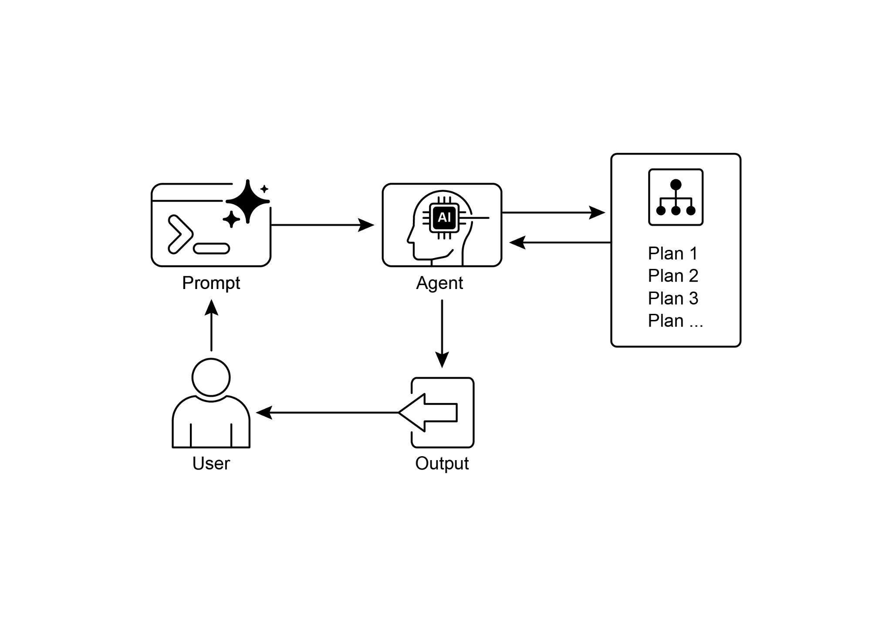

intermediate steps, including the agent\'s reasoning, the specific web search queries it executed, and any code it ran. This allows for detailed debugging,

analysis, and a deeper understanding of how the final answer was constructed.

● **Extensibility:** It supports the Model Context Protocol (MCP), enabling

developers to connect the agent to private knowledge bases and internal data sources, blending public web research with proprietary information.

 

To use the API, you send a request to the client.responses.create endpoint, specifying a

model, an input prompt, and the tools the agent can use. The input typically includes a

system_message that defines the agent\'s persona and desired output format, along with the user_query. You must also include the web_search_preview tool and can

optionally add others like code_interpreter or custom MCP tools (see Chapter 10) for

internal data.

[\# Access and print the final report from the response ][final_report = response.output\[-1\].content\[0\].text ][print(final_report) ]

 

 

[\# \-\-- ACCESS INLINE CITATIONS AND METADATA \-\-- ][print(\"\-\-- CITATIONS \-\--\") ]

[annotations = response.output\[-1\].content\[0\].annotations ]

 

[if not annotations: ]

[print(\"No annotations found in the report.\") ][else: ]

[for i, citation in enumerate(annotations): ]

[\# The text span the citation refers to ]

[cited_text = ]

[final_report\[citation.start_index:citation.end_index\] ]

[print(\"\\nNo web search steps found.\") ]

 

[\# 3. Code Execution: Any code run by the agent using the code ][interpreter. ]

[try: ]

[code_step = next(item for item in response.output if item.type == ][\"code_interpreter_call\") ]

[print(\"\\n\[Found a Code Execution Step\]\") ]

[print(\" Code Input:\") ]

[print(f\" \`\`\`python\\n{code_step.input}\\n \`\`\`\") ]

[print(\" Code Output:\") ]

[print(f\" {code_step.output}\") ]

[except StopIteration: ]

[print(\"\\nNo code execution steps found.\") ]

 

This code snippet utilizes the OpenAI API to perform a \"Deep Research\" task. It starts **Why:** The Planning pattern offers a standardized solution by having an agentic system

first create a coherent plan to address a goal. It involves decomposing a high-level objective into a sequence of smaller, actionable steps or sub-goals. This allows the

system to manage complex workflows, orchestrate various tools, and handle

dependencies in a logical order. LLMs are particularly well-suited for this, as they can

generate plausible and effective plans based on their vast training data. This structured approach transforms a simple reactive agent into a strategic executor that can

proactively work towards a complex objective and even adapt its plan if necessary.

 

**Rule of thumb:** Use this pattern when a user\'s request is too complex to be handled by a single action or tool. It is ideal for automating multi-step processes, such as

generating a detailed research report, onboarding a new employee, or executing a

competitive analysis. Apply the Planning pattern whenever a task requires a sequence

of interdependent operations to reach a final, synthesized outcome.

[Key Takeaways ]

 

[● ]Planning enables agents to break down complex goals into actionable, sequential

steps.

[● ]It is essential for handling multi-step tasks, workflow automation, and navigating

complex environments.

[● ]LLMs can perform planning by generating step-by-step approaches based on

task descriptions.

[● ]Explicitly prompting or designing tasks to require planning steps encourages this

behavior in agent frameworks.

● Google Deep Research is an agent analyzing on our behalf sources obtained using

Google Search as a tool. It reflects, plans, and executes

 

[Conclusion ]
