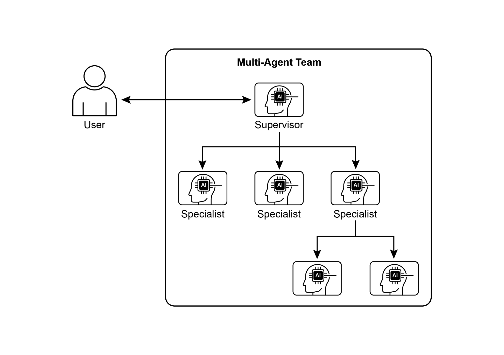
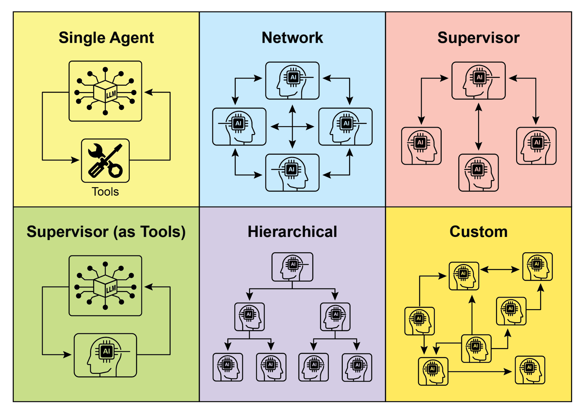

## [Chapter 7: Multi-Agent Collaboration ]

 

While a monolithic agent architecture can be effective for well-defined problems, its

capabilities are often constrained when faced with complex, multi-domain tasks. The Multi-Agent Collaboration pattern addresses these limitations by structuring a system

as a cooperative ensemble of distinct, specialized agents. This approach is predicated

on the principle of task decomposition, where a high-level objective is broken down

into discrete sub-problems. Each sub-problem is then assigned to an agent possessing the specific tools, data access, or reasoning capabilities best suited for

that task.

 

For example, a complex research query might be decomposed and assigned to a

Research Agent for information retrieval, a Data Analysis Agent for statistical [● ]**Parallel Processing:** Multiple agents work on different parts of a problem

simultaneously, and their results are later combined.

[● ]**Debate and Consensus:** Multi-Agent Collaboration where Agents with varied

perspectives and information sources engage in discussions to evaluate options,

ultimately reaching a consensus or a more informed decision.

[● ]**Hierarchical Structures:** A manager agent might delegate tasks to worker

agents dynamically based on their tool access or plugin capabilities and

synthesize their results. Each agent can also handle relevant groups of tools,

rather than a single agent handling all the tools.

[● ]**Expert Teams:** Agents with specialized knowledge in different domains (e.g., a

researcher, a writer, an editor) collaborate to produce a complex output.

**● Critic-Reviewer:** Agents create initial outputs such as plans, drafts, or answers. A

second group of agents then critically assesses this output for adherence to

policies, security, compliance, correctness, quality, and alignment with

and a fourth a documentation writer. They could pass outputs between each

other to build and verify components.

[● ]**Creative Content Generation:** Creating a marketing campaign could involve a

market research agent, a copywriter agent, a graphic design agent (using image

generation tools), and a social media scheduling agent, all working together.

[● ]**Financial Analysis:** A multi-agent system could analyze financial markets. Agents

might specialize in fetching stock data, analyzing news sentiment, performing

technical analysis, and generating investment recommendations.

[● ]**Customer Support Escalation:** A front-line support agent could handle initial

queries, escalating complex issues to a specialist agent (e.g., a technical expert or a billing specialist) when needed, demonstrating a sequential handoff based on

problem complexity.

[● ]**Supply Chain Optimization:** Agents could represent different nodes in a supply

chain (suppliers, manufacturers, distributors) and collaborate to optimize **1. Single Agent:** At the most basic level, a \"Single Agent\" operates autonomously

without direct interaction or communication with other entities. While this model is straightforward to implement and manage, its capabilities are inherently limited by the

individual agent\'s scope and resources. It is suitable for tasks that are decomposable

into independent sub-problems, each solvable by a single, self-sufficient agent.

 

**2. Network:** The \"Network\" model represents a significant step towards collaboration, where multiple agents interact directly with each other in a decentralized fashion.

Communication typically occurs peer-to-peer, allowing for the sharing of information,

resources, and even tasks. This model fosters resilience, as the failure of one agent

does not necessarily cripple the entire system. However, managing communication overhead and ensuring coherent decision-making in a large, unstructured network

can be challenging.

for robustness, and the acceptable communication overhead. Future advancements in

multi-agent systems will likely continue to explore and refine these models, as well as develop new paradigms for collaborative intelligence.

 

[Hands-On code (Crew AI) ]

 

This Python code defines an AI-powered crew using the CrewAI framework to

generate a blog post about AI trends. It starts by setting up the environment, loading API keys from a .env file. The core of the application involves defining two agents: a

researcher to find and summarize AI trends, and a writer to create a blog post based

on the research.

 

Two tasks are defined accordingly: one for researching the trends and another for

writing the blog post, with the writing task depending on the output of the research

[\# Updated to a model from the Gemini 2.0 series for better ][performance and features. ]

[\# For cutting-edge (preview) capabilities, you could use ][\"gemini-2.5-flash\". ]

[llm = ChatGoogleGenerativeAI(model=\"gemini-2.0-flash\") ]

 

[\# Define Agents with specific roles and goals ]

[researcher = Agent( ]

[role=\'Senior Research Analyst\', ]

[goal=\'Find and summarize the latest trends in AI.\', ]

[backstory=\"You are an experienced research analyst with a ][knack for identifying key trends and synthesizing information.\", ]

[verbose=True, ]

[allow_delegation=False, ]

[) ]

[blog_creation_crew = Crew( ]

[agents=\[researcher, writer\], ]

[tasks=\[research_task, writing_task\], ]

[process=Process.sequential, ]

[llm=llm, ]

[verbose=2 \# Set verbosity for detailed crew execution logs ]

[) ]

 

[\# Execute the Crew ]

[print(\"## Running the blog creation crew with Gemini 2.0 Flash\... ][##\") ]

[try: ]

[result = blog_creation_crew.kickoff() ]

[print(\"\\n\-\-\-\-\-\-\-\-\-\-\-\-\-\-\-\-\--\\n\") ]

[print(\"## Crew Final Output ##\") ]

[print(result) ]

[from google.adk.agents import LlmAgent, BaseAgent ][from google.adk.agents.invocation_context import InvocationContext ][from google.adk.events import Event ]

 

[from typing import AsyncGenerator ]

 

[\# Correctly implement a custom agent by extending BaseAgent ][class TaskExecutor(BaseAgent): ]

[\"\"\"A specialized agent with custom, non-LLM behavior.\"\"\" ]

[name: str = \"TaskExecutor\" ]
