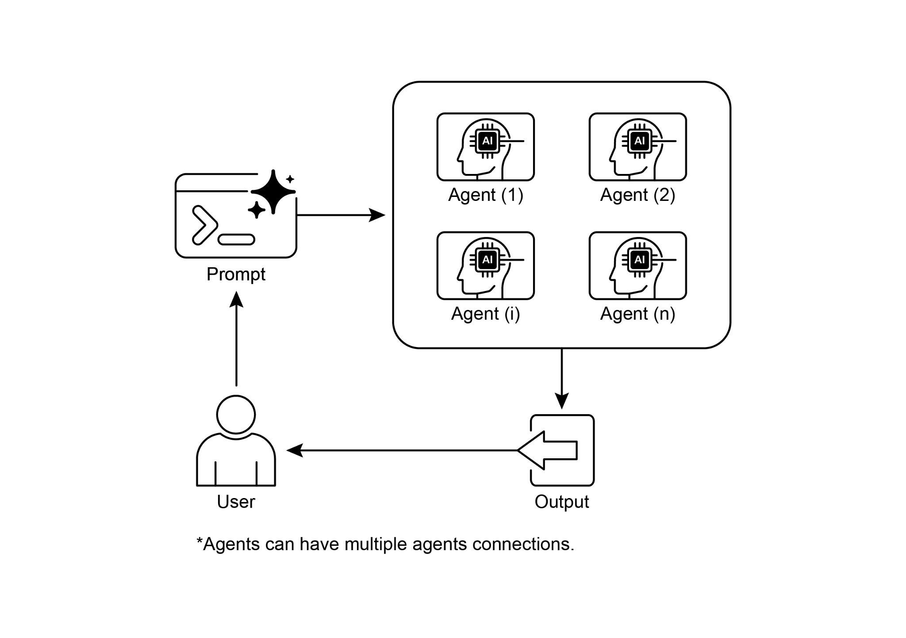

[description: str = \"Executes a predefined task.\" ]

 

[async def \_run_async_impl(self, context: InvocationContext) -\> ][AsyncGenerator\[Event, None\]: ]

[\"\"\"Custom implementation logic for the task.\"\"\" ][relationships. ]

[\# These assertions will pass if checked after initialization. ][assert greeter.parent_agent == coordinator ][assert task_doer.parent_agent == coordinator ]

 

[print(\"Agent hierarchy created successfully.\") ]

 

This code excerpt illustrates the employment of the LoopAgent within the Google ADK

framework to establish iterative workflows. The code defines two agents:

ConditionChecker and ProcessingStep. ConditionChecker is a custom agent that checks a \"status\" value in the session state. If the \"status\" is \"completed\",

ConditionChecker escalates an event to stop the loop. Otherwise, it yields an event to

continue the loop. ProcessingStep is an LlmAgent using the \"gemini-2.0-flash-exp\"

model. Its instruction is to perform a task and set the session \"status\" to \"completed\"

[is_done = (status == \"completed\") ]

 

[if is_done: ]

[\# Escalate to terminate the loop when the condition is ][met. ]

[yield Event(author=self.name, ]

[actions=EventActions(escalate=True)) ]

[else: ]

[\# Yield a simple event to continue the loop. ]

[yield Event(author=self.name, content=\"Condition not met, ][continuing loop.\") ]

 

[\# Correction: The LlmAgent must have a model and clear instructions. ][process_step = LlmAgent( ]

[name=\"ProcessingStep\", ]

[model=\"gemini-2.0-flash-exp\", ]these sub-agents. When the pipeline is run with an initial input, step1 will execute first.

The response from step1 will be saved into the session state under the key \"data\". Subsequently, step2 will execute, utilizing the information that step1 placed into the

state as per its instruction. This structure allows for building workflows where the

output of one agent becomes the input for the next. This is a common pattern in

creating multi-step AI or data processing pipelines.

 

[from google.adk.agents import SequentialAgent, Agent ]

 

[\# This agent\'s output will be saved to session.state\[\"data\"\] ][step1 = Agent(name=\"Step1_Fetch\", output_key=\"data\") ]

 

[\# This agent will use the data from the previous step. ]example shows how to access the collected weather and news data from the

final_state after the agent\'s execution is complete.

 

[from google.adk.agents import Agent, ParallelAgent ]

 

[\# It\'s better to define the fetching logic as tools for the agents ][\# For simplicity in this example, we\'ll embed the logic in the ][agent\'s instruction. ]

[\# In a real-world scenario, you would use tools. ]

 

[\# Define the individual agents that will run in parallel ][weather_fetcher = Agent( ]

[name=\"weather_fetcher\", ]

[model=\"gemini-2.0-flash-exp\", ]function is a simple tool that simulates image creation, returning mock image data.

The image_generator_agent is responsible for using this tool based on a text prompt it receives. The artist_agent\'s role is to first invent a creative image prompt. It then calls

the image_generator_agent through an AgentTool wrapper. The AgentTool acts as a

bridge, allowing one agent to use another agent as a tool. When the artist_agent calls

the image_tool, the AgentTool invokes the image_generator_agent with the artist\'s invented prompt. The image_generator_agent then uses the generate_image function

with that prompt. Finally, the generated image (or mock data) is returned back up

through the agents. This architecture demonstrates a layered agent system where a

higher-level agent orchestrates a lower-level, specialized agent to perform a task.

 

[from google.adk.agents import LlmAgent ]

[from google.adk.tools import agent_tool ][image_generator_agent = LlmAgent( ]

[name=\"ImageGen\", ]

[model=\"gemini-2.0-flash\", ]

[description=\"Generates an image based on a detailed text prompt.\", ]

[instruction=( ]

[\"You are an image generation specialist. Your task is to take ][the user\'s request \" ]

[\"and use the \`generate_image\` tool to create the image. \" ]

[\"The user\'s entire request should be used as the \'prompt\' ][argument for the tool. \" ]

[\"After the tool returns the image bytes, you MUST output the ][image.\" ]

[), ]

[tools=\[generate_image\] ]

[) ]result, tackling sophisticated, multi-domain objectives becomes inefficient and can

lead to incomplete or suboptimal outcomes.

 

**Why:** The Multi-Agent Collaboration pattern offers a standardized solution by creating

a system of multiple, cooperating agents. A complex problem is broken down into

smaller, more manageable sub-problems. Each sub-problem is then assigned to a

specialized agent with the precise tools and capabilities required to solve it. These agents work together through defined communication protocols and interaction

models like sequential handoffs, parallel workstreams, or hierarchical delegation. This

agentic, distributed approach creates a synergistic effect, allowing the group to

achieve outcomes that would be impossible for any single agent.

 

**Rule of thumb:** Use this pattern when a task is too complex for a single agent and can

be decomposed into distinct sub-tasks requiring specialized skills or tools. It is ideal

complex, multifaceted problems across diverse domains. Understanding agent

collaboration naturally leads to an inquiry into their interactions with the external environment.

 

[References ]

 

[1. Multi-Agent Collaboration Mechanisms: A Survey of LLMs, ]

[<https://arxiv.org/abs/2501.06322>]

[2. Multi-Agent System --- The Power of Collaboration, ]

[[https://aravindakumar.medium.com/introducing-multi-agent-frameworks-the-power-of-coll](https://aravindakumar.medium.com/introducing-multi-agent-frameworks-the-power-of-collaboration-e9db31bba1b6)]

[[aboration-e9db31bba1b6](https://aravindakumar.medium.com/introducing-multi-agent-frameworks-the-power-of-collaboration-e9db31bba1b6)]
