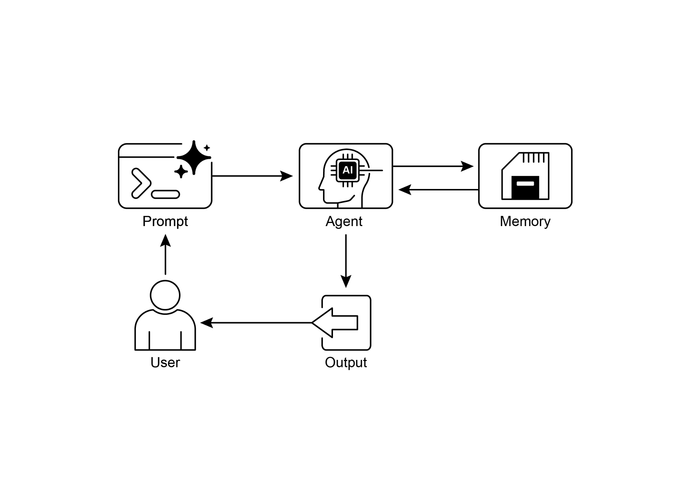

**What**: Agentic systems need to remember information from past interactions to

perform complex tasks and provide coherent experiences. Without a memory

mechanism, agents are stateless, unable to maintain conversational context, learn

[● ]Frameworks like ADK have specific parts like Session (the chat thread), State

(temporary chat data), and MemoryService (the searchable long-term knowledge) to manage memory.

[● ]ADK\'s SessionService handles the whole life of a chat session, including its

history (events) and temporary data (state).

[● ]ADK\'s session.state is a dictionary for temporary chat data. Prefixes (user:, app:,

temp:) tell you where the data belongs and if it sticks around.

[● ]In ADK, you should update state by using EventActions.state_delta or output_key

when adding events, not by changing the state dictionary directly.

[● ]ADK\'s MemoryService is for putting info into long-term storage and letting agents

search it, often using tools.

● LangChain offers practical tools like ConversationBufferMemory to automatically

inject the history of a single conversation into a prompt, enabling an agent to

recall immediate context.

2\. LangGraph Memory,

<https://langchain-ai.github.io/langgraph/concepts/memory/>

3\. Vertex AI Agent Engine Memory Bank,

[https://cloud.google.com/blog/products/ai-machine-learning/vertex-ai-memory](https://cloud.google.com/blog/products/ai-machine-learning/vertex-ai-memory-bank-in-public-preview)

[-bank-in-public-preview](https://cloud.google.com/blog/products/ai-machine-learning/vertex-ai-memory-bank-in-public-preview)
