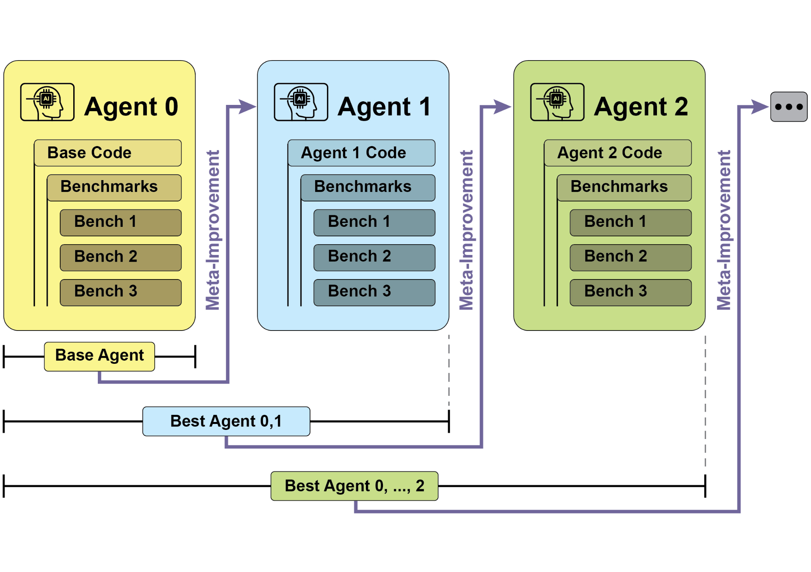
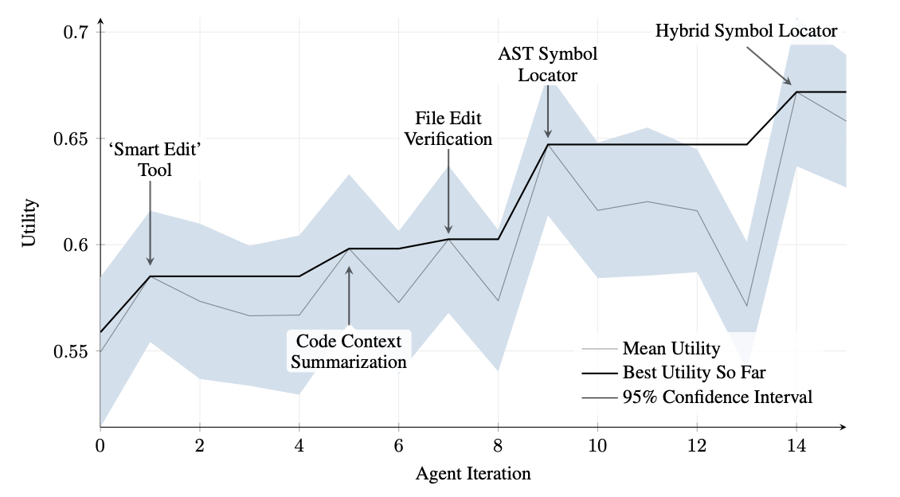
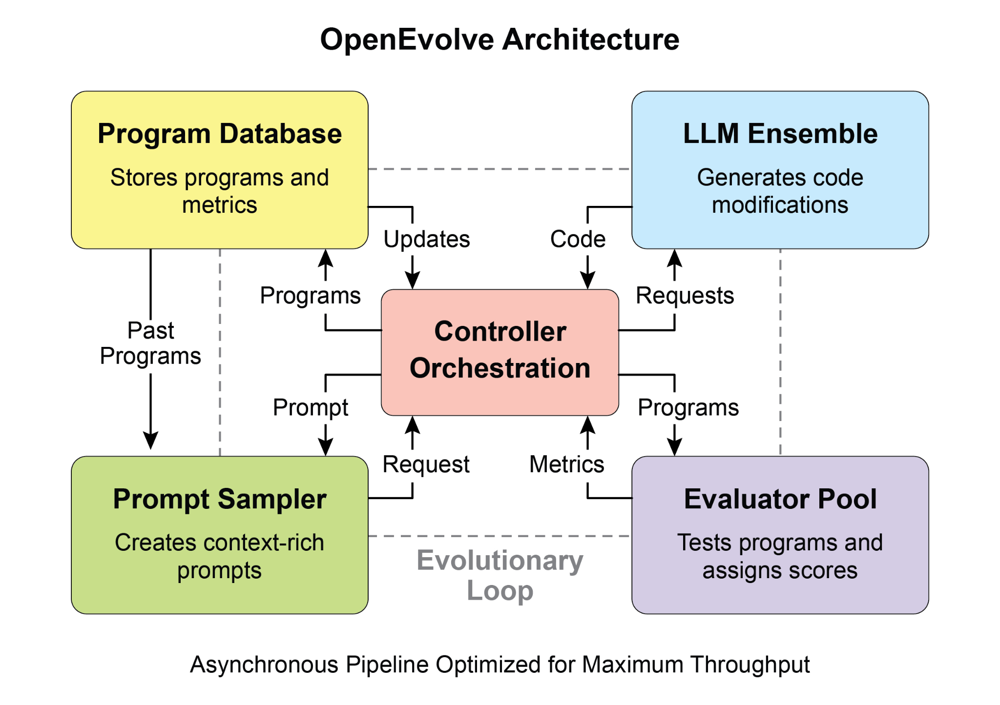
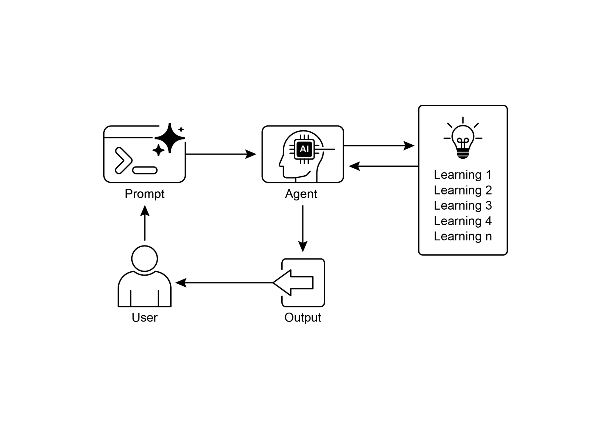

## [Chapter 9: Learning and Adaptation ]

 

Learning and adaptation are pivotal for enhancing the capabilities of artificial

intelligence agents. These processes enable agents to evolve beyond predefined parameters, allowing them to improve autonomously through experience and

environmental interaction. By learning and adapting, agents can effectively manage

novel situations and optimize their performance without constant manual intervention.

This chapter explores the principles and mechanisms underpinning agent learning and adaptation in detail.

 

[The big picture ]

 

Agents learn and adapt by changing their thinking, actions, or knowledge based on **Proximal Policy Optimization (PPO)** is a reinforcement learning algorithm used to

train agents in environments with a continuous range of actions, like controlling a robot\'s joints or a character in a game. Its main goal is to reliably and stably improve

an agent\'s decision-making strategy, known as its policy.

 

The core idea behind PPO is to make small, careful updates to the agent\'s policy. It

avoids drastic changes that could cause performance to collapse. Here\'s how it works:

 

1\. Collect Data: The agent interacts with its environment (e.g., plays a game) using

its current policy and collects a batch of experiences (state, action, reward).

2\. Evaluate a \"Surrogate\" Goal: PPO calculates how a potential policy update

would change the expected reward. However, instead of just maximizing this

reward, it uses a special \"clipped\" objective function.

the reward model. The reward model acts as the \"judge\" in the training

game.

 

This two-step process can be complex and unstable. For instance, the LLM might find

a loophole and learn to \"hack\" the reward model to get high scores for bad

responses.

 

● The DPO Approach (Direct Process): DPO skips the reward model entirely.

Instead of translating human preferences into a reward score and then

optimizing for that score, DPO uses the preference data directly to update the

LLM\'s policy.

● It works by using a mathematical relationship that directly links preference data

to the optimal policy. It essentially teaches the model: \"Increase the probability

of generating responses like the *preferred* one and decrease the probability of

and minimizing financial losses.

● **Recommendation agents** improve content selection precision by employing

user preference learning algorithms, providing highly individualized and

contextually relevant recommendations.

● **Game AI agents** enhance player engagement by dynamically adapting

strategic algorithms, thereby increasing game complexity and challenge.

● **Knowledge Base Learning Agents**: Agents can leverage Retrieval Augmented

Generation (RAG) to maintain a dynamic knowledge base of problem

descriptions and proven solutions (see the Chapter 14). By storing successful

strategies and challenges encountered, the agent can reference this data during decision-making, enabling it to adapt to new situations more effectively

by applying previously successful patterns or avoiding known pitfalls.

 

[Case Study: The Self-Improving Coding Agent ]

reducing processing time and costs. Initially, file changes were recorded as diffs,

showing only modifications and periodically consolidated.

 

**SICA: A Look at the Code:** Delving deeper into SICA\'s implementation reveals several

key design choices that underpin its capabilities. As discussed, the system is built with

a modular architecture, incorporating several sub-agents, such as a coding agent, a

problem-solver agent, and a reasoning agent. These sub-agents are invoked by the main agent, much like tool calls, serving to decompose complex tasks and efficiently

manage context length, especially during those extended meta-improvement

iterations.

 

The project is actively developed and aims to provide a robust framework for those interested in post-training LLMs on tool use and other agentic tasks, with the full code

available for further exploration and contribution at the fostering open-ended learning and authentic creativity in LLM agents, remains a key

area of investigation in current research.

 

[AlphaEvolve and OpenEvolve ]

 

**AlphaEvolve** is an AI agent developed by Google designed to discover and optimize

algorithms. It utilizes a combination of LLMs, specifically Gemini models (Flash and

Pro), automated evaluation systems, and an evolutionary algorithm framework. This

system aims to advance both theoretical mathematics and practical computing applications.

 

AlphaEvolve employs an ensemble of Gemini models. Flash is used for generating a

wide range of initial algorithm proposals, while Pro provides more in-depth analysis for any LLM. Furthermore, it incorporates multi-objective optimization, allows for

flexible prompt engineering, and is capable of distributed evaluation to efficiently handle complex coding challenges.

[\# Initialize the system ]

[evolve = OpenEvolve( ]

[initial_program_path=\"path/to/initial_program.py\", ]

[evaluation_file=\"path/to/evaluator.py\", ]

[config_path=\"path/to/config.yaml\" ]

[) ]

 

[\# Run the evolution ]

[best_program = await evolve.run(iterations=1000) ][print(f\"Best program metrics:\") ]

[for name, value in best_program.metrics.items(): ]

[print(f\" {name}: {value:.4f}\") ]

 

[At a Glance ]

[● ]Building agents that learn often means hooking them up with machine learning

tools and managing how data flows.

[● ]An agent system, equipped with basic coding tools, can autonomously edit itself,

and thereby improve its performance on benchmark tasks

[● ]AlphaEvolve is Google\'s AI agent that leverages LLMs and an evolutionary

framework to autonomously discover and optimize algorithms, significantly enhancing both fundamental research and practical computing applications..

 

[Conclusion ]

 

This chapter examines the crucial roles of learning and adaptation in Artificial
