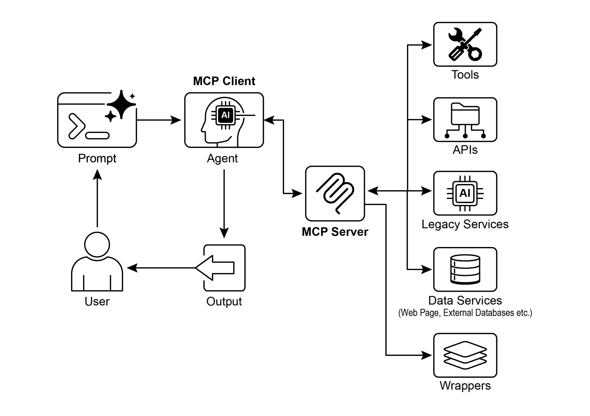

[from google.adk.agents import LlmAgent ]

[from google.adk.tools.mcp_tool.mcp_toolset import MCPToolset, ][StdioServerParameters ]

[TARGET_FOLDER_PATH, ]

[\], ]

[), ]

[\# Optional: You can filter which tools from the MCP server ][are exposed. ]

[\# For example, to only allow reading: ]

[\# tool_filter=\[\'list_directory\', \'read_file\'\] ]

[) ]

[\], ]

[) ]

 

\`npx\` (Node Package Execute), bundled with npm (Node Package Manager) versions

5.2.0 and later, is a utility that enables direct execution of Node.js packages from the npm registry. This eliminates the need for global installation. In essence, \`npx\` serves

UVX, in the context of Python, refers to a command-line tool that utilizes uv to execute commands in a temporary, isolated Python environment. Essentially, it allows you to

 

run Python tools and packages without needing to install them globally or within your

project\'s environment. You can run it via the MCP server.

 

[connection_params = StdioConnectionParams( ][ server_params={ ]

[\"command\": \"uvx\", ]

[\"args\": \[\"mcp-google-sheets@latest\"\], ]

[\"env\": { ]

[\"SERVICE_ACCOUNT_PATH\":SERVICE_ACCOUNT_PATH, ]

[\"DRIVE_FOLDER_ID\": DRIVE_FOLDER_ID ]

[} ]

[ } ]

[Creating an MCP Server with FastMCP ]

 

FastMCP is a high-level Python framework designed to streamline the development of MCP servers. It provides an abstraction layer that simplifies protocol complexities,

allowing developers to focus on core logic.

 

The library enables rapid definition of tools, resources, and prompts using simple Python decorators. A significant advantage is its automatic schema generation, which

intelligently interprets Python function signatures, type hints, and documentation

strings to construct necessary AI model interface specifications. This automation

minimizes manual configuration and reduces human error.

 

Beyond basic tool creation, FastMCP facilitates advanced architectural patterns like

server composition and proxying. This enables modular development of complex,

[name: The name of the person to greet. ]

 

[Returns: ]

[A greeting string. ]

[\"\"\" ]

[return f\"Hello, {name}! Nice to meet you.\" ]

 

[\# Or if you want to run it from the script: ]

[if \_\_name\_\_ == \"\_\_main\_\_\": ]

[mcp_server.run( ]

[transport=\"http\", ]

[host=\"127.0.0.1\", ]

[port=8000 ]

[) ]

 

This Python script defines a single function called greet, which takes a person\'s name

and returns a personalized greeting. The \@tool() decorator above this function ADK agent and use HttpServerParameters to establish a connection with the

operational FastMCP server.

 

[\# ./adk_agent_samples/fastmcp_client_agent/agent.py ][import os ]

[from google.adk.agents import LlmAgent ]

[from google.adk.tools.mcp_tool.mcp_toolset import MCPToolset, ][HttpServerParameters ]

 

[\# Define the FastMCP server\'s address. ]

[\# Make sure your fastmcp_server.py (defined previously) is running on ][this port. ]

[FASTMCP_SERVER_URL = \"http://localhost:8000\" ]

 

[root_agent = LlmAgent( ]

[model=\'gemini-2.0-flash\', \# Or your preferred model ]Creating an \_\_init\_\_.py file within the fastmcp_client_agent directory is necessary. This

ensures the agent is recognized as a discoverable Python package for the ADK.

 

To begin, open a new terminal and run \`python fastmcp_server.py\` to start the

FastMCP server. Next, go to the parent directory of \`fastmcp_client_agent\` (for

example, \`adk_agent_samples\`) in your terminal and execute \`adk web\`. Once the

ADK Web UI loads in your browser, select the \`fastmcp_greeter_agent\` from the agent menu. You can then test it by entering a prompt like \"Greet John Doe.\" The agent will

use the \`greet\` tool on your FastMCP server to create a response.

 

[At a Glance ]

 

**What:** To function as effective agents, LLMs must move beyond simple text generation. They require the ability to interact with the external environment to access **Visual summary**

generative media capabilities (Imagen, Veo, Chirp 3 HD, Lyria).

● MCP enables LLMs and agents to interact with real-world systems, access

dynamic information, and perform actions beyond text generation.

 

[Conclusion ]

 

The Model Context Protocol (MCP) is an open standard that facilitates communication

between Large Language Models (LLMs) and external systems. It employs a client-server architecture, enabling LLMs to access resources, utilize prompts, and

execute actions through standardized tools. MCP allows LLMs to interact with

databases, manage generative media workflows, control IoT devices, and automate

financial services. Practical examples demonstrate setting up agents to communicate with MCP servers, including filesystem servers and servers built with FastMCP,

illustrating its integration with the Agent Development Kit (ADK). MCP is a key
