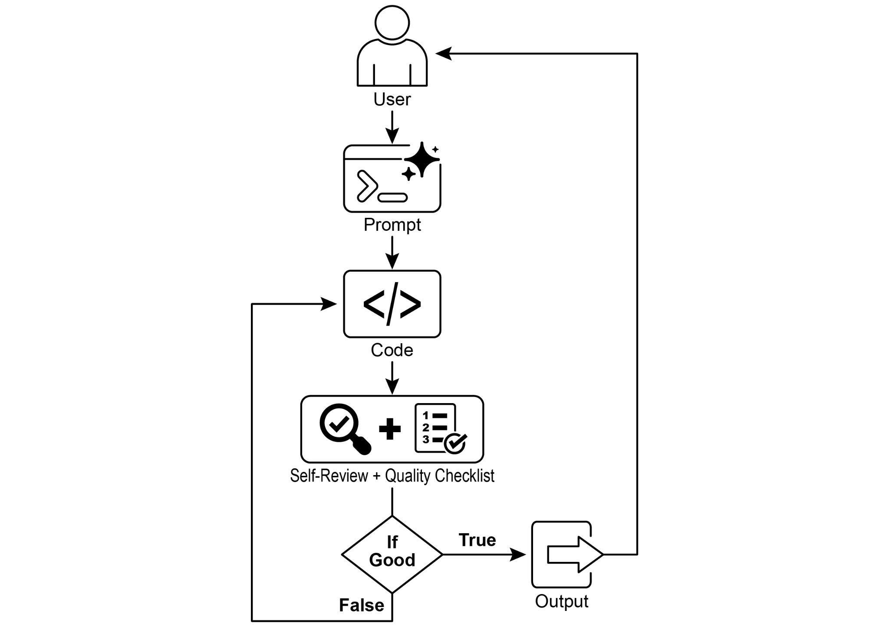

## [Chapter 11: Goal Setting and Monitoring ]

 

For AI agents to be truly effective and purposeful, they need more than just the ability

to process information or use tools; they need a clear sense of direction and a way to know if they\'re actually succeeding. This is where the Goal Setting and Monitoring

pattern comes into play. It\'s about giving agents specific objectives to work towards

and equipping them with the means to track their progress and determine if those

objectives have been met.

 

[Goal Setting and Monitoring Pattern Overview ]

 

Think about planning a trip. You don\'t just spontaneously appear at your destination.

You decide where you want to go (the goal state), figure out where you are starting [● ]**Customer Support Automation:** An agent\'s goal might be to \"resolve customer\'s

billing inquiry.\" It monitors the conversation, checks database entries, and uses tools to adjust billing. Success is monitored by confirming the billing change and

receiving positive customer feedback. If the issue isn\'t resolved, it escalates.

[● ]**Personalized Learning Systems:** A learning agent might have the goal to

\"improve students' understanding of algebra.\" It monitors the student\'s progress on exercises, adapts teaching materials, and tracks performance metrics like

accuracy and completion time, adjusting its approach if the student struggles.

[● ]**Project Management Assistants:** An agent could be tasked with \"ensuring

project milestone X is completed by Y date.\" It monitors task statuses, team communications, and resource availability, flagging delays and suggesting

corrective actions if the goal is at risk.

[● ]**Automated Trading Bots:** A trading agent\'s goal might be to \"maximize portfolio

gains while staying within risk tolerance.\" It continuously monitors market data, its The agent\'s success is measured by its own AI-driven judgment on whether the

generated code successfully meets the initial objectives. The ultimate output is a polished, commented, and ready-to-use Python file that represents the culmination of

this refinement process.

 

**Dependencies**:

 

[pip install langchain_openai openai python-dotenv ][.env file with key in OPENAI_API_KEY ]

 

You can best understand this script by imagining it as an autonomous AI programmer assigned to a project (see Fig. 1). The process begins when you hand the AI a detailed

project brief, which is the specific coding problem it needs to solve. [from dotenv import load_dotenv, find_dotenv ]

 

[\# ][🔐][ Load environment variables ][\_ = load_dotenv(find_dotenv()) ]

[OPENAI_API_KEY = os.getenv(\"OPENAI_API_KEY\") ][if not OPENAI_API_KEY: ]

[raise EnvironmentError(\"][❌][ Please set the OPENAI_API_KEY ][environment variable.\") ]

 

[\# ][✅][ Initialize OpenAI model ]

[print(\"][📡][ Initializing OpenAI LLM (gpt-4o)\...\") ][llm = ChatOpenAI( ]

[model=\"gpt-4o\", \# If you dont have access to got-4o use other ][OpenAI LLMs ]

[temperature=0.3, ]

[openai_api_key=OPENAI_API_KEY, ]

[def get_code_feedback(code: str, goals: list\[str\]) -\> str: ]

 

[print(\"][🔍][ Evaluating code against the goals\...\") ]

[feedback_prompt = f\"\"\" ]

[You are a Python code reviewer. A code snippet is shown below. ][Based on the following goals: ]

 

[{chr(10).join(f\"- {g.strip()}\" for g in goals)} ]

 

[Please critique this code and identify if the goals are met. ][Mention if improvements are needed for clarity, simplicity, ][correctness, edge case handling, or test coverage. ]

 

[Code: ]

[{code} ]

[\"\"\" ]

[lines = lines\[:-1\] ]

[return \"\\n\".join(lines).strip() ]

 

[def add_comment_header(code: str, use_case: str) -\> str: ]

[comment = f\"# This Python program implements the following use ][case:\\n# {use_case.strip()}\\n\" ]

[return comment + \"\\n\" + code ]

 

[def to_snake_case(text: str) -\> str: ]

[text = re.sub(r\"\[\^a-zA-Z0-9 \]\", \"\", text) ]

[return re.sub(r\"\\s+\", \"\_\", text.strip().lower()) ]

 

[def save_code_to_file(code: str, use_case: str) -\> str: ]

[print(\"][💾][ Saving final code to file\...\") ]

 

[summary_prompt = ( ]

[feedback = \"\" ]

 

[for i in range(max_iterations): ]

[print(f\"\\n=== ][🔁][ Iteration {i + 1} of {max_iterations} ===\") ]

[prompt = generate_prompt(use_case, goals, previous_code, ][feedback if isinstance(feedback, str) else feedback.content) ]

 

[print(\"][🚧][ Generating code\...\") ]

[code_response = llm.invoke(prompt) ]

[raw_code = code_response.content.strip() ]

[code = clean_code_block(raw_code) ]

[print(\"\\n][🧾][ Generated Code:\\n\" + \"-\" \* 50 + f\"\\n{code}\\n\" + ][\"-\" \* 50) ]

 

[print(\"\\n][📤][ Submitting code for feedback review\...\") ]

[feedback = get_code_feedback(code, goals) ][current directory and all its nested sub directories, and print the ][total count\" ]

[\# goals_input = ( ]

[\# \"Code simple to understand, Functionally correct, Handles ][comprehensive edge cases, Ignore recommendations for performance, ][Ignore recommendations for test suite use like unittest or pytest\" ]

[\# ) ]

[\# run_code_agent(use_case_input, goals_input) ]

 

[\# Example 3 ]

[\# use_case_input = \"Write code which takes a command line input ][of a word doc or docx file and opens it and counts the number of ][words, and characters in it and prints all\" ]

[\# goals_input = \"Code simple to understand, Functionally ][correct, Handles edge cases\" ]

[\# run_code_agent(use_case_input, goals_input) ]

the code passes this final inspection, the script packages the polished solution,

adding helpful comments and saving it to a clean, new Python file, ready for use.

 

**Caveats and Considerations:** It is important to note that this is an exemplary

illustration and not production-ready code. For real-world applications, several factors

must be taken into account. An LLM may not fully grasp the intended meaning of a

goal and might incorrectly assess its performance as successful. Even if the goal is well understood, the model may hallucinate. When the same LLM is responsible for

both writing the code and judging its quality, it may have a harder time discovering it
