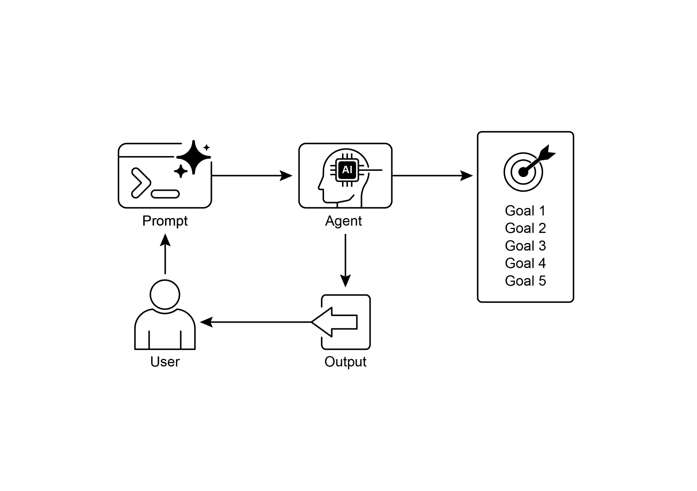

is going in the wrong direction.

 

Ultimately, LLMs do not produce flawless code by magic; you still need to run and test the produced code. Furthermore, the \"monitoring\" in the simple example is basic and

creates a potential risk of the process running forever.

● The Peer Programmer: Helps write and brainstorm code.

● The Code Reviewer: Catches errors and suggests improvements. ● The Documenter: Generates clear and concise documentation.

● The Test Writer: Creates comprehensive unit tests.

● The Prompt Refiner: Optimizes interactions with the AI.

 

In this multi-agent system, the Code Reviewer, acting as a separate entity from the programmer agent, has a prompt similar to the judge in the example, which

significantly improves objective evaluation. This structure naturally leads to better

practices, as the Test Writer agent can fulfill the need to write unit tests for the code

produced by the Peer Programmer.

 

I leave to the interested reader the task of adding these more sophisticated controls

and making the code closer to production-ready.

**Visual summary**:

monitoring accomplished through state management and tool interactions.

 

[Conclusion ]

 

This chapter focused on the crucial paradigm of Goal Setting and Monitoring. I

highlighted how this concept transforms AI agents from merely reactive systems into

proactive, goal-driven entities. The text emphasized the importance of defining clear,

measurable objectives and establishing rigorous monitoring procedures to track progress. Practical applications demonstrated how this paradigm supports reliable

autonomous operation across various domains, including customer service and

robotics. A conceptual coding example illustrates the implementation of these

principles within a structured framework, using agent directives and state management to guide and evaluate an agent\'s achievement of its specified goals.

Ultimately, equipping agents with the ability to formulate and oversee goals is a
