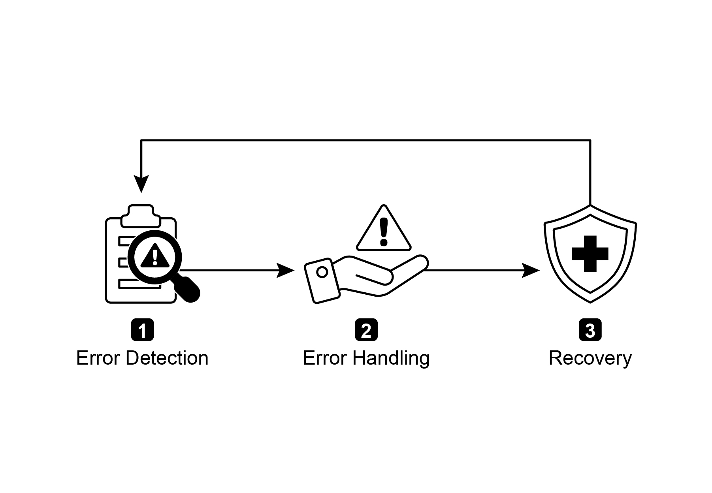
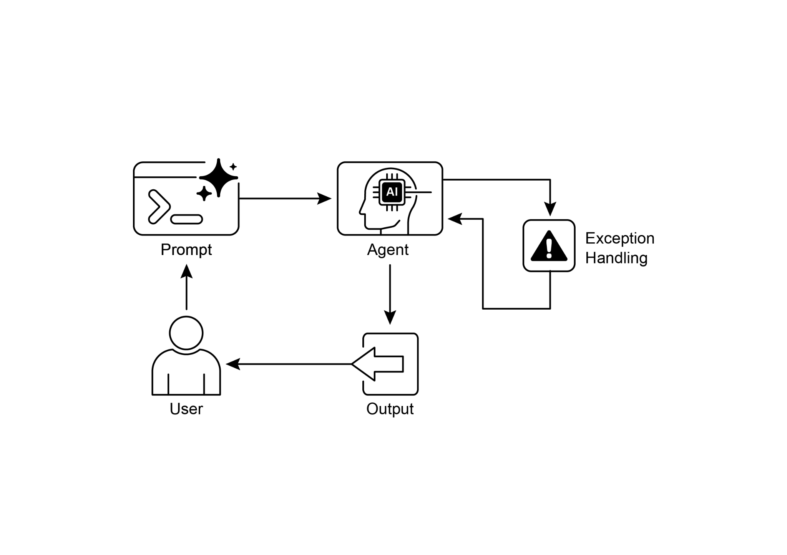

## [Chapter 12: Exception Handling and ]

 

[Recovery ]

 

For AI agents to operate reliably in diverse real-world environments, they must be able

to manage unforeseen situations, errors, and malfunctions. Just as humans adapt to unexpected obstacles, intelligent agents need robust systems to detect problems,

initiate recovery procedures, or at least ensure controlled failure. This essential

requirement forms the basis of the Exception Handling and Recovery pattern.

 

This pattern focuses on developing exceptionally durable and resilient agents that can

maintain uninterrupted functionality and operational integrity despite various

difficulties and anomalies. It emphasizes the importance of both proactive preparation and notifications. Additionally, the pattern emphasizes recovery mechanisms like state

rollback, diagnosis, self-correction, and escalation, to restore agents to stable operation. Implementing this pattern enhances the reliability and robustness of AI

agents, allowing them to function in unpredictable environments. Examples of

practical applications include chatbots managing database errors, trading bots

handling financial errors, and smart home agents addressing device malfunctions. The pattern ensures that agents can continue to operate effectively despite encountering

complexities and failures.

degradation). Finally, alerting human operators or other agents might be crucial for

situations that require human intervention or collaboration (notification).

 

**Recovery:** This stage is about restoring the agent or system to a stable and

operational state after an error. It could involve reversing recent changes or

transactions to undo the effects of the error (state rollback). A thorough investigation

into the cause of the error is vital for preventing recurrence. Adjusting the agent\'s plan, logic, or parameters through a self-correction mechanism or replanning process

may be needed to avoid the same error in the future. In complex or severe cases,

delegating the issue to a human operator or a higher-level system (escalation) might

be the best course of action.

 

Implementation of this robust exception handling and recovery pattern can transform

AI agents from fragile and unreliable systems into robust, dependable components [● ]**Web Scraping Agents:** When a web scraping agent encounters a CAPTCHA, a

changed website structure, or a server error (e.g., 404 Not Found, 503 Service Unavailable), it needs to handle these gracefully. This could involve pausing, using

a proxy, or reporting the specific URL that failed.

[● ]**Robotics and Manufacturing:** A robotic arm performing an assembly task might

fail to pick up a component due to misalignment. It needs to detect this failure (e.g., via sensor feedback), attempt to readjust, retry the pickup, and if persistent,

alert a human operator or switch to a different component.

 

In short, this pattern is fundamental for building agents that are not only intelligent but

also reliable, resilient, and user-friendly in the face of real-world complexities.

 

[Hands-On Code Example (ADK) ]

 

Exception handling and recovery are vital for system robustness and reliability.

[tools=\[get_general_area_info\] ]

[) ]

 

[\# Agent 3: Presents the final result from the state. ][response_agent = Agent( ]

[name=\"response_agent\", ]

[model=\"gemini-2.0-flash-exp\", ]

[instruction=\"\"\" ]

[Review the location information stored in state\[\"location_result\"\]. ][Present this information clearly and concisely to the user. ][If state\[\"location_result\"\] does not exist or is empty, apologize ][that you could not retrieve the location. ]

[\"\"\", ]

[tools=\[\] \# This agent only reasons over the final state. ][) ]hurdles. This unreliability makes it difficult to deploy them in critical or complex

applications where consistent performance is essential.

 

**Why**: The Exception Handling and Recovery pattern provides a standardized solution

for building robust and resilient AI agents. It equips them with the agentic capability to

anticipate, manage, and recover from operational failures. The pattern involves

proactive error detection, such as monitoring tool outputs and API responses, and reactive handling strategies like logging for diagnostics, retrying transient failures, or

using fallback mechanisms. For more severe issues, it defines recovery protocols,

including reverting to a stable state, self-correction by adjusting its plan, or escalating

the problem to a human operator. This systematic approach ensures agents can maintain operational integrity, learn from failures, and function dependably in

unpredictable settings.

[Conclusion ]

 

This chapter explores the Exception Handling and Recovery pattern, which is essential for developing robust and dependable AI agents. This pattern addresses how AI

agents can identify and manage unexpected issues, implement appropriate

responses, and recover to a stable operational state. The chapter discusses various

aspects of this pattern, including the detection of errors, the handling of these errors through mechanisms such as logging, retries, and fallbacks, and the strategies used

to restore the agent or system to proper function. Practical applications of the

Exception Handling and Recovery pattern are illustrated across several domains to

demonstrate its relevance in handling real-world complexities and potential failures. These applications show how equipping AI agents with exception handling capabilities

contributes to their reliability and adaptability in dynamic environments.
