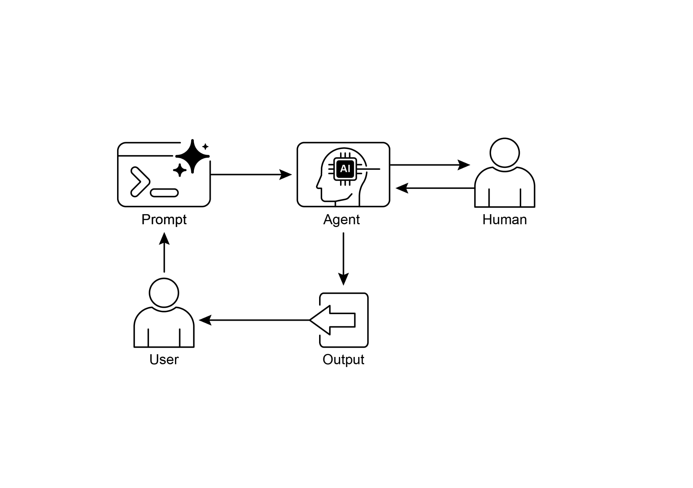

## [Chapter 13: Human-in-the-Loop ]

 

The Human-in-the-Loop (HITL) pattern represents a pivotal strategy in the

development and deployment of Agents. It deliberately interweaves the unique strengths of human cognition---such as judgment, creativity, and nuanced

understanding---with the computational power and efficiency of AI. This strategic

integration is not merely an option but often a necessity, especially as AI systems

become increasingly embedded in critical decision-making processes.

 

The core principle of HITL is to ensure that AI operates within ethical boundaries,

adheres to safety protocols, and achieves its objectives with optimal effectiveness.

These concerns are particularly acute in domains characterized by complexity, ambiguity, or significant risk, where the implications of AI errors or misinterpretations [Human-in-the-Loop Pattern Overview ]

 

The Human-in-the-Loop (HITL) pattern integrates artificial intelligence with human input to enhance Agent capabilities. This approach acknowledges that optimal AI

performance frequently requires a combination of automated processing and human

insight, especially in scenarios with high complexity or ethical considerations. Rather

than replacing human input, HITL aims to augment human abilities by ensuring that critical judgments and decisions are informed by human understanding.

 

HITL encompasses several key aspects: Human Oversight, which involves monitoring

AI agent performance and output (e.g., via log reviews or real-time dashboards) to ensure adherence to guidelines and prevent undesirable outcomes. Intervention and

Correction occurs when an AI agent encounters errors or ambiguous scenarios and

may request human intervention; human operators can rectify errors, supply missing accuracy. Furthermore, the effectiveness of this pattern is heavily dependent on the

expertise of the human operators; for example, while an AI can generate software code, only a skilled developer can accurately identify subtle errors and provide the

correct guidance to fix them. This need for expertise also applies when using HITL to

generate training data, as human annotators may require special training to learn how

to correct an AI in a way that produces high-quality data. Lastly, implementing HITL raises significant privacy concerns, as sensitive information must often be rigorously

anonymized before it can be exposed to a human operator, adding another layer of

process complexity.

 

[Practical Applications & Use Cases ]

 

The Human-in-the-Loop pattern is vital across a wide range of industries and

applications, particularly where accuracy, safety, ethics, or nuanced understanding

audio, providing the ground truth that the AI learns from. This is a continuous

process as models evolve.

[● ]**Generative AI Refinement:** When an LLM generates creative content (e.g.,

marketing copy, design ideas), human editors or designers review and refine the

output, ensuring it meets brand guidelines, resonates with the target audience,

and maintains quality.

**● Autonomous Networks:** AI systems are capable of analyzing alerts and

forecasting network issues and traffic anomalies by leveraging key performance

indicators (KPIs) and identified patterns. Nevertheless, crucial decisions---such as

addressing high-risk alerts---are frequently escalated to human analysts. These analysts conduct further investigation and make the ultimate determination

regarding the approval of network changes.

 

This pattern exemplifies a practical method for AI implementation. It harnesses AI for

volume of immediate actions according to the slower, strategic guidance provided

by the human operator.

 

[Hands-On Code Example ]

 

To demonstrate the Human-in-the-Loop pattern, an ADK agent can identify scenarios

requiring human review and initiate an escalation process . This allows for human

intervention in situations where the agent\'s autonomous decision-making capabilities are limited or when complex judgments are required. This is not an isolated feature;

other popular frameworks have adopted similar capabilities. LangChain, for instance,

also provides tools to implement these types of interactions.

 

[from google.adk.agents import Agent ]

[from google.adk.tools.tool_context import ToolContext ][For complex issues beyond basic troubleshooting: ][1. Use escalate_to_human to transfer to a human specialist. ][Maintain a professional but empathetic tone. Acknowledge the ][frustration technical issues can cause, while providing clear steps ][toward resolution. ]

[\"\"\", ]

[tools=\[troubleshoot_issue, create_ticket, escalate_to_human\] ][) ]

 

[def personalization_callback( ]

[callback_context: CallbackContext, llm_request: LlmRequest ][) -\> Optional\[LlmRequest\]: ]

[\"\"\"Adds personalization information to the LLM request.\"\"\" ]

[\# Get customer info from state ]

[customer_info = callback_context.state.get(\"customer_info\") ]

[if customer_info: ]support workflow. The escalation tool is a core part of the HITL design, ensuring

complex or sensitive cases are passed to human specialists.

 

A key feature of this architecture is its capacity for deep personalization, achieved

through a dedicated callback function. Before contacting the LLM, this function

dynamically retrieves customer-specific data---such as their name, tier, and purchase

history---from the agent\'s state. This context is then injected into the prompt as a system message, enabling the agent to provide highly tailored and informed

responses that reference the user\'s history. By combining a structured workflow with

essential human oversight and dynamic personalization, this code serves as a

practical example of how the ADK facilitates the development of sophisticated and robust AI support solutions.

 

[At Glance ]high-quality, human-labeled data or to refine generative AI outputs to meet specific

quality standards.

 

**Visual summary:**

● The primary drawbacks of Human-in-the-Loop are its inherent lack of scalability,
