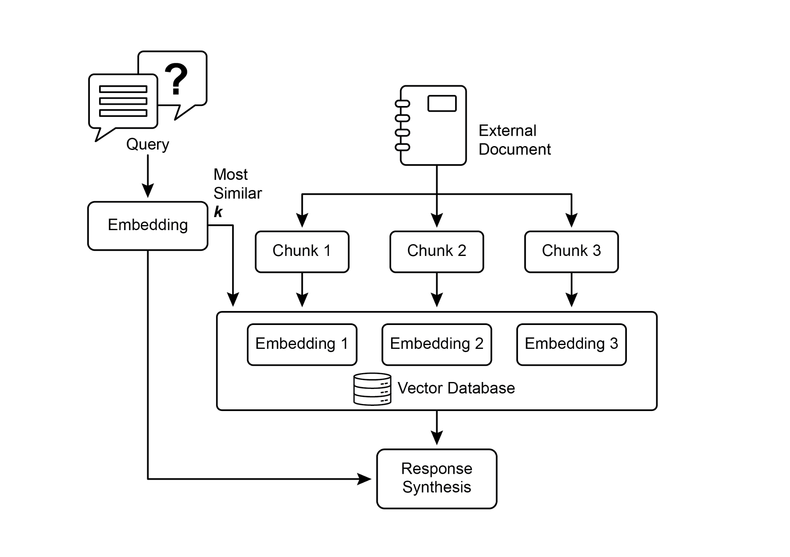
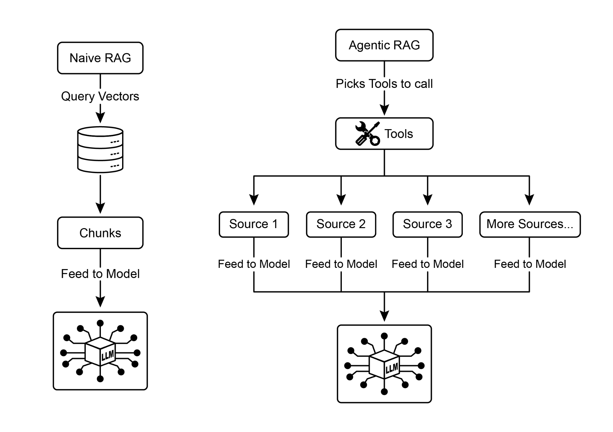

## [Chapter 14: Knowledge Retrieval (RAG) ]

 

LLMs exhibit substantial capabilities in generating human-like text. However, their

knowledge base is typically confined to the data on which they were trained, limiting their access to real-time information, specific company data, or highly specialized

details. Knowledge Retrieval (RAG, or Retrieval Augmented Generation), addresses

this limitation. RAG enables LLMs to access and integrate external, current, and

context-specific information, thereby enhancing the accuracy, relevance, and factual basis of their outputs.

 

For AI agents, this is crucial as it allows them to ground their actions and responses in

real-time, verifiable data beyond their static training. This capability enables them to

perform complex tasks accurately, such as accessing the latest company policies to data. This approach also reduces the risk of \"hallucination\"---the generation of false

information---by grounding responses in verifiable data. Moreover, LLMs can utilize specialized knowledge found in internal company documents or wikis. A vital

advantage of this process is the capability to offer \"citations,\" which pinpoint the

exact source of information, thereby enhancing the trustworthiness and verifiability of

the AI\'s responses..

 

To fully appreciate how RAG functions, it\'s essential to understand a few core

concepts (see Fig.1):

 

**Embeddings**: In the context of LLMs, embeddings are numerical representations of

text, such as words, phrases, or entire documents. These representations are in the form of a vector, which is a list of numbers. The key idea is to capture the semantic

meaning and the relationships between different pieces of text in a mathematical recognize that they refer to the same thing and would consider them to be highly

similar. This is because their embeddings would be very close in the vector space, indicating a small semantic distance. This is the \"smart search\" that allows RAG to find

relevant information even when the user\'s wording doesn\'t exactly match the text in

the knowledge base.

retrieval process faster and the information provided to the LLM more focused and

relevant to the user\'s immediate need. Once documents are chunked, the RAG system must employ a retrieval technique to find the most relevant pieces for a given query.

The primary method is vector search, which uses embeddings and semantic distance

to find chunks that are conceptually similar to the user\'s question. An older, but still

valuable, technique is BM25, a keyword-based algorithm that ranks chunks based on term frequency without understanding semantic meaning. To get the best of both

worlds, hybrid search approaches are often used, combining the keyword precision of

BM25 with the contextual understanding of semantic search. This fusion allows for

more robust and accurate retrieval, capturing both literal matches and conceptual relevance.

 

**Vector databases:** A vector database is a specialized type of database designed to

store and query embeddings efficiently. After documents are chunked and converted highly dependent on the quality of the chunking and retrieval process; if irrelevant

chunks are retrieved, it can introduce noise and confuse the LLM. Furthermore, effectively synthesizing information from potentially contradictory sources remains a

significant hurdle for these systems. Besides that, another challenge is that RAG

requires the entire knowledge base to be pre-processed and stored in specialized

databases, such as vector or graph databases, which is a considerable undertaking. Consequently, this knowledge requires periodic reconciliation to remain up-to-date, a

crucial task when dealing with evolving sources like company wikis. This entire

process can have a noticeable impact on performance, increasing latency, operational

costs, and the number of tokens used in the final prompt.

 

In summary, the Retrieval-Augmented Generation (RAG) pattern represents a

significant leap forward in making AI more knowledgeable and reliable. By seamlessly

integrating an external knowledge retrieval step into the generation process, RAG maintenance cost. In summary, it excels where deep, interconnected insights are more

critical than the speed and simplicity of standard RAG.

 

**Agentic RAG:** An evolution of this pattern, known as **Agentic RAG** (see Fig.2),

introduces a reasoning and decision-making layer to significantly enhance the

reliability of information extraction. Instead of just retrieving and augmenting, an

\"agent\"---a specialized AI component---acts as a critical gatekeeper and refiner of knowledge. Rather than passively accepting the initially retrieved data, this agent

actively interrogates its quality, relevance, and completeness, as illustrated by the

following scenarios.

 

First, an agent excels at reflection and source validation. If a user asks, \"What is our company\'s policy on remote work?\" a standard RAG might pull up a 2020 blog post

alongside the official 2025 policy document. The agent, however, would analyze the

Fig.2: Agentic RAG introduces a reasoning agent that actively evaluates, reconciles,

and refines retrieved information to ensure a more accurate and trustworthy final

response.

 

Second, an agent is adept at reconciling knowledge conflicts. Imagine a financial

analyst asks, \"What was Project Alpha\'s Q1 budget?\" The system retrieves two

documents: an initial proposal stating a €50,000 budget and a finalized financial report listing it as €65,000. An Agentic RAG would identify this contradiction,

prioritize the financial report as the more reliable source, and provide the LLM with

the verified figure, ensuring the final answer is based on the most accurate data.

 

Third, an agent can perform multi-step reasoning to synthesize complex answers. If a user asks, \"How do our product\'s features and pricing compare to Competitor X\'s?\"
