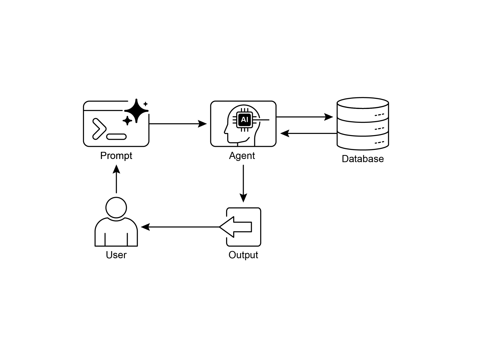
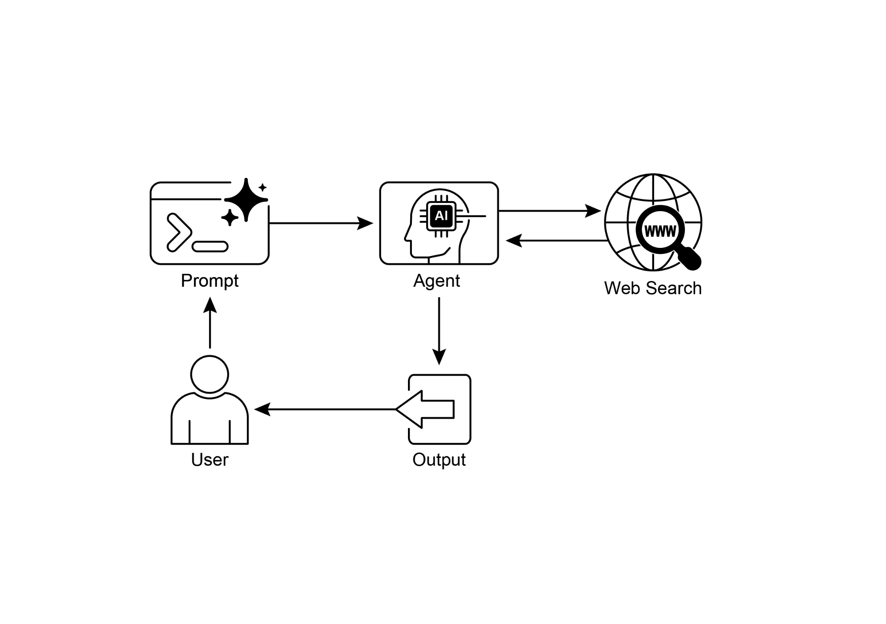

the agent would decompose this into separate sub-queries. It would initiate distinct **In summary:** Agentic RAG represents a sophisticated evolution of the standard

retrieval pattern, transforming it from a passive data pipeline into an active,

problem-solving framework. By embedding a reasoning layer that can evaluate

sources, reconcile conflicts, decompose complex questions, and use external tools, agents dramatically improve the reliability and depth of the generated answers. This

advancement makes the AI more trustworthy and capable, though it comes with

important trade-offs in system complexity, latency, and cost that must be carefully

managed.

 

[Practical Applications & Use Cases ]

 

Knowledge Retrieval (RAG) is changing how Large Language Models (LLMs) are

utilized across various industries, enhancing their ability to provide more accurate and [Hands-On Code Example (ADK) ]

 

To illustrate the Knowledge Retrieval (RAG) pattern, let\'s see three examples.

 

First, is how to use Google Search to do RAG and ground LLMs to search results.

Since RAG involves accessing external information, the Google Search tool is a direct

example of a built-in retrieval mechanism that can augment an LLM\'s knowledge.

 

[from google.adk.tools import google_search ][from google.adk.agents import Agent ]

 

[search_agent = Agent( ]

[name=\"research_assistant\", ]

[model=\"gemini-2.0-flash-exp\", ]

[instruction=\"You help users research topics. When asked, use the ][to retrieve. ]

[\# This controls how many relevant document chunks the RAG service ][will return. ]

[SIMILARITY_TOP_K = 5 ]

 

[\# Define an optional parameter for the vector distance threshold. ][\# This threshold determines the maximum semantic distance allowed for ][retrieved results; ]

[\# results with a distance greater than this value might be filtered ][out. ]

[VECTOR_DISTANCE_THRESHOLD = 0.7 ]

 

[\# Initialize an instance of VertexAiRagMemoryService. ][\# This sets up the connection to your Vertex AI RAG Corpus. ][\# - rag_corpus: Specifies the unique identifier for your RAG Corpus. ][\# - similarity_top_k: Sets the maximum number of similar results to ][import dotenv ]

 

[\# Load environment variables (e.g., OPENAI_API_KEY) ][dotenv.load_dotenv() ]

[\# Set your OpenAI API key (ensure it\'s loaded from .env or set here) ][\# os.environ\[\"OPENAI_API_KEY\"\] = \"YOUR_OPENAI_API_KEY\" ]

 

[\# \-\-- 1. Data Preparation (Preprocessing) \-\-- ][\# Load data ]

[url = ]

[\"https://github.com/langchain-ai/langchain/blob/master/docs/docs/how\_] [to/state_of_the_union.txt\" ]

[res = requests.get(url) ]

 

[with open(\"state_of_the_union.txt\", \"w\") as f: ]

[f.write(res.text) ]

[documents: List\[Document\] ]

[generation: str ]

 

[\# \-\-- 3. Define the Nodes (Functions) \-\-- ]

 

[def retrieve_documents_node(state: RAGGraphState) -\> RAGGraphState: ]

[\"\"\"Retrieves documents based on the user\'s question.\"\"\" ]

[question = state\[\"question\"\] ]

[documents = retriever.invoke(question) ]

[return {\"documents\": documents, \"question\": question, ][\"generation\": \"\"} ]

 

[def generate_response_node(state: RAGGraphState) -\> RAGGraphState: ]

[\"\"\"Generates a response using the LLM based on retrieved ][documents.\"\"\" ]

[question = state\[\"question\"\] ][workflow.add_node(\"generate\", generate_response_node) ]

 

[\# Set the entry point ]

[workflow.set_entry_point(\"retrieve\") ]

 

[\# Add edges (transitions) ]

[workflow.add_edge(\"retrieve\", \"generate\") ][workflow.add_edge(\"generate\", END) ]

 

[\# Compile the graph ]

[app = workflow.compile() ]

 

[\# \-\-- 5. Run the RAG Application \-\-- ]

[if \_\_name\_\_ == \"\_\_main\_\_\": ]

[print(\"\\n\-\-- Running RAG Query \-\--\") ]

[query = \"What did the president say about Justice Breyer\" ]

[At Glance ]

 

**What:** LLMs possess impressive text generation abilities but are fundamentally limited

by their training data. This knowledge is static, meaning it doesn\'t include real-time information or private, domain-specific data. Consequently, their responses can be

outdated, inaccurate, or lack the specific context required for specialized tasks. This

gap restricts their reliability for applications demanding current and factual answers.

 

**Why:** The Retrieval-Augmented Generation (RAG) pattern provides a standardized solution by connecting LLMs to external knowledge sources. When a query is

received, the system first retrieves relevant information snippets from a specified

knowledge base. These snippets are then appended to the original prompt, enriching

it with timely and specific context. This augmented prompt is then sent to the LLM,

● Agentic RAG moves beyond simple information retrieval by using an intelligent

agent to actively reason about, validate, and refine external knowledge, ensuring a more accurate and reliable answer.

● Practical applications span enterprise search, customer support, legal research,

and personalized recommendations.

 

[Conclusion ]

 

In conclusion, Retrieval-Augmented Generation (RAG) addresses the core limitation of

a Large Language Model\'s static knowledge by connecting it to external, up-to-date

data sources. The process works by first retrieving relevant information snippets and

then augmenting the user\'s prompt, enabling the LLM to generate more accurate and contextually aware responses. This is made possible by foundational technologies like

embeddings, semantic search, and vector databases, which find information based on [*3.* ]Retrieval-Augmented Generation with Graphs (GraphRAG),

<https://arxiv.org/abs/2501.00309>

[*4.* ]LangChain and LangGraph: Leonie Monigatti, \"Retrieval-Augmented Generation

(RAG): From Theory to LangChain Implementation,\"

[[*https://medium.com/data-science/retrieval-augmented-generation-rag-fro*](https://medium.com/data-science/retrieval-augmented-generation-rag-from-theory-to-langchain-implementation-4e9bd5f6a4f2)]
