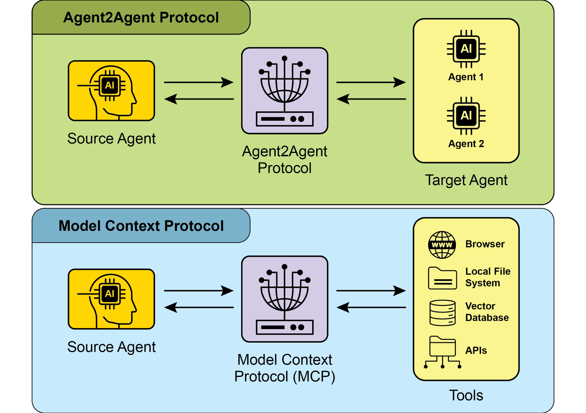

## [Chapter 15: Inter-Agent Communication ]

 

[(A2A)]

 

Individual AI agents often face limitations when tackling complex, multifaceted

problems, even with advanced capabilities. To overcome this, Inter-Agent Communication (A2A) enables diverse AI agents, potentially built with different

frameworks, to collaborate effectively. This collaboration involves seamless

coordination, task delegation, and information exchange.

 

Google\'s A2A protocol is an open standard designed to facilitate this universal communication. This chapter will explore A2A, its practical applications, and its

implementation within the Google ADK.

**Core Actors:** A2A involves three main entities:

 

 

● User: Initiates requests for agent assistance.

● A2A Client (Client Agent): An application or AI agent that acts on the user\'s

behalf to request actions or information.

● A2A Server (Remote Agent): An AI agent or system that provides an HTTP

endpoint to process client requests and return results. The remote agent

operates as an \"opaque\" system, meaning the client does not need to

understand its internal operational details.

 

**Agent Card:** An agent\'s digital identity is defined by its Agent Card, usually a JSON

file. This file contains key information for client interaction and automatic discovery,

including the agent\'s identity, endpoint URL, and version. It also details supported

[\"name\": \"Get Current Weather\", ]

[\"description\": \"Retrieve real-time weather for any location.\", ]

[\"inputModes\": \[ ]

[\"text\" ]

[\], ]

[\"outputModes\": \[ ]

[\"text\" ]

[\], ]

[\"examples\": \[ ]

[\"What\'s the weather in Paris?\", ]

[\"Current conditions in Tokyo\" ]

[\], ]

[\"tags\": \[ ]

[\"weather\", ]

[\"current\", ]

[\"real-time\" ]

/.well-known/agent.json). This approach offers broad, often automated,

accessibility for public or domain-specific use.

● Curated Registries**:** These provide a centralized catalog where Agent Cards are

published and can be queried based on specific criteria. This is well-suited for

enterprise environments needing centralized management and access control.

● Direct Configuration**:** Agent Card information is embedded or privately shared.

This method is appropriate for closely coupled or private systems where dynamic

discovery isn\'t crucial.

 

Regardless of the chosen method, it is important to secure Agent Card endpoints.

This can be achieved through access control, mutual TLS (mTLS), or network restrictions, especially if the card contains sensitive (though non-secret) information.

 

**Communications and Tasks:** In the A2A framework, communication is structured

periodically poll the server by sending new requests to check the status of the

task until it is marked as \"completed\" or \"failed.\"

● Streaming Updates (Server-Sent Events - SSE): Ideal for receiving real-time,

incremental results. This method establishes a persistent, one-way connection

from the server to the client. It allows the remote agent to continuously push

updates, such as status changes or partial results, without the client needing to make multiple requests.

● Push Notifications (Webhooks): Designed for very long-running or

resource-intensive tasks where maintaining a constant connection or frequent

polling is inefficient. The client can register a webhook URL, and the server will send an asynchronous notification (a \"push\") to that URL when the task\'s

status changes significantly (e.g., upon completion).

 

The Agent Card specifies whether an agent supports streaming or push notification The synchronous request uses the sendTask method, where the client asks for and

expects a single, complete answer to its query. In contrast, the streaming request uses the sendTaskSubscribe method to establish a persistent connection, allowing the

agent to send back multiple, incremental updates or partial results over time.

 

[\# Streaming Request Example ]

[{ ]

[ \"jsonrpc\": \"2.0\", ]

[ \"id\": \"2\", ]

[ \"method\": \"sendTaskSubscribe\", ]

[ \"params\": { ]

[\"id\": \"task-002\", ]

[\"sessionId\": \"session-001\", ]

[\"message\": { ]

[\"role\": \"user\", ]Agent Card Declaration: Authentication requirements are explicitly declared in the

Agent Card, a configuration artifact outlining the agent\'s identity, capabilities, and security policies. This centralizes and simplifies authentication management.

 

Credential Handling: Agents typically authenticate using secure credentials like OAuth

2.0 tokens or API keys, passed via HTTP headers. This method prevents credential

exposure in URLs or message bodies, enhancing overall security.

 

[A2A vs. MCP ]

 

A2A is a protocol that complements Anthropic\'s Model Context Protocol (MCP) (see

Fig. 1). While MCP focuses on structuring context for agents and their interaction with

external data and tools, A2A facilitates coordination and communication among agents, enabling task delegation and collaboration. systems. Therefore, a thorough understanding of A2A\'s core components and

operational methods is essential for its effective design, implementation, and application in building collaborative and interoperable AI agent systems..

 

[Practical Applications & Use Cases ]

 

Inter-Agent Communication is indispensable for building sophisticated AI solutions

across diverse domains, enabling modularity, scalability, and enhanced intelligence.

 

[● ]**Multi-Framework Collaboration:** A2A\'s primary use case is enabling

independent AI agents, regardless of their underlying frameworks (e.g., ADK,

LangChain, CrewAI), to communicate and collaborate. This is fundamental for

building complex multi-agent systems where different agents specialize in different aspects of a problem.

[● ]**Automated Workflow Orchestration:** In enterprise settings, A2A can facilitate [ignore\[import-untyped\] ]

 

[async def create_agent(client_id, client_secret) -\> LlmAgent: ]

[\"\"\"Constructs the ADK agent.\"\"\" ]

[toolset = CalendarToolset(client_id=client_id, ][client_secret=client_secret) ]

[return LlmAgent( ]

[model=\'gemini-2.0-flash-001\', ]

[name=\'calendar_agent\', ]
