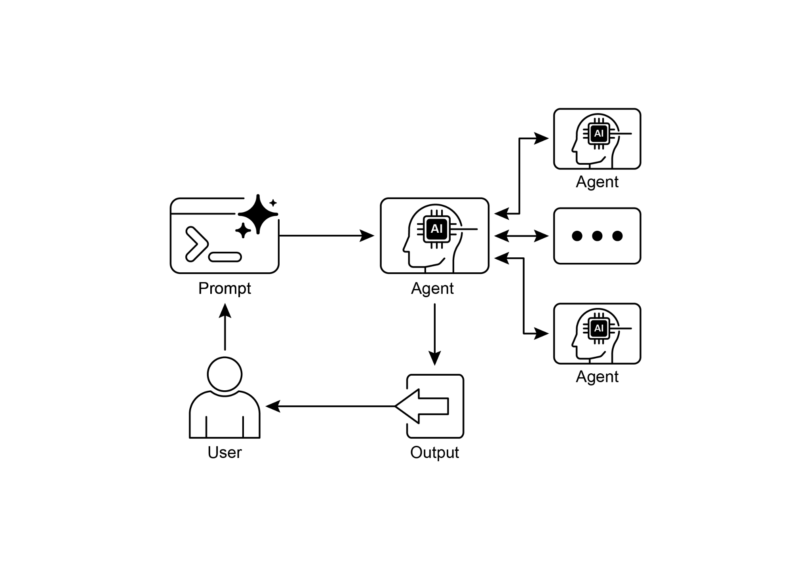

[description=\"An agent that can help manage a user\'s calendar\", ]

[instruction=f\"\"\" ]

[You are an agent that can help manage a user\'s calendar. ]

 

[Users will request information about the state of their calendar ][or to make changes to their calendar. Use the provided tools for ][interacting with the calendar API. ]

[https://github.com/a2aproject/a2a-samples/blob/main/samples/python/agents/birthda](https://github.com/a2aproject/a2a-samples/blob/main/samples/python/agents/birthday_planner_adk/calendar_agent/__main__.py)

[y_planner_adk/calendar_agent/\_\_main\_\_.py](https://github.com/a2aproject/a2a-samples/blob/main/samples/python/agents/birthday_planner_adk/calendar_agent/__main__.py)

 

[def main(host: str, port: int): ]

[\# Verify an API key is set. ]

[\# Not required if using Vertex AI APIs. ]

[if os.getenv(\'GOOGLE_GENAI_USE_VERTEXAI\') != \'TRUE\' and not ][os.getenv( ]

[\'GOOGLE_API_KEY\' ]

[): ]

[raise ValueError( ]

[\'GOOGLE_API_KEY environment variable not set and \' ]

[\'GOOGLE_GENAI_USE_VERTEXAI is not TRUE.\' ]

[) ]

 

[skill = AgentSkill( ]

[agent_executor = ADKAgentExecutor(runner, agent_card) ]

 

[async def handle_auth(request: Request) -\> PlainTextResponse: ]

[await agent_executor.on_auth_callback( ]

[str(request.query_params.get(\'state\')), str(request.url) ]

[) ]

[return PlainTextResponse(\'Authentication successful.\') ]

 

[request_handler = DefaultRequestHandler( ]

[agent_executor=agent_executor, task_store=InMemoryTaskStore() ]

[) ]

 

[a2a_app = A2AStarletteApplication( ]

[agent_card=agent_card, http_handler=request_handler ]

[) ]

[routes = a2a_app.routes() ]like Google Calendar. This practical approach demonstrates the application of A2A in

establishing a multi-agent ecosystem.

 

Further exploration of A2A is recommended through the code demonstration at 

[https://www.trickle.so/blog/how-to-build-google-a2a-project.](https://www.trickle.so/blog/how-to-build-google-a2a-project) Resources available at

this link include sample A2A clients and servers in Python and JavaScript, multi-agent

web applications, command-line interfaces, and example implementations for various agent frameworks.

 

[At a Glance ]

 

**What:** Individual AI agents, especially those built on different frameworks, often

struggle with complex, multi-faceted problems on their own. The primary challenge is the lack of a common language or protocol that allows them to communicate and **Visual summary**

state, which allows agents to request additional information and maintain

context during interactions.

[● ]A2A encourages a modular architecture where specialized agents can operate

independently on different ports, enabling system scalability and distribution.

[● ]Tools such as Trickle AI aid in visualizing and tracking A2A communications,

which helps developers monitor, debug, and optimize multi-agent systems.

● While A2A is a high-level protocol for managing tasks and workflows between

different agents, the Model Context Protocol (MCP) provides a standardized

interface for LLMs to interface with external resources

 

[Conclusions ]

 

The Inter-Agent Communication (A2A) protocol establishes a vital, open standard to

overcome the inherent isolation of individual AI agents. By providing a common

[3. ]Google Agent Development Kit (ADK)  <https://google.github.io/adk-docs/>

[4. ]Getting Started with Agent-to-Agent (A2A) Protocol:

<https://codelabs.developers.google.com/intro-a2a-purchasing-concierge#0>

5\. Google AgentDiscovery - <https://a2a-protocol.org/latest/>

6\. Communication between different AI frameworks such as LangGraph, CrewAI,

and Google ADK [https://www.trickle.so/blog/how-to-build-google-a2a-project](https://www.trickle.so/blog/how-to-build-google-a2a-project#setting-up-your-a2a-development-environment)

7\. Designing Collaborative Multi-Agent Systems with the A2A Protocol

[https://www.oreilly.com/radar/designing-collaborative-multi-agent-systems-with-](https://www.oreilly.com/radar/designing-collaborative-multi-agent-systems-with-the-a2a-protocol/)

[the-a2a-protocol/](https://www.oreilly.com/radar/designing-collaborative-multi-agent-systems-with-the-a2a-protocol/)
