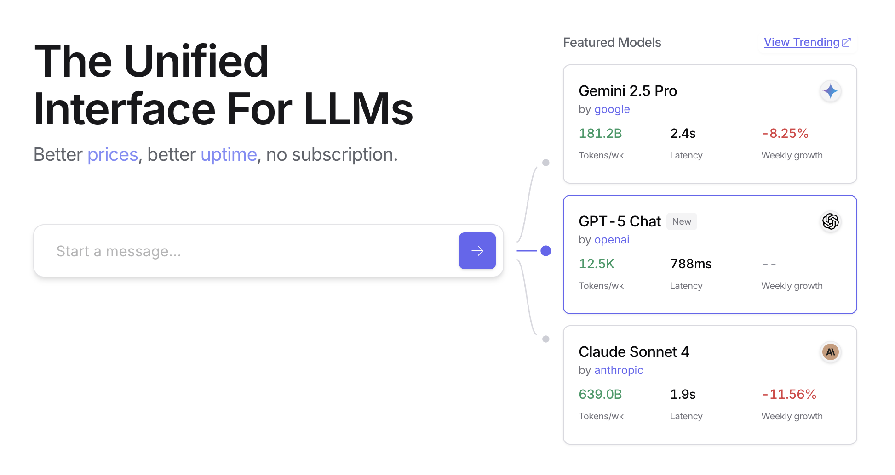
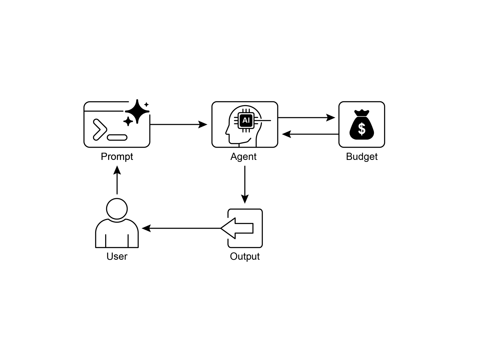

OpenRouter offers a unified interface to hundreds of AI models via a single API

endpoint. It provides automated failover and cost-optimization, with easy integration through your preferred SDK or framework.

Openrouter offers two distinct methodologies for routing and determining the

computational model used to process a given request.

 

● **Automated Model Selection:** This function routes a request to an optimized

model chosen from a curated set of available models. The selection is

predicated on the specific content of the user\'s prompt. The identifier of the model that ultimately processes the request is returned in the response\'s

metadata.

 

[{ ]

[ \"model\": \"openrouter/auto\", ]

[ \... // Other params ]

[} ]

most relevant information from the interaction history, preventing unnecessary

computational overhead.

 

**Proactive Resource Prediction** involves anticipating resource demands by

forecasting future workloads and system requirements, which allows for proactive

allocation and management of resources, ensuring system responsiveness and

preventing bottlenecks.

 

**Cost-Sensitive Exploration** in multi-agent systems extends optimization

considerations to encompass communication costs alongside traditional

computational costs, influencing the strategies employed by agents to collaborate

and share information, aiming to minimize the overall resource expenditure.

 

**Energy-Efficient Deployment** is specifically tailored for environments with stringent

resource constraints, aiming to minimize the energy footprint of intelligent agent Without a dynamic management strategy, systems cannot adapt to varying task

complexities or operate within budgetary and performance constraints.

 

**Why:** The standardized solution is to build an agentic system that intelligently

monitors and allocates resources based on the task at hand. This pattern typically

employs a \"Router Agent\" to first classify the complexity of an incoming request. The

request is then forwarded to the most suitable LLM or tool---a fast, inexpensive model for simple queries, and a more powerful one for complex reasoning. A \"Critique

Agent\" can further refine the process by evaluating the quality of the response,

providing feedback to improve the routing logic over time. This dynamic, multi-agent

approach ensures the system operates efficiently, balancing response quality with cost-effectiveness.

 

**Rule of thumb:** Use this pattern when operating under strict financial budgets for API

[● ]Optimization Through Feedback and Flexibility: Evaluation capabilities for

critique and model integration flexibility contribute to adaptive and self-improving system behavior.

[● ]Additional Resource-Aware Optimizations: Other methods include Adaptive

Tool Use & Selection, Contextual Pruning & Summarization, Proactive Resource

Prediction, Cost-Sensitive Exploration in Multi-Agent Systems, Energy-Efficient Deployment, Parallelization & Distributed Computing Awareness, Learned

Resource Allocation Policies, Graceful Degradation and Fallback Mechanisms,

and Prioritization of Critical Tasks.

 

[Conclusions ]

 

Resource-aware optimization is essential for the development of intelligent agents, enabling efficient operation within real-world constraints. By managing computational,

[1 ]

 
