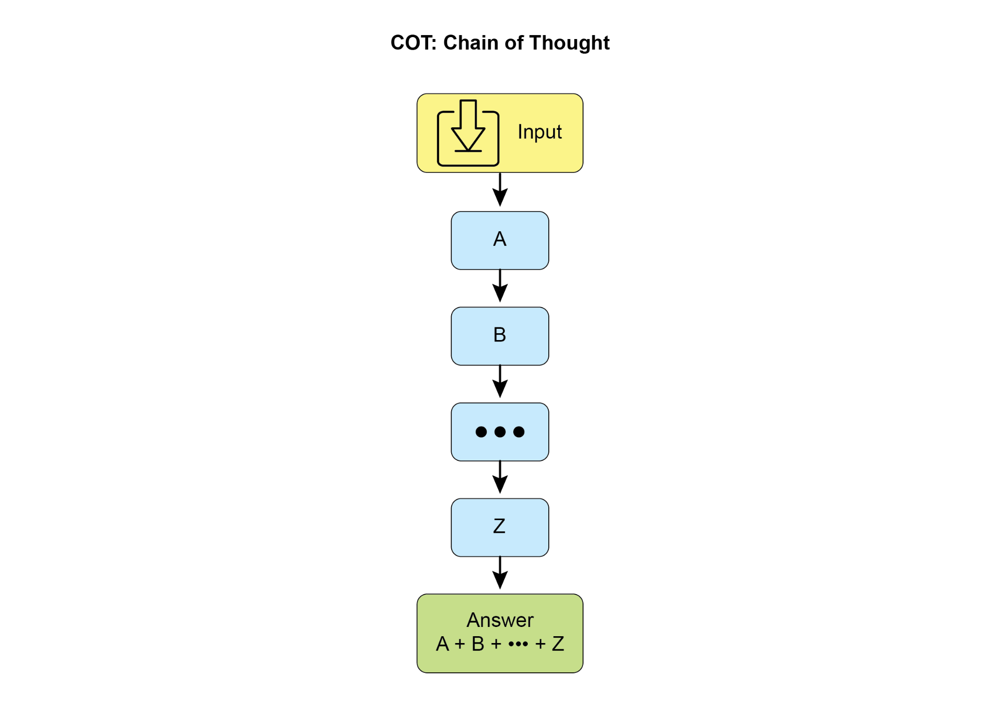
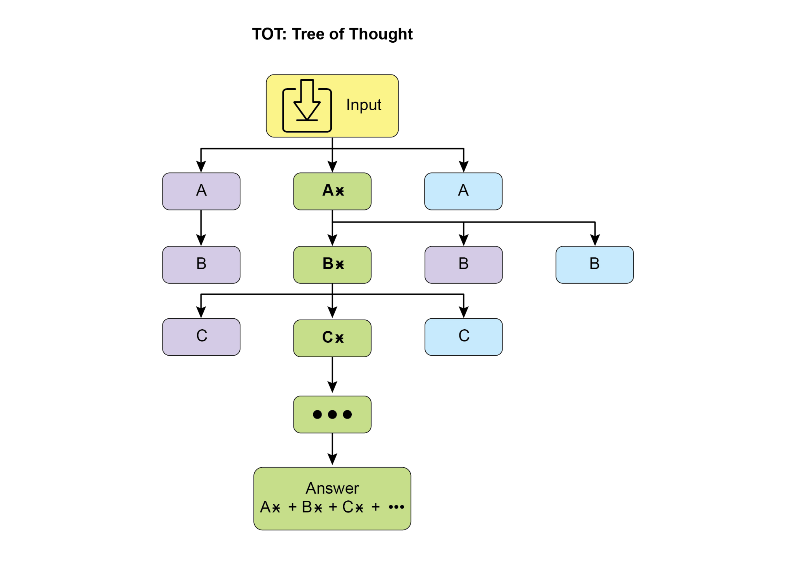

## [Chapter 17: Reasoning Techniques ]

 

This chapter delves into advanced reasoning methodologies for intelligent agents,

focusing on multi-step logical inferences and problem-solving. These techniques go

beyond simple sequential operations, making the agent\'s internal reasoning explicit.

This allows agents to break down problems, consider intermediate steps, and reach more robust and accurate conclusions. A core principle among these advanced

methods is the allocation of increased computational resources during inference. This

means granting the agent, or the underlying LLM, more processing time or steps to

process a query and generate a response. Rather than a quick, single pass, the agent can engage in iterative refinement, explore multiple solution paths, or utilize external

tools. This extended processing time during inference often significantly enhances

accuracy, coherence, and robustness, especially for complex problems requiring

[2 ]

 

(ReAct). Increased inference time allows for a more comprehensive differential

diagnosis.

● **Legal Analysis:** Supporting the analysis of legal documents and precedents to

formulate arguments or provide guidance, detailing the logical steps taken, and

ensuring logical consistency through self-correction. Increased inference time

allows for more in-depth legal research and argument construction.

 

[Reasoning techniques ]

 

To start, let\'s delve into the core reasoning techniques used to enhance the

problem-solving abilities of AI models..

 

**Chain-of-Thought (CoT)** prompting significantly enhances LLMs complex reasoning

abilities by mimicking a step-by-step thought process (see Fig. 1). Instead of providing

[3 ]

[4 ]

 

[1. \*\*Analyze the Query:\*\* Understand the core subject and specific ][requirements of the user\'s question. Identify key entities, keywords, ][and the type of information being sought. ][2. \*\*Formulate Search Queries (for Knowledge Base):\*\* Based on your ][analysis, generate a list of precise search queries that you would ][use to retrieve relevant information from a knowledge base or ][external tools. ]

[3. \*\*Simulate Information Retrieval (Self-Correction/Reasoning):\*\* ][For each search query, mentally consider what kind of information you ][expect to find. If you were to retrieve the content, what would be ][the most relevant snippets? Think about potential ambiguities or ][missing pieces. ]

[4. \*\*Synthesize Information:\*\* Based on the simulated retrieval and ][your understanding of the user\'s original query, synthesize the ][gathered information into a coherent and complete answer. Ensure all ][aspects of the query are addressed. ]

[5 ]

 

[uses quantum mechanics. ]

[- From \"applications\": Expect drug discovery, material science, ][cryptography, optimization. ]

 

[\*\*Thought 4 (Synthesize Information):\*\* ]

[Classical computers use bits (0 or 1), processing information ][sequentially. Quantum computers use qubits, which can be 0, 1, or ][both simultaneously (superposition), and can be entangled, allowing ][for vastly different computational approaches. This enables them to ][solve certain problems (like factoring large numbers or simulating ][complex molecules) far more efficiently than classical computers. A ][potential application is in drug discovery, where quantum computers ][could simulate molecular interactions with unprecedented accuracy, ][accelerating the development of new medicines. ]

 

[\*\*Thought 5 (Review and Refine):\*\* ]

[6 ]

 

finalizing an answer. This iterative process enhances the model\'s ability to handle

challenging tasks that require strategic planning and decision-making.

[7 ]

 

defined five-step analytical and revision workflow. Following this, a subpar \"Initial

Draft\" of a social media post is presented. The \"Self-Correction Agent\'s Thought Process\" forms the core of the demonstration. Here, the Agent critically evaluates the

draft according to its instructions, pinpointing weaknesses such as low engagement

and a vague call to action. It then suggests concrete enhancements, including the use

of more impactful verbs and emojis. The process concludes with the \"Final Revised Content,\" a polished and notably improved version that integrates the self-identified

adjustments.

 

[You are a highly critical and detail-oriented Self-Correction Agent. ][Your task is to review a previously generated piece of content ][against its original requirements and identify areas for improvement. ][Your goal is to refine the content to be more accurate, ][comprehensive, engaging, and aligned with the prompt. ]

[8 ]

 

[line: \'GreenTech Gadgets\'.\" ]

 

[\*\*Initial Draft (Content to be corrected):\*\* ]

 

[\"We have new products. They are green and techy. Buy GreenTech ][Gadgets now!\" ]

 

[\*\*Self-Correction Agent\'s Thought Process (Internal CoT Output - ][encouraged by the prompt):\*\* ]

 

[\*\*Thought 1 (Understand Original Requirements):\*\* ][- Short, engaging social media post. ]

[- Max 150 characters. ]

[- Announce \"GreenTech Gadgets\" - a new eco-friendly product line. ]

 

[\*\*Thought 2 (Analyze Current Content):\*\* ]

[9 ]

 

[🌱][ Discover GreenTech Gadgets! Our new eco-friendly line blends ][innovation with sustainability. Go green, go smart! Shop now! ][#EcoFriendly #GreenTech ]

 

Fundamentally, this technique integrates a quality control measure directly into the

Agent\'s content generation, yielding more refined, precise, and superior results that

more effectively meet intricate user demands.

 

**Program-Aided Language Models (PALMs)** integrate LLMs with symbolic reasoning

capabilities. This integration allows the LLM to generate and execute code, such as

Python, as part of its problem-solving process. PALMs offload complex calculations,

logical operations, and data manipulation to a deterministic programming environment. This approach utilizes the strengths of traditional programming for tasks

[10 ]

 

[\"\"\", ]

[code_executor=\[BuiltInCodeExecutor\], ]

[) ]

[root_agent = Agent( ]

[name=\"RootAgent\", ]
