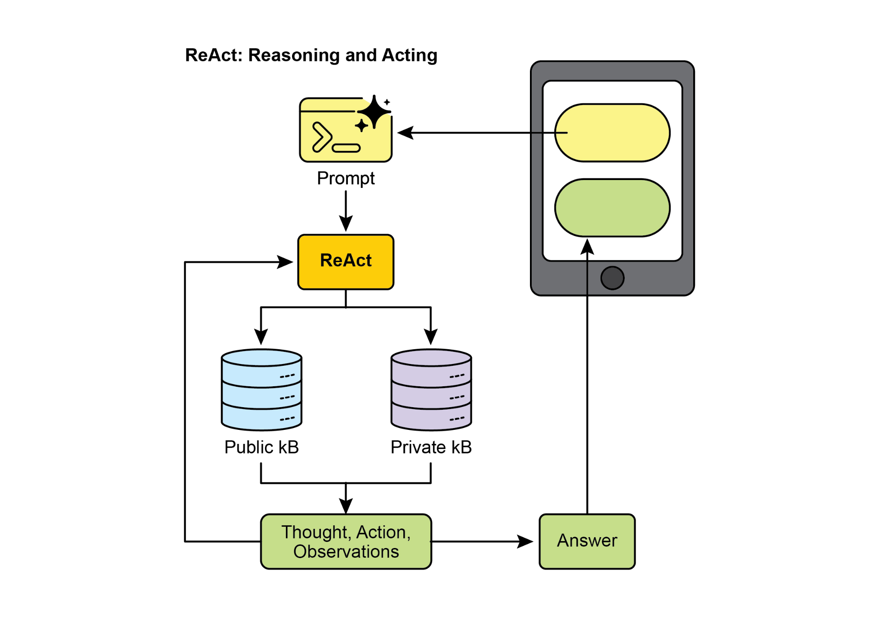
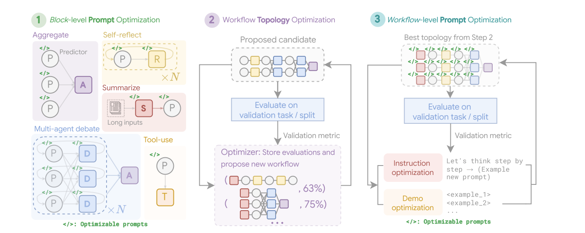
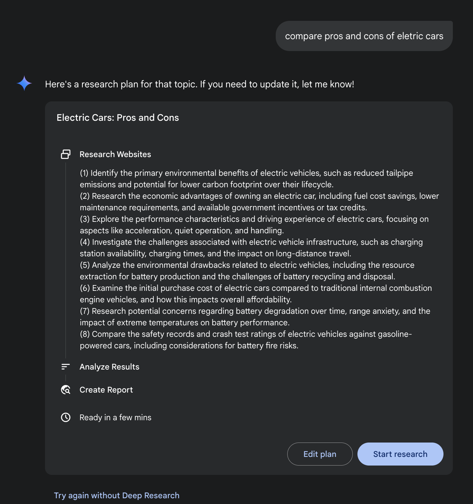

[model=\"gemini-2.0-flash\", ]

[description=\"Root Agent\", ]

[tools=\[agent_tool.AgentTool(agent=search_agent), ][agent_tool.AgentTool(agent=coding_agent)\], ][) ]

 

**Reinforcement Learning with Verifiable Rewards (RLVR):** While effective, the

standard Chain-of-Thought (CoT) prompting used by many LLMs is a somewhat basic approach to reasoning. It generates a single, predetermined line of thought without

[11 ]

[12 ]

 

the overall quality of the final answer by leveraging collective intelligence. Functioning

as an AI version of peer review, this method creates a transparent and trustworthy record of the reasoning process. Ultimately, it represents a shift from a solitary Agent

providing an answer to a collaborative team of Agents working together to find a more

robust and validated solution.

 

**GoD** (Graph of Debates) is an advanced Agentic framework that reimagines discussion as a dynamic, non-linear network rather than a simple chain. In this model,

arguments are individual nodes connected by edges that signify relationships like

\'supports\' or \'refutes,\' reflecting the multi-threaded nature of real debate. This

structure allows new lines of inquiry to dynamically branch off, evolve independently, and even merge over time. A conclusion is reached not at the end of a sequence, but

by identifying the most robust and well-supported cluster of arguments within the

entire graph. In this context, \"well-supported\" refers to knowledge that is firmly

[13 ]

 

configured ones. For example, when optimizing for the HotpotQA dataset, the prompt

for a \"Debator\" agent is creatively framed to instruct it to act as an \"expert fact-checker for a major publication\". Its optimized task is to meticulously review

proposed answers from other agents, cross-reference them with provided context

passages, and identify any inconsistencies or unsupported claims. This specialized

role-playing prompt, discovered during block-level optimization, aims to make the debator agent highly effective at synthesizing information before it\'s even placed into

a larger workflow.

 

[**2. Workflow Topology Optimization:** ]Following local optimization, MASS optimizes the

workflow topology by selecting and arranging different agent interactions from a customizable design space. To make this search efficient, MASS employs an

influence-weighted method. This method calculates the \"incremental influence\" of

each topology by measuring its performance gain relative to a baseline agent and

[14 ]

 

building blocks (Aggregate, Reflect, Debate, Summarize, and Tool-use). The first

stage, Block-level Prompt Optimization, independently optimizes prompts for each agent module. Stage two, Workflow Topology Optimization, samples valid system

configurations from an influence-weighted design space, integrating the optimized

prompts. The final stage, Workflow-level Prompt Optimization, involves a second

round of prompt optimization for the entire multi-agent system after the optimal workflow from Stage two has been identified.

 

[**3. Workflow-Level Prompt Optimization:** ]The final stage involves a global optimization of the entire system\'s prompts. After identifying the best-performing topology, the

prompts are fine-tuned as a single, integrated entity to ensure they are tailored for orchestration and that agent interdependencies are optimized. As an example, after

finding the best topology for the DROP dataset, the final optimization stage refines

the \"Predictor\" agent\'s prompt. The final, optimized prompt is highly detailed,

[15 ]

 

topic by breaking it down into sub-questions, using Web search as a tool, and

synthesizing its findings.

 

**Deep Research.** The term \"Deep Research\" describes a category of AI Agentic tools

designed to act as tireless, methodical research assistants. Major platforms in this

space include Perplexity AI, Google\'s Gemini research capabilities, and OpenAI\'s

advanced functions within ChatGPT (see Fig.5).

[16 ]

 

A fundamental shift introduced by these tools is the change in the search process

itself. A standard search provides immediate links, leaving the work of synthesis to

you. Deep Research operates on a different model. Here, you task an AI with a

complex query and grant it a \"time budget\"---usually a few minutes. In return for this patience, you receive a detailed report.

 

During this time, the AI works on your behalf in an agentic way. It autonomously

performs a series of sophisticated steps that would be incredibly time-consuming for

a person:

 

1\. Initial Exploration: It runs multiple, targeted searches based on your initial

prompt.

[17 ]

 

GPU, but rather employing more sophisticated or resource-intensive inference

strategies. A prime example of such a strategy is instructing the model to generate multiple potential answers---perhaps through techniques like diverse beam search or

self-consistency methods---and then employing a selection mechanism to identify the

most optimal output. This iterative refinement or multiple-candidate generation

process demands more computational cycles but can significantly elevate the quality of the final response.

 

This principle offers a crucial framework for informed and economically sound

decision-making in the deployment of Agents systems. It challenges the intuitive

notion that a larger model will always yield better performance. The law posits that a smaller model, when granted a more substantial \"thinking budget\" during inference,

can occasionally surpass the performance of a much larger model that relies on a

simpler, less computationally intensive generation process. The \"thinking budget\" here

[18 ]

 

[Hands-On Code Example ]

 

The DeepSearch code, open-sourced by Google, is available through the

gemini-fullstack-langgraph-quickstart repository (Fig. 6). This repository provides a

template for developers to construct full-stack AI agents using Gemini 2.5 and the LangGraph orchestration framework. This open-source stack facilitates
