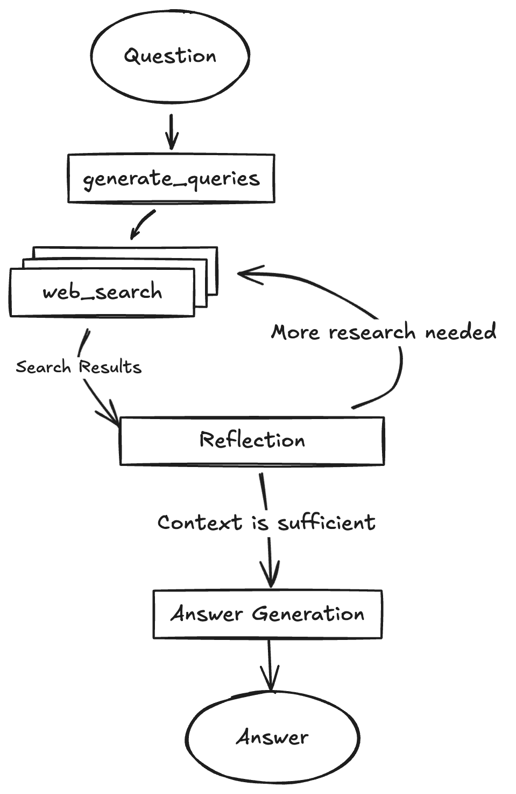
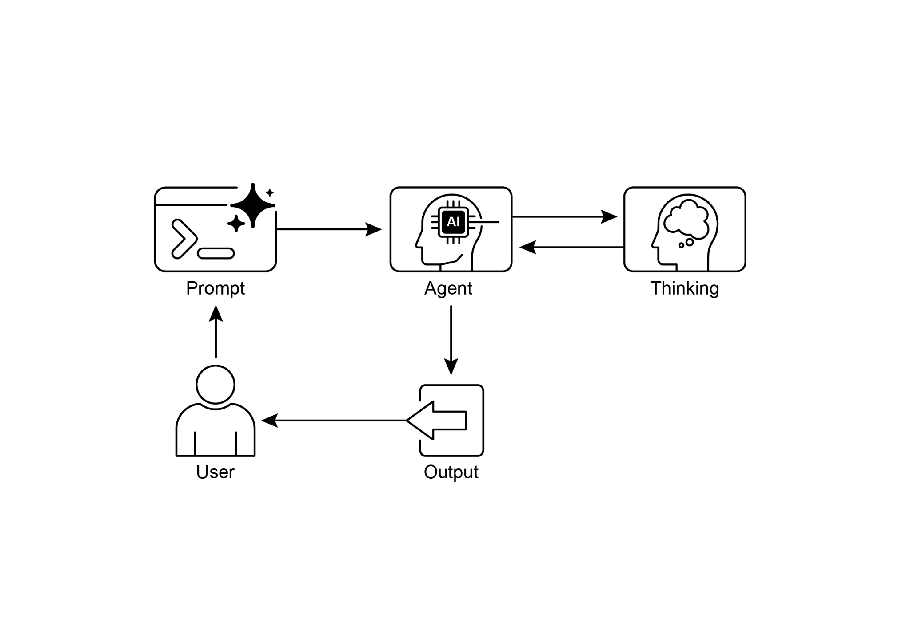

experimentation with agent-based architectures and can be integrated with local

LLLMs such as Gemma. It utilizes Docker and modular project scaffolding for rapid

prototyping. It should be noted that this release serves as a well-structured

[19 ]

 

LangGraph agent dynamically generates search queries using Google Gemini models

and integrates web research via the Google Search API. The system employs reflective reasoning to identify knowledge gaps, refine searches iteratively, and

synthesize answers with citations. The frontend and backend support hot-reloading.

The project\'s structure includes separate frontend/ and backend/ directories.

Requirements for setup include Node.js, npm, Python 3.8+, and a Google Gemini API key. After configuring the API key in the backend\'s .env file, dependencies for both the

backend (using pip install .) and frontend (npm install) can be installed. Development

servers can be run concurrently with make dev or individually. The backend agent,

defined in backend/src/agent/graph.py, generates initial search queries, conducts web research, performs knowledge gap analysis, refines queries iteratively, and

synthesizes a cited answer using a Gemini model. Production deployment involves the

backend server delivering a static frontend build and requires Redis for streaming

real-time output and a Postgres database for managing data. A Docker image can be

[20 ]

 

[\# Finalize the answer ]

[builder.add_edge(\"finalize_answer\", END) ]

 

[graph = builder.compile(name=\"pro-search-agent\") ]

 

Fig.4: Example of DeepSearch with LangGraph (code from backend/src/agent/graph.py)

 

[So, what do agents think? ]

 

In summary, an agent\'s thinking process is a structured approach that combines

reasoning and acting to solve problems. This method allows an agent to explicitly plan its steps, monitor its progress, and interact with external tools to gather information.

 

At its core, the agent\'s \"thinking\" is facilitated by a powerful LLM. This LLM generates

[21 ]

 

reasoning. In contrast, for decision-making tasks that require many actions, such as

navigating a simulated environment, thoughts may be used more sparingly, allowing the agent to decide when thinking is necessary

 

[At a Glance ]

 

**What**: Complex problem-solving often requires more than a single, direct answer,

posing a significant challenge for AI. The core problem is enabling AI agents to tackle

multi-step tasks that demand logical inference, decomposition, and strategic planning. Without a structured approach, agents may fail to handle intricacies, leading

to inaccurate or incomplete conclusions. These advanced reasoning methodologies

aim to make an agent\'s internal \"thought\" process explicit, allowing it to systematically

work through challenges.

[22 ]

[23 ]

 

● Tree-of-Thought and Self-Correction give agents the crucial ability to

deliberate, allowing them to evaluate multiple strategies, backtrack from errors, and improve their own plans before execution.

● Collaborative frameworks like Chain of Debates (CoD) signal the shift from

solitary agents to multi-agent systems, where teams of agents can reason

together to tackle more complex problems and reduce individual biases.

● Applications like Deep Research demonstrate how these techniques culminate

in agents that can execute complex, long-running tasks, such as in-depth

investigation, completely autonomously on a user\'s behalf.

● To build effective teams of agents, frameworks like MASS automate the

optimization of how individual agents are instructed and how they interact,

ensuring the entire multi-agent system performs optimally.

● By integrating these reasoning techniques, we build agents that are not just

automated but truly autonomous, capable of being trusted to plan, act, and

[24 ]

 

manage and solve intricate problems. Ultimately, by combining explicit reasoning with

the power to act, these methodologies are completing the transformation of AI into truly agentic problem-solvers.

 

[References ]

 

Relevant research includes:

 

[1. ]\"Chain-of-Thought Prompting Elicits Reasoning in Large Language Models\" by

Wei et al. (2022)

[2. ]\"Tree of Thoughts: Deliberate Problem Solving with Large Language Models\" by

Yao et al. (2023)

[3. ]\"Program-Aided Language Models\" by Gao et al. (2023) [4. ]\"ReAct: Synergizing Reasoning and Acting in Language Models\" by Yao et al.

\(2023\)
