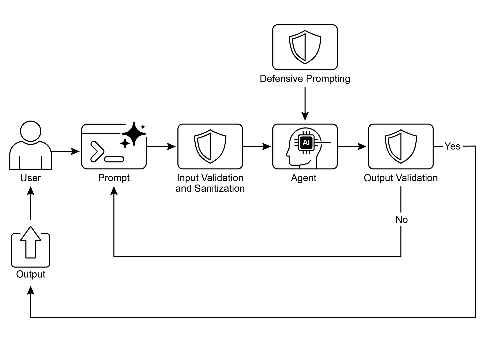

govern traditional software engineering. We must remember that even deterministic

code is prone to bugs and unpredictable emergent behavior, which is why principles

like fault tolerance, state management, and robust testing have always been paramount. Instead of viewing agents as something entirely new, we should see them

as complex systems that demand these proven engineering disciplines more than

ever.

 

The checkpoint and rollback pattern is a perfect example of this. Given that autonomous agents manage complex states and can head in unintended directions,

● The Principle of Least Privilege: Security is paramount. An agent should be

granted the absolute minimum set of permissions required to perform its task. An agent designed to summarize public news articles should only have access

to a news API, not the ability to read private files or interact with other company

systems. This drastically limits the \"blast radius\" of potential errors or malicious

exploits.

 

By integrating these core principles---fault tolerance, modular design, deep

observability, and strict security---we move from simply creating a functional agent to

engineering a resilient, production-grade system. This ensures that the agent\'s

operations are not only effective but also robust, auditable, and trustworthy, meeting the high standards required of any well-engineered software.

 

[At a Glance ]

**Visual summary**

● The most effective way to build reliable, production-grade Agents is to treat them

as complex software, applying the same proven engineering best practices---like fault tolerance, state management, and robust testing---that have governed

traditional systems for decades.

 

[Conclusion ]

 

Implementing effective guardrails represents a core commitment to responsible AI development, extending beyond mere technical execution. Strategic application of

these safety patterns enables developers to construct intelligent agents that are

robust and efficient, while prioritizing trustworthiness and beneficial outcomes.

Employing a layered defense mechanism, which integrates diverse techniques ranging from input validation to human oversight, yields a resilient system against unintended

or harmful outputs. Ongoing evaluation and refinement of these guardrails are
