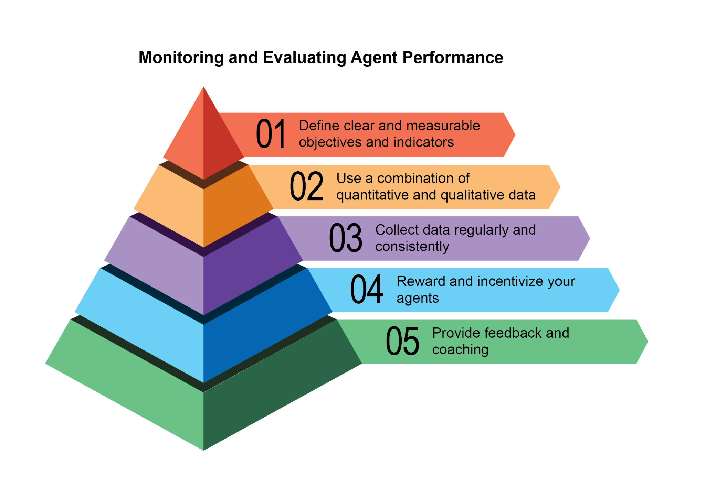

## [Chapter 19: Evaluation and Monitoring ]

 

This chapter examines methodologies that allow intelligent agents to systematically

assess their performance, monitor progress toward goals, and detect operational

anomalies. While Chapter 11 outlines goal setting and monitoring, and Chapter 17

addresses Reasoning mechanisms, this chapter focuses on the continuous, often external, measurement of an agent\'s effectiveness, efficiency, and compliance with

requirements. This includes defining metrics, establishing feedback loops, and

implementing reporting systems to ensure agent performance aligns with

expectations in operational environments (see Fig.1)

[● ]**Performance Tracking in Live Systems:** Continuously monitoring the accuracy,

latency, and resource consumption of an agent deployed in a production environment (e.g., a customer service chatbot\'s resolution rate, response time).

[● ]**A/B Testing for Agent Improvements:** Systematically comparing the

performance of different agent versions or strategies in parallel to identify optimal

approaches (e.g., trying two different planning algorithms for a logistics agent).

[● ]**Compliance and Safety Audits:** Generate automated audit reports that track an

agent\'s compliance with ethical guidelines, regulatory requirements, and safety

protocols over time. These reports can be verified by a human-in-the-loop or

another agent, and can generate KPIs or trigger alerts upon identifying issues.

● **Enterprise systems:** To govern Agentic AI in corporate systems, a new control

instrument, the AI \"Contract,\" is needed. This dynamic agreement codifies the

objectives, rules, and controls for AI-delegated tasks.

[● ]**Drift Detection:** Monitoring the relevance or accuracy of an agent\'s outputs over [def evaluate_response_accuracy(agent_output: str, expected_output: ][str) -\> float: ]

[\"\"\"Calculates a simple accuracy score for agent responses.\"\"\" ]

[\# This is a very basic exact match; real-world would use more ][sophisticated metrics ]

[return 1.0 if agent_output.strip().lower() == ][expected_output.strip().lower() else 0.0 ]

 

[\# Example usage ]

[agent_response = \"The capital of France is Paris.\" ][ground_truth = \"Paris is the capital of France.\" ][score = evaluate_response_accuracy(agent_response, ground_truth) ][print(f\"Response accuracy: {score}\") ]

 

The Python function \`evaluate_response_accuracy\` calculates a basic accuracy score and relevance.

 

**Latency Monitoring:** Latency Monitoring for Agent Actions is crucial in applications where the speed of an AI agent\'s response or action is a critical factor. This process

measures the duration required for an agent to process requests and generate

outputs. Elevated latency can adversely affect user experience and the agent\'s overall

effectiveness, particularly in real-time or interactive environments. In practical applications, simply printing latency data to the console is insufficient. Logging this

information to a persistent storage system is recommended. Options include

structured log files (e.g., JSON), time-series databases (e.g., InfluxDB, Prometheus),

data warehouses (e.g., Snowflake, BigQuery, PostgreSQL), or observability platforms (e.g., Datadog, Splunk, Grafana Cloud).

 

**Tracking Token Usage for LLM Interactions:** For LLM-powered agents, tracking [monitor.record_interaction(\"Tell me a joke.\", \"Why don\'t scientists ][trust atoms? Because they make up everything!\") ][input_t, output_t = monitor.get_total_tokens() ][print(f\"Total input tokens: {input_t}, Total output tokens: ][{output_t}\") ]

 

This section introduces a conceptual Python class, \`LLMInteractionMonitor\`,

developed to track token usage in large language model interactions. The class incorporates counters for both input and output tokens. Its \`record_interaction\`

method simulates token counting by splitting the prompt and response strings. In a

practical implementation, specific LLM API tokenizers would be employed for precise

token counts. As interactions occur, the monitor accumulates the total input and output token counts. The \`get_total_tokens\` method provides access to these

cumulative totals, essential for cost management and optimization of LLM usage.

[exit(1) ]

 

[\# \-\-- LLM-as-a-Judge Rubric for Legal Survey Quality \-\-- ][LEGAL_SURVEY_RUBRIC = \"\"\" ]

[You are an expert legal survey methodologist and a critical legal ][reviewer. Your task is to evaluate the quality of a given legal ][survey question. ]

 

[Provide a score from 1 to 5 for overall quality, along with a ][detailed rationale and specific feedback. ][Focus on the following criteria: ]

 

[1. \*\*Clarity & Precision (Score 1-5):\*\* ]

[\* 1: Extremely vague, highly ambiguous, or confusing. ]

[\* 3: Moderately clear, but could be more precise. ]

[\* 5: Perfectly clear, unambiguous, and precise in its legal ][Your response MUST be a JSON object with the following keys: ][\* \`overall_score\`: An integer from 1 to 5 (average of criterion ][scores, or your holistic judgment). ]

[\* \`rationale\`: A concise summary of why this score was given, ][highlighting major strengths and weaknesses. ][\* \`detailed_feedback\`: A bullet-point list detailing feedback for ][each criterion (Clarity, Neutrality, Relevance, Completeness, ][Audience Appropriateness). Suggest specific improvements. ][\* \`concerns\`: A list of any specific legal, ethical, or ][methodological concerns. ]

[\* \`recommended_action\`: A brief recommendation (e.g., \"Revise for ][neutrality\", \"Approve as is\", \"Clarify scope\"). ][\"\"\" ]

 

[class LLMJudgeForLegalSurvey: ]

[\"\"\"A class to evaluate legal survey questions using a generative ]

[Args: ]

[survey_question (str): The legal survey question to be ][evaluated. ]

 

[Returns: ]

[Optional\[dict\]: A dictionary containing the LLM\'s ][judgment, or None if an error occurs. ]

[\"\"\" ]

[full_prompt = self.\_generate_prompt(survey_question) ]

 

[try: ]

[logging.info(f\"Sending request to ]

[\'{self.model.model_name}\' for judgment\...\") ]
