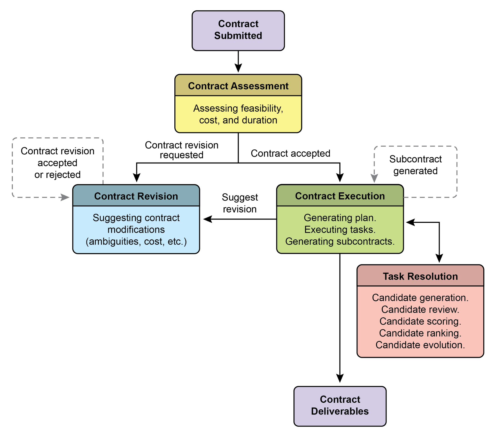
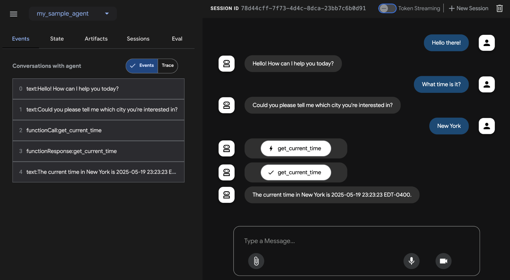

[response = self.model.generate_content( ]

[full_prompt, ]

[good_legal_survey_question = \"\"\" ]

[To what extent do you agree or disagree that current intellectual ][property laws in Switzerland adequately protect emerging AI-generated ][content, assuming the content meets the originality criteria ][established by the Federal Supreme Court? ]

[(Select one: Strongly Disagree, Disagree, Neutral, Agree, Strongly ][Agree) ]

[\"\"\" ]

[print(\"\\n\-\-- Evaluating Good Legal Survey Question \-\--\") ]

[judgment_good = ]

[judge.judge_survey_question(good_legal_survey_question) ]

[if judgment_good: ]

[print(json.dumps(judgment_good, indent=2)) ]

 

[\# \-\-- Biased/Poor Example \-\-- ]

[biased_legal_survey_question = \"\"\" ]and Appropriateness for Audience. For each criterion, a score from 1 to 5 is assigned,

and a detailed rationale and feedback are required in the output. The code constructs a prompt that includes the rubric and the survey question to be evaluated.

 

The judge_survey_question method sends this prompt to the configured Gemini

model, requesting a JSON response formatted according to the defined structure.

The expected output JSON includes an overall score, a summary rationale, detailed feedback for each criterion, a list of concerns, and a recommended action. The class

handles potential errors during the AI model interaction, such as JSON decoding

issues or empty responses. The script demonstrates its operation by evaluating

examples of legal survey questions, illustrating how the AI assesses quality based on the predefined criteria.

 

Before we conclude, let\'s examine various evaluation methods, considering their requires developing sophisticated metrics that go beyond individual performance to

measure the effectiveness of communication and teamwork. Moreover, the environments themselves are not static, demanding that evaluation methods,

including test cases, adapt over time.

 

This involves examining the quality of decisions, the reasoning process, and the

overall outcome. Implementing automated evaluations is valuable, particularly for development beyond the prototype stage. Analyzing trajectory and tool use includes

evaluating the steps an agent employs to achieve a goal, such as tool selection,

strategies, and task efficiency. For example, an agent addressing a customer\'s

product query might ideally follow a trajectory involving intent determination, database search tool use, result review, and report generation. The agent\'s actual

actions are compared to this expected, or ground truth, trajectory to identify errors

and inefficiencies. Comparison methods include exact match (requiring a perfect 10 sided dice twice and then check if 9 is a prime or not," defining expected roll\\\_die

tool calls and a check_prime tool call, along with the final response summarizing the dice rolls and the prime check.

 

**Multi-agents**: Evaluating a complex AI system with multiple agents is much like

assessing a team project. Because there are many steps and handoffs, its complexity

is an advantage, allowing you to check the quality of work at each stage. You can examine how well each individual \"agent\" performs its specific job, but you must also

evaluate how the entire system is performing as a whole.

 

To do this, you ask key questions about the team\'s dynamics, supported by concrete

examples:

 

● Are the agents cooperating effectively? For instance, after a \'Flight-Booking

Agent\' secures a flight, does it successfully pass the correct dates and Today\'s common AI agents operate on brief, underspecified instructions, which makes

them suitable for simple demonstrations but brittle in production, where ambiguity

leads to failure. The \"contractor\" model addresses this by establishing a rigorous,

formalized relationship between the user and the AI, built upon a foundation of clearly defined and mutually agreed-upon terms, much like a legal service agreement in the

human world. This transformation is supported by four key pillars that collectively

ensure clarity, reliability, and robust execution of tasks that were previously beyond

the scope of autonomous systems.

 

First is the pillar of the Formalized Contract, a detailed specification that serves as the

single source of truth for a task. It goes far beyond a simple prompt. For example, a

contract for a financial analysis task wouldn\'t just say \"analyze last quarter\'s sales\"; it

would demand \"a 20-page PDF report analyzing European market sales from Q1 2025,

Finally, the fourth pillar is Hierarchical Decomposition via Subcontracts. For tasks of

significant complexity, a primary contractor agent can act as a project manager, breaking the main goal into smaller, more manageable sub-tasks. It achieves this by

generating new, formal \"subcontracts.\" For example, a master contract to \"build an

e-commerce mobile application\" could be decomposed by the primary agent into

subcontracts for \"designing the UI/UX,\" \"developing the user authentication module,\"

\"creating the product database schema,\" and \"integrating a payment gateway.\" Each

of these subcontracts is a complete, independent contract with its own deliverables

and specifications, which could be assigned to other specialized agents. This

structured decomposition allows the system to tackle immense, multifaceted projects in a highly organized and scalable manner, marking the transition of AI from a simple

tool to a truly autonomous and reliable problem-solving engine.

 

Ultimately, this contractor framework reimagines AI interaction by embedding

deployment. Continuous assessment is therefore necessary to measure an agent\'s

effectiveness, efficiency, and adherence to operational and safety requirements.

 

**Why:** A standardized evaluation and monitoring framework provides a systematic way

to assess and ensure the ongoing performance of intelligent agents. This involves

defining clear metrics for accuracy, latency, and resource consumption, like token
