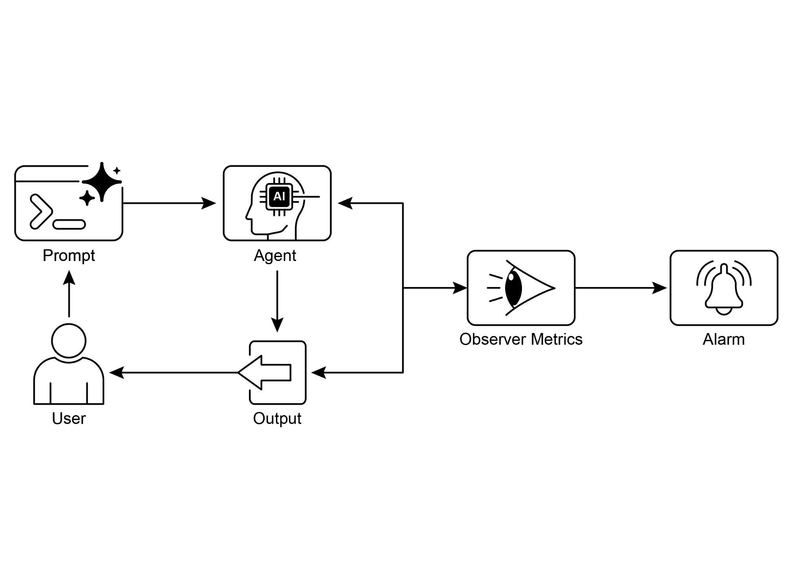

usage for LLMs. It also includes advanced techniques such as analyzing agentic trajectories to understand the reasoning process and employing an LLM-as-a-Judge

for nuanced, qualitative assessments. By establishing feedback loops and reporting

systems, this framework allows for continuous improvement, A/B testing, and the

detection of anomalies or performance drift, ensuring the agent remains aligned with its objectives.

 

**Rule of thumb:** Use this pattern when deploying agents in live, production [Key Takeaways ]

 

● Evaluating intelligent agents goes beyond traditional tests to continuously

measure their effectiveness, efficiency, and adherence to requirements in

real-world environments.

● Practical applications of agent evaluation include performance tracking in live

systems, A/B testing for improvements, compliance audits, and detecting drift or anomalies in behavior.

● Basic agent evaluation involves assessing response accuracy, while real-world

scenarios demand more sophisticated metrics like latency monitoring and

token usage tracking for LLM-powered agents.

● Agent trajectories, the sequence of steps an agent takes, are crucial for

evaluation, comparing actual actions against an ideal, ground-truth path to

To ensure reliability in critical applications, the paradigm is shifting from simple, prompt-driven agents to advanced \"contractors\" bound by formal agreements. These

 

contractor agents operate on explicit, verifiable terms, allowing them to negotiate,

decompose tasks, and self-validate their work to meet rigorous quality standards. This

structured approach transforms agents from unpredictable tools into accountable systems capable of handling complex, high-stakes tasks. Ultimately, this evolution is

crucial for building the trust required to deploy sophisticated agentic AI in

mission-critical domains.

 

[References ]

 

Relevant research includes:
