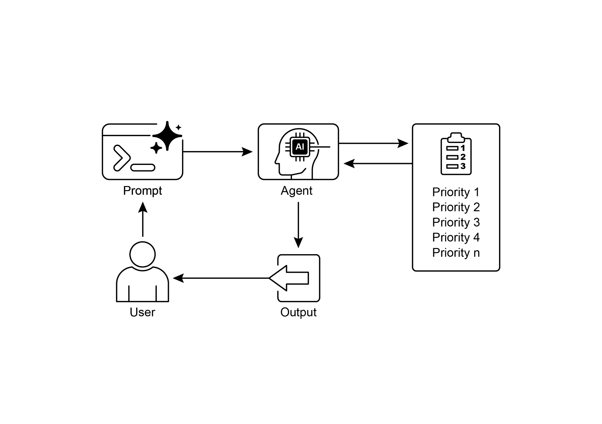

## [Chapter 20: Prioritization ]

 

In complex, dynamic environments, Agents frequently encounter numerous potential

actions, conflicting goals, and limited resources. Without a defined process for determining the subsequent action, the agents may experience reduced efficiency,

operational delays, or failures to achieve key objectives. The prioritization pattern

addresses this issue by enabling agents to assess and rank tasks, objectives, or

actions based on their significance, urgency, dependencies, and established criteria. This ensures the agents concentrate efforts on the most critical tasks, resulting in

enhanced effectiveness and goal alignment.

 

[Prioritization Pattern Overview ]especially in complex, multi-objective environments. This mirrors human team

organization, where managers prioritize tasks by considering input from all members.

 

[Practical Applications & Use Cases ]

 

In various real-world applications, AI agents demonstrate a sophisticated use of

prioritization to make timely and effective decisions.

 

● **Automated Customer Support**: Agents prioritize urgent requests, like system

outage reports, over routine matters, such as password resets. They may also

give preferential treatment to high-value customers.

● **Cloud Computing**: AI manages and schedules resources by prioritizing

allocation to critical applications during peak demand, while relegating less urgent batch jobs to off-peak hours to optimize costs. to team members, illustrating the application of large language models with bespoke

tools for automated project management.

 

[import os ]

[import asyncio ]

[from typing import List, Optional, Dict, Type ]

 

[from dotenv import load_dotenv ]

[from pydantic import BaseModel, Field ]

 

[from langchain_core.prompts import ChatPromptTemplate ][from langchain_core.tools import Tool ]

[from langchain_openai import ChatOpenAI ]

[from langchain.agents import AgentExecutor, create_react_agent ][from langchain.memory import ConversationBufferMemory ]

[print(f\"DEBUG: Task created - {task_id}: {description}\") ]

[return new_task ]

 

[def update_task(self, task_id: str, \*\*kwargs) -\> Optional\[Task\]: ]

[\"\"\"Safely updates a task using Pydantic\'s model_copy.\"\"\" ]

[task = self.tasks.get(task_id) ]

[if task: ]

[\# Use model_copy for type-safe updates. ]

[update_data = {k: v for k, v in kwargs.items() if v is not ][None} ]

[updated_task = task.model_copy(update=update_data) ]

[self.tasks\[task_id\] = updated_task ]

[print(f\"DEBUG: Task {task_id} updated with {update_data}\") ]

[return updated_task ]

 

[print(f\"DEBUG: Task {task_id} not found for update.\") ]

[class AssignWorkerArgs(BaseModel): ]

 

[task_id: str = Field(description=\"The ID of the task to update, ][e.g., \'TASK-001\'.\") ]

[worker_name: str = Field(description=\"The name of the worker to ][assign the task to.\") ]

 

[def create_new_task_tool(description: str) -\> str: ]

[\"\"\"Creates a new project task with the given description.\"\"\" ]

[task = task_manager.create_task(description) ]

[return f\"Created task {task.id}: \'{task.description}\'.\" ]

 

[def assign_priority_to_task_tool(task_id: str, priority: str) -\> str: ]

[\"\"\"Assigns a priority (P0, P1, P2) to a given task ID.\"\"\" ]

[if priority not in \[\"P0\", \"P1\", \"P2\"\]: ]

[return \"Invalid priority. Must be P0, P1, or P2.\" ][after it has been created.\", ]

[args_schema=AssignWorkerArgs ]

[), ]

[Tool( ]

[name=\"list_all_tasks\", ]

[func=task_manager.list_all_tasks, ]

[description=\"Use this to list all current tasks and their ][status.\" ]

[), ]

[\] ]

 

[\# \-\-- 3. Project Manager Agent Definition \-\-- ]

 

[pm_prompt_template = ChatPromptTemplate.from_messages(\[ ]

[(\"system\", \"\"\"You are a focused Project Manager LLM agent. Your ][goal is to manage project tasks efficiently. ][return_messages=True) ]

[) ]

 

[\# \-\-- 4. Simple Interaction Flow \-\-- ]

 

[async def run_simulation(): ]

[print(\"\-\-- Project Manager Simulation \-\--\") ]

 

[\# Scenario 1: Handle a new, urgent feature request ]

[print(\"\\n\[User Request\] I need a new login system implemented ][ASAP. It should be assigned to Worker B.\") ]

[await pm_agent_executor.ainvoke({\"input\": \"Create a task to ][implement a new login system. It\'s urgent and should be assigned to ][Worker B.\"}) ]

 

[print(\"\\n\" + \"-\"\*60 + \"\\n\") ]

The agent interacts with the task manager via a defined set of Tools. These tools

facilitate the creation of new tasks, the assignment of priorities to tasks, the allocation of tasks to personnel, and the listing of all tasks. Each tool is encapsulated to enable

interaction with an instance of the SuperSimpleTaskManager. Pydantic models are

utilized to delineate the requisite arguments for the tools, thereby ensuring data

validation.

 

An AgentExecutor is configured with the language model, the toolset, and a

conversation memory component to maintain contextual continuity. A specific

ChatPromptTemplate is defined to direct the agent\'s behavior in its project

management role. The prompt instructs the agent to initiate by creating a task, subsequently assigning priority and personnel as specified, and concluding with a

comprehensive task list. Default assignments, such as P1 priority and \'Worker A\', are

stipulated within the prompt for instances where information is absent.

**Rule of thumb:** Use the Prioritization pattern when an Agentic system must

autonomously manage multiple, often conflicting, tasks or goals under resource constraints to operate effectively in a dynamic environment.

 

**Visual summary:**

[● ]Effective prioritization results in increased efficiency and improved operational

robustness of AI agents.

 

[Conclusions ]

 

In conclusion, the prioritization pattern is a cornerstone of effective agentic AI,

equipping systems to navigate the complexities of dynamic environments with

purpose and intelligence. It allows an agent to autonomously evaluate a multitude of conflicting tasks and goals, making reasoned decisions about where to focus its
