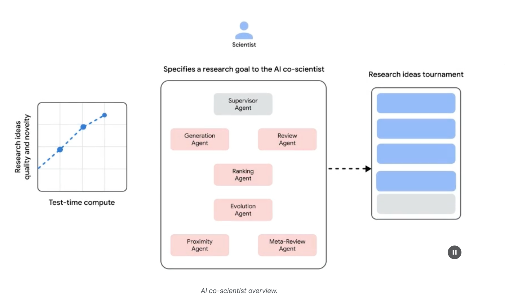

## [Chapter 21: Exploration and Discovery ]

 

This chapter explores patterns that enable intelligent agents to actively seek out novel

information, uncover new possibilities, and identify unknown unknowns within their

operational environment. Exploration and discovery differ from reactive behaviors or

optimization within a predefined solution space. Instead, they focus on agents proactively venturing into unfamiliar territories, experimenting with new approaches,

and generating new knowledge or understanding. This pattern is crucial for agents

operating in open-ended, complex, or rapidly evolving domains where static

knowledge or pre-programmed solutions are insufficient. It emphasizes the agent\'s capacity to expand its understanding and capabilities.

 

[Practical Applications & Use Cases ][Google Co-Scientist]

 

An AI co-scientist is an AI system developed by Google Research designed as a computational scientific collaborator. It assists human scientists in research aspects

such as hypothesis generation, proposal refinement, and experimental design. This

system operates on the Gemini LLM..

 

The development of the AI co-scientist addresses challenges in scientific research. These include processing large volumes of information, generating testable

hypotheses, and managing experimental planning. The AI co-scientist supports

researchers by performing tasks that involve large-scale information processing and

synthesis, potentially revealing relationships within data. Its purpose is to augment human cognitive processes by handling computationally demanding aspects of

early-stage research.

\"test-time compute scaling,\" a mechanism that allocates increased computational

resources to iteratively reason and enhance outputs. The system processes and synthesizes information from diverse sources, including academic literature,

web-based data, and databases.

more novel and impactful compared to other baseline models. The system\'s proposals

for drug repurposing, formatted as NIH Specific Aims pages, were also judged to be of high quality by a panel of six expert oncologists.

 

**End-to-End Experimental Validation:**

 

Drug Repurposing: For acute myeloid leukemia (AML), the system proposed novel

drug candidates. Some of these, like KIRA6, were completely novel suggestions with no prior preclinical evidence for use in AML. Subsequent in vitro experiments

confirmed that KIRA6 and other suggested drugs inhibited tumor cell viability at

clinically relevant concentrations in multiple AML cell lines.

 

Novel Target Discovery: The system identified novel epigenetic targets for liver fibrosis. Laboratory experiments using human hepatic organoids validated these

findings, showing that drugs targeting the suggested epigenetic modifiers had goals found that the system could robustly reject dangerous inputs. To ensure

responsible development, the system is being made available to more scientists through a Trusted Tester Program to gather real-world feedback.

 

[Hands-On Code Example ]

 

Let\'s look at a concrete example of agentic AI for Exploration and Discovery in action:

Agent Laboratory, a project developed by Samuel Schmidgall under the MIT License.

 

\"Agent Laboratory\" is an autonomous research workflow framework designed to

augment human scientific endeavors rather than replace them. This system leverages

specialized LLMs to automate various stages of the scientific research process,

thereby enabling human researchers to dedicate more cognitive resources to conceptualization and critical analysis.

allows agents to build upon previous findings, fostering cumulative research

progress.

 

The modular architecture of Agent Laboratory ensures computational flexibility. The

aim is to enhance research productivity by automating tasks while maintaining the

human researcher.

 

**Code analysis:** While a comprehensive code analysis is beyond the scope of this book, I want to provide you with some key insights and encourage you to delve into

the code on your own.

 

**Judgment:** In order to emulate human evaluative processes, the system employs a

tripartite agentic judgment mechanism for assessing outputs. This involves the deployment of three distinct autonomous agents, each configured to evaluate the

production from a specific perspective, thereby collectively mimicking the nuanced [openai_api_key=self.openai_api_key) ]

 

[return f\"Reviewer #1:\\n{review_1}, \\nReviewer #2:\\n{review_2}, ][\\nReviewer #3:\\n{review_3}\" ]

 

The judgment agents are designed with a specific prompt that closely emulates the cognitive framework and evaluation criteria typically employed by human reviewers.

This prompt guides the agents to analyze outputs through a lens similar to how a

human expert would, considering factors like relevance, coherence, factual accuracy,

and overall quality. By crafting these prompts to mirror human review protocols, the system aims to achieve a level of evaluative sophistication that approaches

human-like discernment.

[- \"Weaknesses\": A list of weaknesses of the paper. ]

[- \"Originality\": A rating from 1 to 4 ]

[(low, medium, high, very high). ]

[- \"Quality\": A rating from 1 to 4 ]

[(low, medium, high, very high). ]

[- \"Clarity\": A rating from 1 to 4 ]

[(low, medium, high, very high). ]

[- \"Significance\": A rating from 1 to 4 ]

[(low, medium, high, very high). ]

[- \"Questions\": A set of clarifying questions to be ]

[answered by the paper authors. ]

[- \"Limitations\": A set of limitations and potential ]

[negative societal impacts of the work. ]

[- \"Ethical Concerns\": A boolean value indicating ]

[whether there are ethical concerns. ]

[- \"Soundness\": A rating from 1 to 4 ]

[class ProfessorAgent(BaseAgent): ]

 

[def \_\_init\_\_(self, model=\"gpt4omini\", notes=None, max_steps=100, ][openai_api_key=None): ]

[super().\_\_init\_\_(model, notes, max_steps, openai_api_key) ]

[self.phases = \[\"report writing\"\] ]

 

[def generate_readme(self): ]
