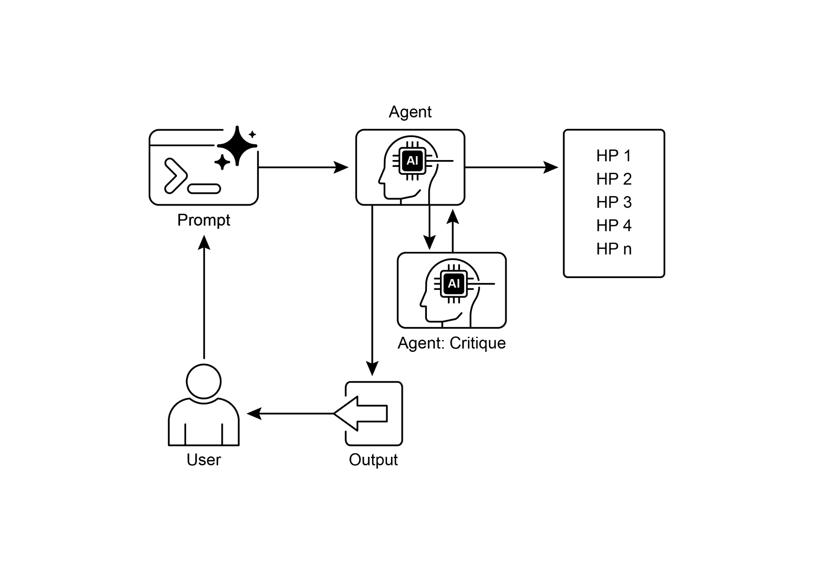

[sys_prompt = f\"\"\"You are {self.role_description()} \\n Here is ][the written paper \\n{self.report}. Task instructions: Your goal is to ][integrate all of the knowledge, code, reports, and notes provided to ][you and generate a readme.md for a github repository.\"\"\" ]

[history_str = \"\\n\".join(\[\_\[1\] for \_ in self.history\]) ]

[prompt = ( ]

[f\"\"\"History: {history_str}\\n{\'\~\' \* 10}\\n\"\"\" ]

[f\"Previous Results: {self.prev_exp_results}\\n\" ]

[f\"Previous Interpretation of results: ][{self.prev_interpretation}\\n\" ]

[f\"Previous Report: {self.prev_report}\\n\" ]

[f\"{self.reviewer_response}\\n\\n\\n\" ]

[) ]

[if phase == \"plan formulation\": ]

[return ( ]

[sr_str, ]

[f\"Current Literature Review: {self.lit_review_sum}\", ]

[) ]

[elif phase == \"results interpretation\": ]

[return ( ]

[sr_str, ]

[f\"Current Literature Review: {self.lit_review_sum}\\n\" ]

[f\"Current Plan: {self.plan}\\n\" ]

**SWEngineerAgents:** Software Engineering Agents guide Machine Learning Engineer Agents. Their main purpose is to assist the Machine Learning Engineer Agent in

 

creating straightforward data preparation code for a specific experiment. The

Software Engineer Agent integrates the provided literature review and experimental

plan, ensuring the generated code is uncomplicated and directly relevant to the research objectives.

 

[\"You are a software engineer directing a machine learning engineer, ][where the machine learning engineer will be writing the code, and you ][can interact with them through dialogue.\\n\" ]

[\"Your goal is to help the ML engineer produce code that prepares the ][data for the provided experiment. You should aim for very simple code ][to prepare the data, not complex code. You should integrate the ]critically reviewing them, and evolving the most promising concepts. This structured,

collaborative methodology allows the system to intelligently navigate vast information landscapes, design and execute experiments, and generate genuinely new

knowledge. By automating the labor-intensive aspects of exploration, these systems

augment human intellect and significantly accelerate the pace of discovery.

 

**Rule of thumb:** Use the Exploration and Discovery pattern when operating in open-ended, complex, or rapidly evolving domains where the solution space is not

fully defined. It is ideal for tasks requiring the generation of novel hypotheses,

strategies, or insights, such as in scientific research, market analysis, and creative

content generation. This pattern is essential when the objective is to uncover \"unknown unknowns\" rather than merely optimizing a known process.

 

**Visual summary**

[Key Takeaways ]

 

● Exploration and Discovery in AI enable agents to actively pursue new

information and possibilities, which is essential for navigating complex and

evolving environments.

● Systems such as Google Co-Scientist demonstrate how Agents can

autonomously generate hypotheses and design experiments, supplementing human scientific research.

● The multi-agent framework, exemplified by Agent Laboratory\'s specialized

roles, improves research through the automation of literature review,

experimentation, and report writing.

[● ]Ultimately, these Agents aim to enhance human creativity and problem-solving

by managing computationally intensive tasks, thus accelerating innovation and agentic AI, transforming computational tools into independent, goal-seeking partners

in the pursuit of knowledge.

 

[References]

 

[1. ]Exploration-Exploitation Dilemma**:** A fundamental problem in reinforcement

learning and decision-making under uncertainty.

<https://en.wikipedia.org/wiki/Exploration%E2%80%93exploitation_dilemma>

2\. Google Co-Scientist:

[https://research.google/blog/accelerating-scientific-breakthroughs-with-an-ai-c](https://research.google/blog/accelerating-scientific-breakthroughs-with-an-ai-co-scientist/)

[o-scientist/](https://research.google/blog/accelerating-scientific-breakthroughs-with-an-ai-co-scientist/)

[3. ]Agent Laboratory: Using LLM Agents as Research Assistants

<https://github.com/SamuelSchmidgall/AgentLaboratory>

4\. AgentRxiv: Towards Collaborative Autonomous Research:

[Appendix A: Advanced Prompting ]

 

[Techniques ]

 

[Introduction to Prompting ]

 

Prompting, the primary interface for interacting with language models, is the process

of crafting inputs to guide the model towards generating a desired output. This

involves structuring requests, providing relevant context, specifying the output format, and demonstrating expected response types. Well-designed prompts can maximize

the potential of language models, resulting in accurate, relevant, and creative

responses. In contrast, poorly designed prompts can lead to ambiguous, irrelevant, or

erroneous outputs.

**Clarity and Specificity**: Instructions should be unambiguous and precise. Language models interpret patterns; multiple interpretations may lead to unintended responses.

 

Define the task, desired output format, and any limitations or requirements. Avoid

vague language or assumptions. Inadequate prompts yield ambiguous and inaccurate

responses, hindering meaningful output.

 

**Conciseness**: While specificity is crucial, it should not compromise conciseness.

Instructions should be direct. Unnecessary wording or complex sentence structures

can confuse the model or obscure the primary instruction. Prompts should be simple;

what is confusing to the user is likely confusing to the model. Avoid intricate language and superfluous information. Use direct phrasing and active verbs to clearly delineate

the desired action. Effective verbs include: Act, Analyze, Categorize, Classify, iteration, a robust framework is established for applying more advanced prompting

techniques.

 

[Basic Prompting Techniques ]

 

Building on core principles, foundational techniques provide language models with

varying levels of information or examples to direct their responses. These methods

serve as an initial phase in prompt engineering and are effective for a wide spectrum of applications.

 
