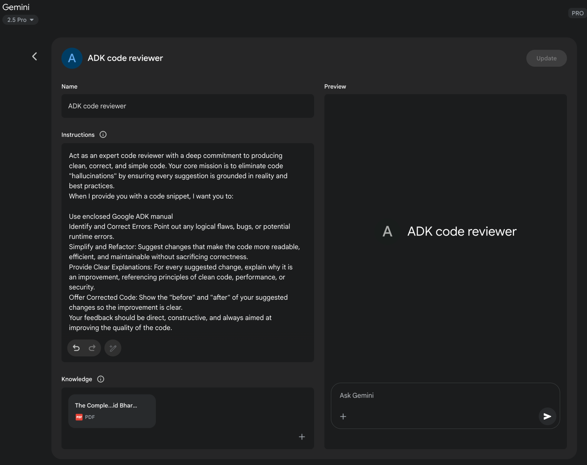

generate, evaluate, and refine prompts. This method aims to automate the prompt writing process, potentially enhancing model performance without requiring extensive

human effort in prompt design.

2\. **An Objective Function (or Scoring Metric):** This is a function that

automatically evaluates the LLM\'s output against the corresponding \"golden\" output from the dataset. It returns a score indicating the quality, accuracy, or

correctness of the response.

 

Using these components, an optimizer, such as a Bayesian optimizer, systematically

refines the prompt. This process typically involves two main strategies, which can be used independently or in concert:

 

● **Few-Shot Example Optimization:** Instead of a developer manually selecting

examples for a few-shot prompt, the optimizer programmatically samples

different combinations of examples from the goldset. It then tests these combinations to identify the specific set of examples that most effectively

guides the model toward generating the desired outputs.

[○ ]*Attempt 3:* \"Write a product description for the \'SpeedClean Coffee Pro\'.

Emphasize its ability to brew a pot in under 2 minutes and its self-cleaning cycle. Target busy professionals.\" (Result is much closer to desired).

 

[Providing Negative Examples ]

 

While the principle of \"Instructions over Constraints\" generally holds true, there are

situations where providing negative examples can be helpful, albeit used carefully. A negative example shows the model an input and an *undesired* output, or an input and

an output that *should not* be generated. This can help clarify boundaries or prevent

specific types of incorrect responses.

 

[● ]**Example:**

Generate a list of popular tourist attractions in Paris. Do NOT include the Eiffel

Tower.

[○ ]Prompt 3: \"Write the section on \'Impact on White-Collar Jobs\' based on this

outline: \[insert outline section\].\" (Repeat for other sections).

[○ ]Prompt N: \"Combine these sections and write a conclusion.\"

 

[Retrieval Augmented Generation (RAG) ]

 

RAG is a powerful technique that enhances language models by giving them access to

external, up-to-date, or domain-specific information during the prompting process. When a user asks a question, the system first retrieves relevant documents or data

from a knowledge base (e.g., a database, a set of documents, the web). This retrieved

information is then included in the prompt as context, allowing the language model to

generate a response grounded in that external knowledge. This mitigates issues like hallucination and provides access to information the model wasn\'t trained on or that is

very recent. This is a key pattern for agentic systems that need to work with dynamic

or proprietary information.

These advanced and supplementary techniques provide further tools for prompt

engineers to optimize model behavior, integrate external information, and tailor interactions for specific users and tasks within agentic workflows.

 

[Using Google Gems ]

 

Google\'s AI \"Gems\" (see Fig. 1) represent a user-configurable feature within its large

language model architecture. Each \"Gem\" functions as a specialized instance of the core Gemini AI, tailored for specific, repeatable tasks. Users create a Gem by

providing it with a set of explicit instructions, which establishes its operational

parameters. This initial instruction set defines the Gem\'s designated purpose,

response style, and knowledge domain. The underlying model is designed to consistently adhere to these pre-defined directives throughout a conversation.

get suggestions for making our prompts better. It turns the LLM into a collaborative

partner in the prompt engineering process.

 

How does this work in practice? You can provide a language model with an existing

prompt that you\'re trying to improve, along with the task you want it to accomplish

and perhaps even examples of the output you\'re currently getting (and why it\'s not

meeting your expectations). You then prompt the LLM to analyze the prompt and suggest improvements.

 

A model like Gemini, with its strong reasoning and language generation capabilities,

can analyze your existing prompt for potential areas of ambiguity, lack of specificity,

or inefficient phrasing. It can suggest incorporating techniques we\'ve discussed, such as adding delimiters, clarifying the desired output format, suggesting a more effective

persona, or recommending the inclusion of few-shot examples.

Suggestions for Improvement:

 

In this example, we\'re using the LLM to critique and enhance another prompt. This

meta-level interaction demonstrates the flexibility and power of these models,

allowing us to build more effective agentic systems by first optimizing the fundamental

instructions they receive. It\'s a fascinating loop where AI helps us talk better to AI.

 

[Prompting for Specific Tasks ]

 

While the techniques discussed so far are broadly applicable, some tasks benefit from

specific prompting considerations. These are particularly relevant in the realm of code

and multimodal inputs.

[Multimodal Prompting ]

 

While the focus of this appendix and much of current LLM interaction is text-based, the field is rapidly moving towards multimodal models that can process and generate

information across different modalities (text, images, audio, video, etc.). Multimodal

prompting involves using a combination of inputs to guide the model. This refers to

using multiple input formats instead of just text.

 

[● ]**Example:** Providing an image of a diagram and asking the model to explain the

process shown in the diagram (Image Input + Text Prompt). Or providing an image

and asking the model to generate a descriptive caption (Image Input + Text

Prompt -\> Text Output).

 

As multimodal capabilities become more sophisticated, prompting techniques will

evolve to effectively leverage these combined inputs and outputs.

[● ]**Adapt to Model Updates:** Language models are constantly being updated. Be
