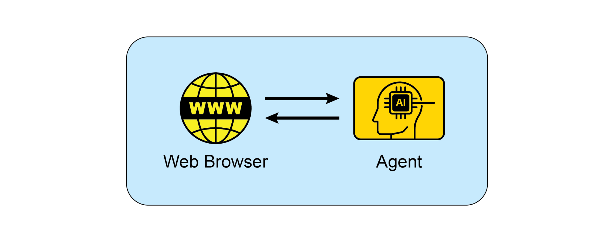

prepared to test your existing prompts on new model versions and adjust them to leverage new capabilities or maintain performance.

[● ]**Experiment with Output Formats:** Especially for non-creative tasks, experiment

with requesting structured output like JSON or XML.

[● ]**Experiment Together with Other Prompt Engineers:** Collaborating with others

can provide different perspectives and lead to discovering more effective

prompts.

[● ]**CoT Best Practices:** Remember specific practices for Chain of Thought, such as

placing the answer after the reasoning and setting temperature to 0 for tasks with a single correct answer.

[● ]**Document the Various Prompt Attempts:** This is crucial for tracking what works,

what doesn\'t, and why. Maintain a structured record of your prompts,

configurations, and results. clear delimiters provides an essential architectural layer for fine-grained control over

the model.

 

The importance of these techniques becomes paramount in the context of building

autonomous agents, where they provide the control and reliability necessary for

complex, multi-step operations. For an agent to effectively create and execute a plan,

it must leverage advanced reasoning patterns like Chain of Thought and Tree of Thoughts. These sophisticated methods compel the model to externalize its logical

steps, systematically breaking down complex goals into a sequence of manageable

sub-tasks. The operational reliability of the entire agentic system hinges on the

predictability of each component\'s output. This is precisely why requesting structured data like JSON, and programmatically validating it with tools such as Pydantic, is not a

mere convenience but an absolute necessity for robust automation. Without this

discipline, the agent's internal cognitive components cannot communicate reliably, [2. ]Chain-of-Thought Prompting Elicits Reasoning in Large Language Models,

<https://arxiv.org/abs/2201.11903>

[3. ]Self-Consistency Improves Chain of Thought Reasoning in Language Models,

<https://arxiv.org/pdf/2203.11171>

[4. ]ReAct: Synergizing Reasoning and Acting in Language Models,

<https://arxiv.org/abs/2210.03629>

[5. ]Tree of Thoughts: Deliberate Problem Solving with Large Language Models,

<https://arxiv.org/pdf/2305.10601>

[6. ]Take a Step Back: Evoking Reasoning via Abstraction in Large Language Models,

<https://arxiv.org/abs/2310.06117>

[7. ]DSPy: Programming---not prompting---Foundation Models

<https://github.com/stanfordnlp/dspy> [Appendix B - AI Agentic Interactions: ]

 

[From GUI to Real World environment ]

 

AI agents are increasingly performing complex tasks by interacting with digital

interfaces and the physical world. Their ability to perceive, process, and act within

these varied environments is fundamentally transforming automation,

human-computer interaction, and intelligent systems. This appendix explores how agents interact with computers and their environments, highlighting advancements

and projects.

 

[Interaction: Agents with Computers ]

dynamically responding to changes, loading screens, pop-up notifications, or

errors to successfully navigate multi-step workflows.

 

This technology is no longer theoretical. Several leading AI labs have developed

functional agents that demonstrate the power of GUI interaction:

 

**ChatGPT Operator (OpenAI):** Envisioned as a digital partner, ChatGPT Operator is

designed to automate tasks across a wide range of applications directly from the desktop. It understands on-screen elements, enabling it to perform actions like

transferring data from a spreadsheet into a customer relationship management (CRM)

platform, booking a complex travel itinerary across airline and hotel websites, or filling

out detailed online forms without needing specialized API access for each service. This makes it a universally adaptable tool aimed at boosting both personal and

enterprise productivity by taking over repetitive digital chores.

**Anthropic\'s Computer Use:** This feature empowers Anthropic\'s AI model, Claude, to

become a direct user of a computer\'s desktop environment. By capturing screenshots to perceive the screen and programmatically controlling the mouse and keyboard,

Claude can orchestrate workflows that span multiple, unconnected applications. A

user could ask it to analyze data in a PDF report, open a spreadsheet application to

perform calculations on that data, generate a chart, and then paste that chart into an email draft---a sequence of tasks that previously required constant human input.

 

**Browser Use**: This is an open-source library that provides a high-level API for

programmatic browser automation. It enables AI agents to interface with web pages

by granting them access to and control over the Document Object Model (DOM). The API abstracts the intricate, low-level commands of browser control protocols, into a

more simplified and intuitive set of functions. This allows an agent to perform complex

sequences of actions, including data extraction from nested elements, form users to incorporate visual information by using their phone\'s camera, sharing their

screen, or uploading files for a more context-aware discussion. More advanced versions can even perceive a user\'s tone of voice and intelligently filter out irrelevant

background noise to better understand the conversation. These capabilities combine

to create rich interactions, such as receiving live instructions on a task by simply

pointing a camera at it.

 

OpenAI\'s **GPT-4o model** is an alternative designed for \"omni\" interaction, meaning it

can reason across voice, vision, and text. It processes these inputs with low latency

that mirrors human response times, which allows for real-time conversations. For

example, users can show the AI a live video feed to ask questions about what is happening, or use it for language translation. OpenAI provides developers with a

\"Realtime API\" to build applications requiring low-latency, speech-to-speech
