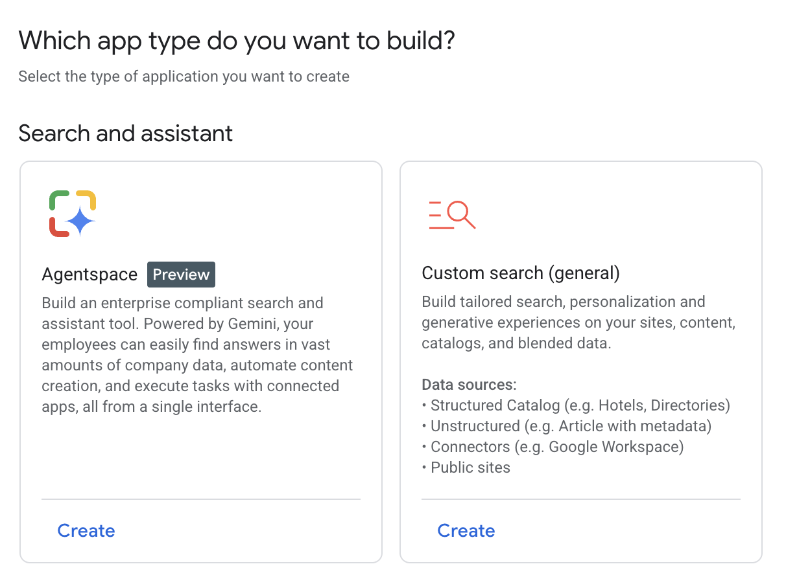
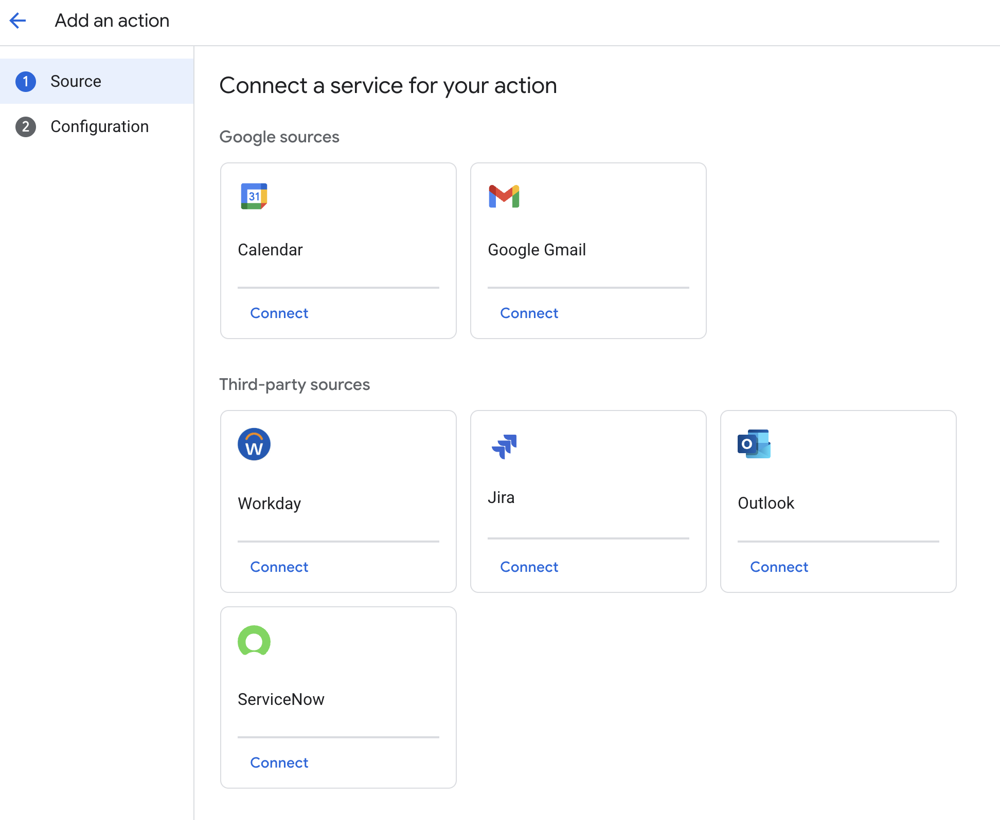
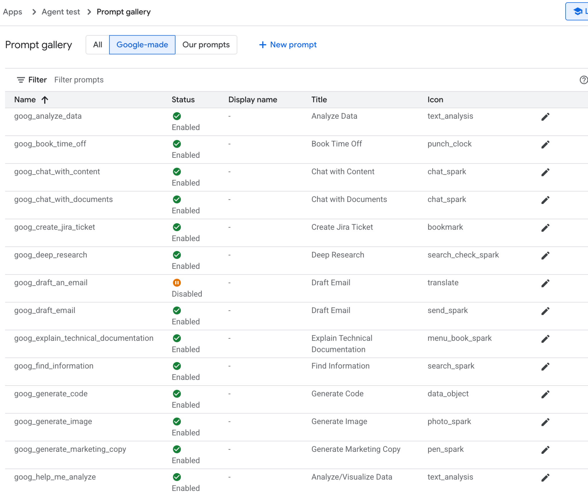
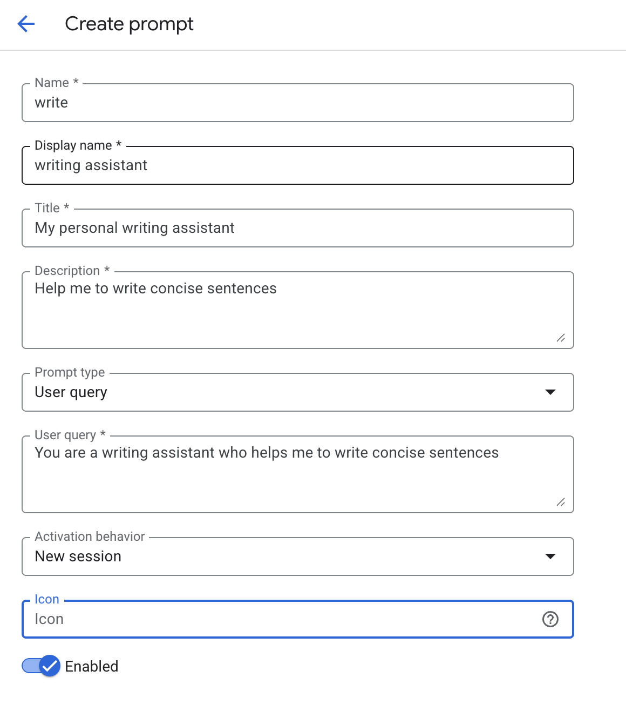
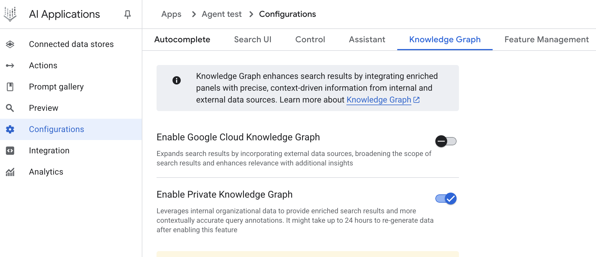
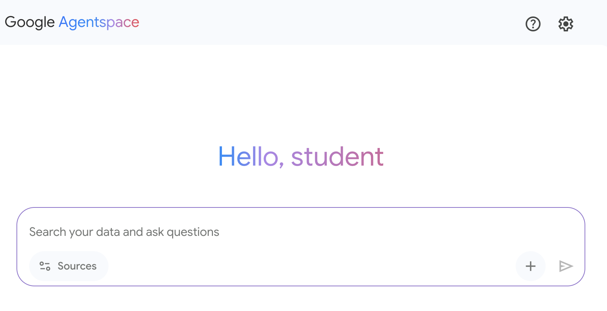

[Other agent development framework ]**MetaGPT**: MetaGPT implements a multi-agent system by assigning roles and tasks based on a predefined set of Standard Operating Procedures (SOPs). This framework structures agent collaboration to mimic a software development company, with agents taking on roles like product managers or engineers to complete complex tasks. This SOP-driven approach results in highly structured and coherent outputs, which is a significant advantage for specialized domains like code generation. The framework\'s primary limitation is its high degree of specialization, making it less adaptable for general-purpose agentic tasks outside of its core design.

 

**SuperAGI**: SuperAGI is an open-source framework designed to provide a complete lifecycle management system for autonomous agents. It includes features for agent provisioning, monitoring, and a graphical interface, aiming to enhance the reliability of agent execution. The key benefit is its focus on production-readiness, with built-in mechanisms to handle common failure modes like looping and to provide observability The landscape of agentic frameworks offers a diverse spectrum of tools, from low-level libraries for defining agent logic to high-level platforms for orchestrating multi-agent collaboration. At the foundational level, LangChain enables simple, linear workflows, while LangGraph introduces stateful, cyclical graphs for more complex reasoning. Higher-level frameworks like CrewAI and Google\'s ADK shift the focus to orchestrating teams of agents with predefined roles, while others like LlamaIndex specialize in data-intensive applications. This variety presents developers with a core trade-off between the granular control of graph-based systems and the streamlined development of more opinionated platforms. Consequently, selecting the right framework hinges on whether the application requires a simple sequence, a dynamic reasoning loop, or a managed team of specialists. Ultimately, this evolving ecosystem empowers developers to build increasingly sophisticated AI systems by choosing the precise level of abstraction their project demands. [Appendix D - Building an Agent with ]

 

[AgentSpace ]

 

[Overview ]

 

AgentSpace is a platform designed to facilitate an \"agent-driven enterprise\" by integrating artificial intelligence into daily workflows. At its core, it provides a unified search capability across an organization\'s entire digital footprint, including documents, emails, and databases. This system utilizes advanced AI models, like Google\'s Gemini, to comprehend and synthesize information from these varied sources.

 

The platform enables the creation and deployment of specialized AI \"agents\" that can

The Agent can then utilize its own prompt, chosen from a gallery of pre-made prompts provided by Google, as illustrated in Fig. 3.

[Conclusion ]

 

In conclusion, AgentSpace provides a functional framework for developing and deploying AI agents within an organization\'s existing digital infrastructure. The system\'s architecture links complex backend processes, such as autonomous reasoning and enterprise knowledge graph mapping, to a graphical user interface for agent construction. Through this interface, users can configure agents by integrating various data services and defining their operational parameters via prompts, resulting in customized, context-aware automated systems.

 

This approach abstracts the underlying technical complexity, enabling the construction of specialized multi-agent systems without requiring deep programming expertise. The primary objective is to embed automated analytical and operational capabilities directly into workflows, thereby increasing process efficiency and enhancing data-driven

[Appendix E - AI Agents on the CLI ]

 

 

[Introduction ]

 

The developer\'s command line, long a bastion of precise, imperative commands, is undergoing a profound transformation. It is evolving from a simple shell into an intelligent, collaborative workspace powered by a new class of tools: AI Agent Command-Line Interfaces (CLIs). These agents move beyond merely executing commands; they understand natural language, maintain context about your entire codebase, and can perform complex, multi-step tasks that automate significant parts of the development lifecycle.

2\. **API Integration:** After being provided with an OpenAPI specification for a new

weather service, you could say: \"Integrate this new weather API. Create a service module to handle the API calls, add a new component to display the weather, and update the main dashboard to include it.\"

3\. **Documentation Generation**: Pointing it to a complex module with poorly

documented code, you can ask: \"Analyze the ./src/utils/data_processing.js file. Generate comprehensive TSDoc comments for every function, explaining its purpose, parameters, and return value.\"

 

Claude CLI functions as a specialized coding assistant, with inherent tools for core development tasks, including file ingestion, code structure analysis, and edit generation. Its deep integration with Git facilitates direct branch and commit management. The agent\'s extensibility is mediated by the Multi-tool Control Protocol (MCP), enabling users to define and integrate custom tools. This allows for interactions with private APIs,

the get-employee-details \--id=E90210 tool to fetch their name and team, and then populate the welcome_template.md with that information.\"

4\. **Large-Scale Refactoring**: A developer needs to refactor a large Java codebase
