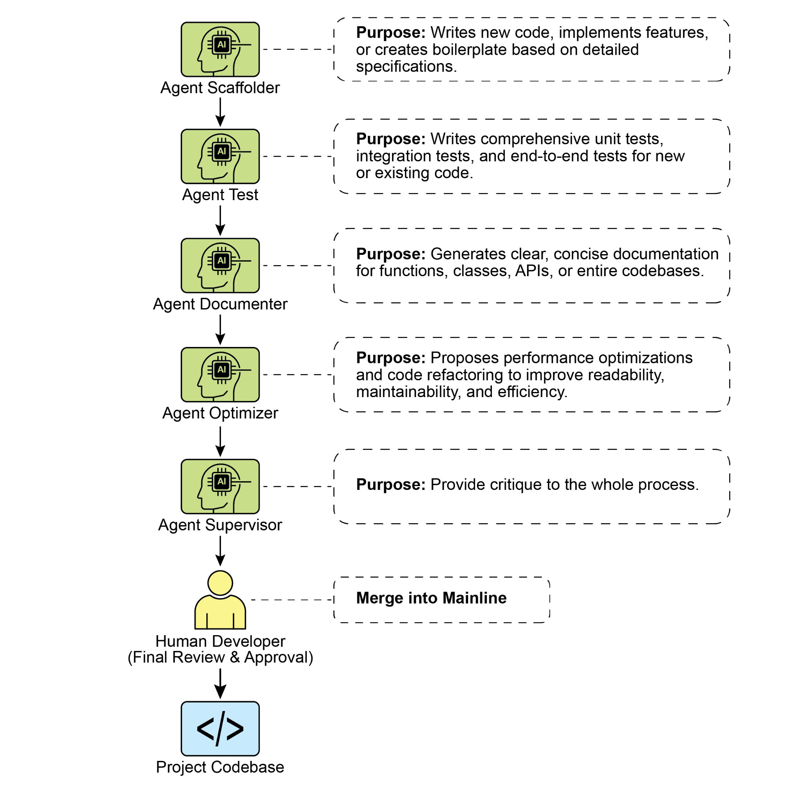

[Ultimately, this human-led model creates a powerful synergy between the developer\'s ][strategic direction and the agents\' tactical execution. As a result, developers can transcend ][routine tasks, focusing their expertise on the creative and architectural challenges that deliver ][the most value. ]

 

[Practical Implementation ]

 

[Setup Checklist ]

 

[To effectively implement the human-agent team framework, the following setup is ][recommended, focusing on maintaining control while improving efficiency. ]

[● ]**Master the Art of the Brief**[ The quality of an agent\'s output is a direct reflection of the ]

[quality of its input. Master the art of the brief by providing clear, unambiguous, and ][comprehensive context for every task. Think of your prompt not as a simple command, ][but as a complete briefing package for a new, highly capable team member. ]

[● ]**Act as the Ultimate Quality Gate**[ An agent\'s output is always a proposal, never a ]

[command. Treat the Reviewer Agent\'s feedback as a powerful signal, but you are the ][ultimate quality gate. Apply your domain expertise and project-specific knowledge to ][validate, challenge, and approve all changes, acting as the final guardian of the ][codebase\'s integrity. ]

[● ]**Engage in Iterative Dialogue**[ The best results emerge from conversation, not ]

[monologue. If an agent\'s initial output is imperfect, don\'t discard it---refine it. Provide ][corrective feedback, add clarifying context, and prompt for another attempt. This ][iterative dialogue is crucial, especially with the Reviewer Agent, whose \"Reflection\" ][output is designed to be the start of a collaborative discussion, not just a final report. ][Appendix G - Coding Agents ]

 

[Vibe Coding: A Starting Point ]

 

[\"Vibe coding\" has become a powerful technique for rapid innovation and creative exploration. ][This practice involves using LLMs to generate initial drafts, outline complex logic, or build ][quick prototypes, significantly reducing initial friction. It is invaluable for overcoming the ][\"blank page\" problem, enabling developers to quickly transition from a vague concept to ][tangible, runnable code. Vibe coding is particularly effective when exploring unfamiliar APIs or ][testing novel architectural patterns, as it bypasses the immediate need for perfect ][implementation. The generated code often acts as a creative catalyst, providing a foundation ][for developers to critique, refactor, and expand upon. Its primary strength lies in its ability to ][accelerate the initial discovery and ideation phases of the software lifecycle. However, while ][vibe coding excels at brainstorming, developing robust, scalable, and maintainable software ]

[context, and, most importantly, exercises the final judgment on any Agent-generated ][output, ensuring it aligns with the project\'s quality standards and long-term vision. ]

[2. ]**The Primacy of Context:**[ An agent\'s performance is entirely dependent on the quality ]

[and completeness of its context. A powerful LLM with poor context is useless. Therefore, ][our framework prioritizes a meticulous, human-led approach to context curation. ][Automated, black-box context retrieval is avoided. The developer is responsible for ][assembling the perfect \"briefing\" for their Agent team member. This includes: ]

[○ ]**The Complete Codebase:**[ Providing all relevant source code so the agent ]

[understands the existing patterns and logic. ]

[○ ]**External Knowledge:**[ Supplying specific documentation, API definitions, or design ]

[documents. ]

[○ ]**The Human Brief:**[ Articulating clear goals, requirements, pull request descriptions, ]

[and style guides. ]

[3. ]**Direct Model Access:**[ To achieve state-of-the-art results, the agents must be powered ]

[by direct access to frontier models (e.g., Gemini 2.5 PRO, Claude Opus 4, OpenAI, ][**The Context Staging Area:** ][As the foundation for any successful agent interaction, the ][Context Staging Area is where the human developer meticulously prepares a complete and ][task-specific briefing.]

[○ ]**Role:**[ A dedicated workspace for each task, ensuring agents receive a complete and ]

[accurate briefing. ]

[○ ]**Implementation:**[ A temporary directory (task-context/) containing markdown files ]

[for goals, code files, and relevant docs ]

[**The Specialist Agents:** ][By using targeted prompts, we can build a team of specialist agents, ][each tailored for a specific development task. ]

[○ ][**The Scaffolder Agent: The Implementer** ]

[■ ]**Purpose:**[ Writes new code, implements features, or creates boilerplate based on ]

[detailed specifications. ]

[■ ]**Invocation Prompt:**[ \"Y][*ou are a senior software engineer. Based on the* ]

[*requirements in 01_BRIEF.md and the existing patterns in 02_CODE/, implement* ]

[■ ]**Invocation Prompt:**[ \"You are a principal engineer conducting a code review. ]

[First, perform a detailed critique of the changes. Second, reflect on your critique ][to provide a concise, prioritized summary of the most important feedback.\" ]

[Ultimately, this human-led model creates a powerful synergy between the developer\'s ][strategic direction and the agents\' tactical execution. As a result, developers can transcend ][routine tasks, focusing their expertise on the creative and architectural challenges that deliver ][the most value. ]

 

[Practical Implementation ]

 

[Setup Checklist ]

 

[To effectively implement the human-agent team framework, the following setup is ][recommended, focusing on maintaining control while improving efficiency. ]

[● ]**Master the Art of the Brief**[ The quality of an agent\'s output is a direct reflection of the ]

[quality of its input. Master the art of the brief by providing clear, unambiguous, and ][comprehensive context for every task. Think of your prompt not as a simple command, ][but as a complete briefing package for a new, highly capable team member. ]
