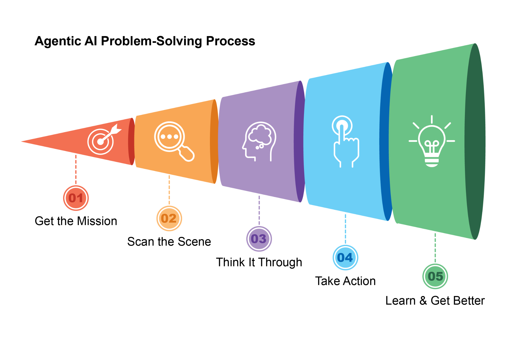
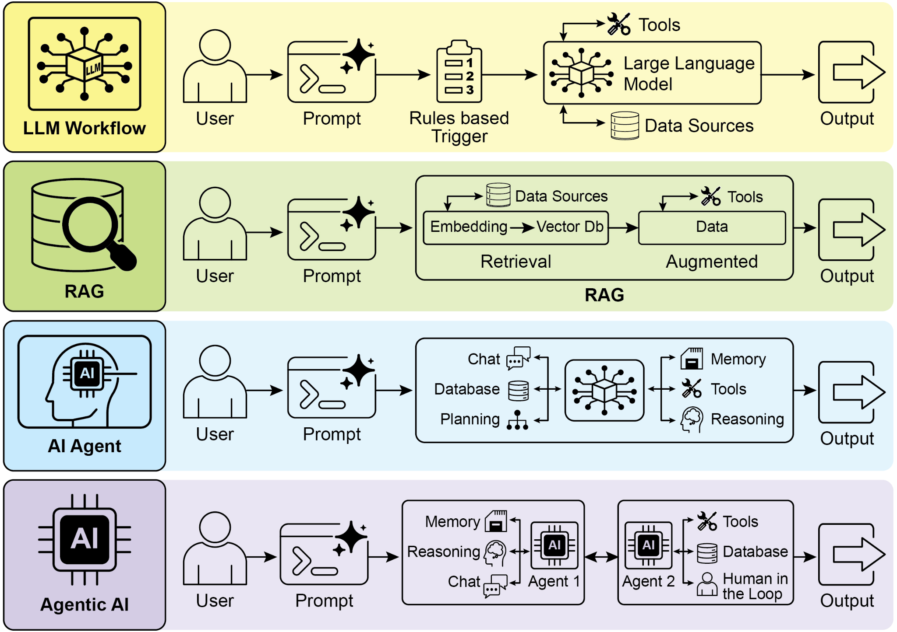
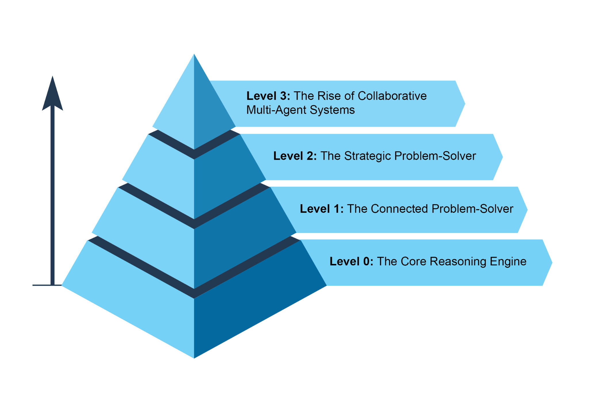

我常听到一个很好的问题：「AI 变化如此之快，为何还要写一本可能很快过时的书？」我的动机其实恰恰相反。正是因为事物发展如此迅速，我们才需要退后一步，辨识那些正在固化的底层原则。诸如检索增强生成（RAG）、反思、路由、记忆以及我讨论的其他模式，正成为基础构建模块。本书是一次邀请，邀请读者反思这些核心思想——它们为我们提供了赖以继续构建的根基。人类需要对这些基础模式进行这样的反思时刻

 

[所用框架简介 ]

 

为给我们的代码示例提供一个可感知的「画布」（另见附录），我们将主要使用三个主流的智能体开发框架。**LangChain** 及其有状态扩展 **LangGraph**，提供了一种将语言模型与其他组件灵活串联的方式，为构建复杂序列提供了稳健的画布 [是什么让一个 AI 系统成为智能体？ ]

 

简而言之，**AI 智能体**是一种被设计为感知其环境并采取行动以实现特定目标的系统。它是对标准大语言模型（LLM）的演进：增强了规划、使用工具以及与周围环境交互的能力。可以把智能体式 AI 想象成一位边干边学的智能助手。它遵循一个简单的五步循环来完成工作（见图 1）：

 

1\. **接受任务：** 你给它一个目标，例如「整理我的日程」。2. **扫描现场：** 它收集所有必要信息——阅读邮件、

查看日历并访问联系人——以了解正在发生什么。

3\. **深入思考：** 它通过考量达成目标的最优

方法来制定行动计划。

4\. **采取行动：** 它通过发送邀请、安排会议来执行计划，

图 1：智能体式 AI 作为智能助手运作，通过

经验持续学习。它经由一个简洁的五步循环来完成任务。

 

智能体正以惊人的速度日益普及。根据近期研究，大多数大型 IT 公司正积极使用这些智能体，其中五分之一是在过去一年内才刚刚开始。金融市场也在关注。到 2024 年底，AI 智能体初创公司已融资超过 20 亿美元，市场规模估值为 52 亿美元。预计到 2034 年，其价值将激增至近 2000 亿美元。简言之，所有迹象都表明 AI 智能体将在我们未来的经济中扮演举足轻重的角色。

 

短短两年内，AI 范式已发生剧变，从简单自动化转向复杂的自主系统（见图 2）。最初，工作流依赖基本提示与触发器，用大语言模型处理数据。随后演进到检索增强生成（RAG），通过对事实信息的锚定增强了可靠性。接着我们看到了单个 AI 智能体的发展 图 2：从大语言模型到 RAG，再到智能体式 RAG，最终到智能体式 AI。

 

本书的意图是讨论专业智能体如何协同合作以实现复杂目标的设计模式，你将在每一章中看到一种协作与交互范式。

 

在此之前，让我们先审视跨越智能体复杂度范围的若干示例（见图 3）。

 

[第 0 级：核心推理引擎 ]

 

尽管大语言模型本身并不是智能体，但它可以作为基本智能体式系统的推理核心。在「第 0 级」配置中，大语言模型在没有工具、记忆或环境交互的情况下运行，仅基于其预训练知识作出响应。其优势在于利用其广泛的训练数据来解释既有概念。执行上下文工程：为每一步战略性地选择、打包与管理最相关信息的过程。例如，要在两个地点之间找一家咖啡店，它首先使用地图工具。然后对这一输出进行工程处理，策选出一段简短、聚焦的上下文——或许只是一份街道名称列表——再喂给本地搜索工具，从而防止认知过载，并确保第二步高效且准确。要从 AI 获得最高准确度，必须为其提供简短、聚焦且有力的上下文。上下文工程正是通过从所有可用来源中战略性地选择、打包与管理最关键信息来完成这一任务的学科。它有效地策管模型有限的注意力，以防止过载，并确保在任何给定任务上实现高质量、高效率的表现。详细信息请参阅附录 A。

 

这一级别通向主动且持续的运行。一个与你的电子邮件相连的旅行助手，通过从冗长的航班确认中进行上下文工程来演示这一点

尽管这种自主、基于团队的自动化愿景已在开发中，重要的是要承认当前的障碍。此类多智能体系统的有效性，目前受其所使用的大语言模型推理局限的制约。此外，它们真正相互学习并以凝聚整体的方式改进的能力，仍处于早期阶段。克服这些技术瓶颈是关键的下一步，而一旦做到，将解锁这一级别的深远承诺：端到端自动化整个业务流程的能力。

 

[智能体的未来：五大假设 ]

 
