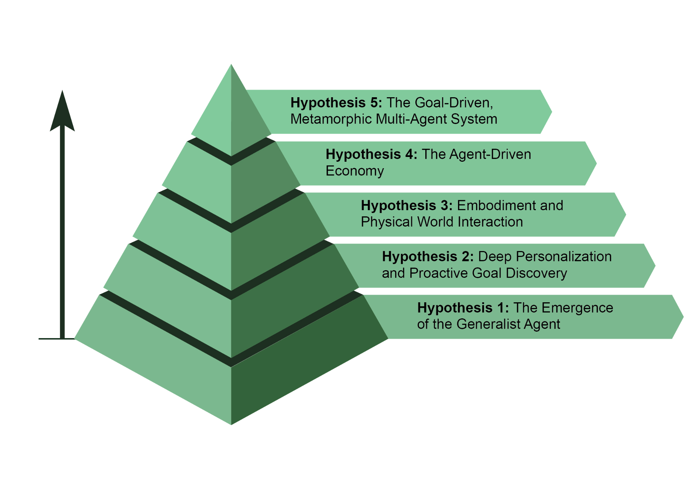

AI 智能体的发展正以前所未有的速度推进，覆盖软件自动化、科学研究与客户服务等领域。尽管当前系统已令人印象深刻，但这只是开始。下一波创新很可能聚焦于让智能体更加可靠、更具协作性，并在它们超越单纯响应聊天或指令之后，真正以智能体的方式深度运作。它们代表用户主动发起并执行任务，在过程中积极协作。这已超越简单的任务执行，进入主动目标发现的领域。

 

例如，如果你正在探索可持续能源，智能体可能会识别你的潜在目标，并通过推荐课程或总结研究来主动支持你。尽管这些系统仍在发展中，但其轨迹已十分清晰。它们将变得越来越主动，在高度确信某项行动会对你有所帮助时，学会代表你采取主动。最终，智能体将成为不可或缺的盟友，帮助你发现并实现那些尚未完全清晰表述的抱负。

访问管道维修知识库以制定计划，然后精确控制其机器人机械臂完成维修。这将是里程碑式的一步，弥合数字智能与物理行动之间的鸿沟，并从根本上改变从制造、物流到养老护理与家庭维护的方方面面。

 

[假设 4：智能体驱动的经济 ]

 

第四个假设是：高度自主的智能体将成为经济中的积极参与者，创造新的市场与商业模式。我们可能会看到智能体作为独立的经济实体运作，被赋予最大化特定结果（例如利润）的任务。一位创业者可以启动一个智能体来运营整家电子商务业务。该智能体将通过分析社交媒体识别热门产品，生成营销文案与视觉素材，通过与其他自动化系统交互管理供应链物流，并根据实时需求动态调整定价。这一转变将造就一种全新的、超高效的「智能体经济」，以某种速度运行，而品牌智能体并衍生出三个新的专业智能体：「Logo 设计」智能体、「网店平台」智能体与「供应链」智能体。它会不断调优它们的内部提示以提升性能。如果网店智能体成为瓶颈，系统可能会将其复制为三个并行智能体，分别处理网站的不同部分，从而在运行中有效地重新架构自身结构，以最好地实现既定目标。

 

[结论 ]

 

本质上，AI 智能体代表着相对传统模型的重大飞跃，其功能是一个自主系统：感知、规划并行动，以实现特定目标。该技术的演进正从单个、使用工具的智能体，走向能够应对多层面目标的复杂、协作式多智能体系统。未来的假设预言将出现通才型、个性化的，甚至
