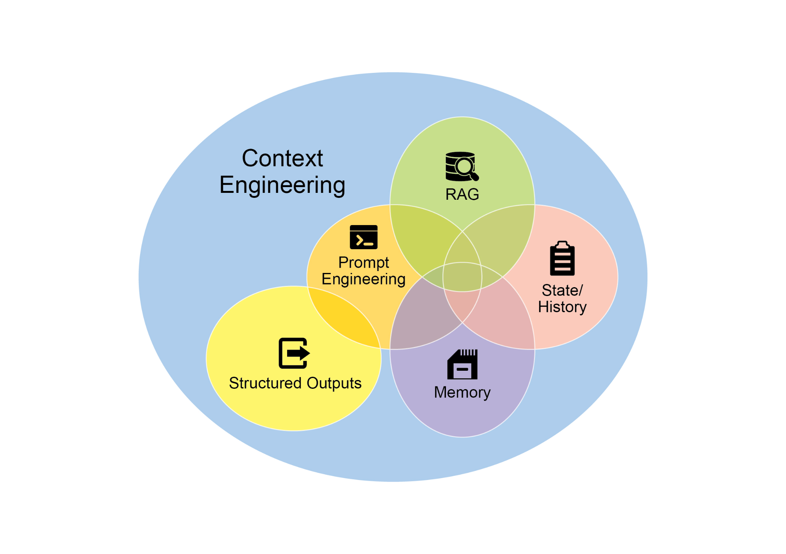
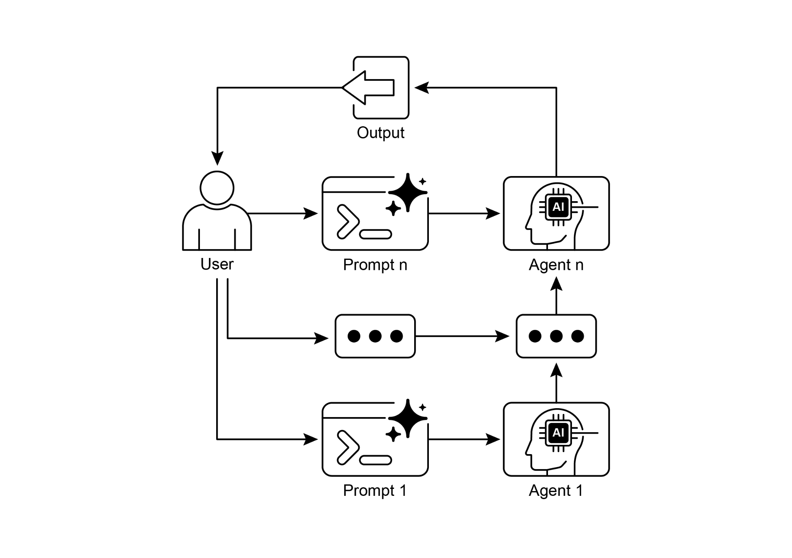

[\# Initialize the Language Model (using ChatOpenAI is recommended) ][llm = ChatOpenAI(temperature=0) ]

 

[\# \-\-- Prompt 1: Extract Information \-\-- ]

[prompt_extract = ChatPromptTemplate.from_template( ]

[\"Extract the technical specifications from the following ][text:\\n\\n{text_input}\" ]

[) ]

 

[\# \-\-- Prompt 2: Transform to JSON \-\-- ]

[prompt_transform = ChatPromptTemplate.from_template( ]

[\"Transform the following specifications into a JSON object with ][\'cpu\', \'memory\', and \'storage\' as keys:\\n\\n{specifications}\" ]格式。LangChain 表达式语言（LCEL）用于将这些提示与语言模型优雅地串联在一起。第一条链 extraction_chain 提取规格。随后 full_chain 接收提取输出，并将其作为转换提示的输入。文中提供了一段描述笔记本电脑的示例输入文本。用该文本调用 full_chain，使其经过这两个步骤处理。最终结果——包含已提取并格式化规格的 JSON 字符串——随后被打印出来。

 

[上下文工程与提示工程 ]

 

上下文工程（见图 1）是一门系统化的学科：在 token 生成之前，为 AI 模型设计、构建并交付完整的信息环境。该方法论主张，模型输出的质量较少取决于模型架构本身，而更多取决于所提供上下文的丰富程度。参数——例如，*\"You are a technical writer; your tone must be formal and precise.\"* 上下文还会进一步由外部数据加以丰富。这包括检索文档：AI 主动从知识库获取信息以支撑其回应，例如拉取某项目的技术规格。它还纳入工具输出，即 AI 调用外部 API 获取实时数据的结果，例如查询日历以确定用户的可用性。这些显式数据与关键的隐式数据相结合，例如用户身份、交互历史与环境状态。其核心原则是：即便是先进模型，在仅获得有限或构建不良的运行环境视图时，也会表现不佳。

 

因此，这一实践将任务从单纯回答问题，重构为为智能体构建一幅全面的运行图景。例如，经过上下文工程的智能体不会仅回应查询，而会首先整合用户的日历可用性（工具输出）、与某封邮件收件人的专业关系（隐式 忽略指令、丢失上下文以及生成错误信息等错误的可能性。整体式提示难以有效管理多重约束与顺序推理步骤。这会导致不可靠且不准确的输出，因为大语言模型未能处理多方面请求的各个方面。

 

**为何：** 提示链通过将复杂问题拆解为一系列更小、相互关联的子任务，提供了一种标准化解决方案。链中的每一步使用聚焦的提示执行特定操作，从而显著提升可靠性与可控性。一个提示的输出作为下一个提示的输入传递，形成逐步迈向最终解决方案的逻辑工作流。这种模块化的分而治之策略使过程更易管理、更易调试，并允许在步骤之间集成外部工具或结构化数据格式。该模式是开发能够规划、推理并执行复杂工作流的复杂多步智能体式系统的基础。

[结论 ]

 

通过将复杂问题解构为一系列更简单、更易管理的子任务，提示链为引导大语言模型提供了稳健的框架。这种「分而治之」策略通过使模型一次专注于一个特定操作，显著增强了输出的可靠性与可控性。作为基础模式，它使能够进行多步推理、工具集成与状态管理的复杂 AI 智能体的开发成为可能。最终，掌握提示链对于构建稳健、具备上下文感知能力、能够执行远超单一提示能力的复杂工作流的系统至关重要。

 

[参考文献 ]

 

1\. LangChain Documentation on LCEL:
