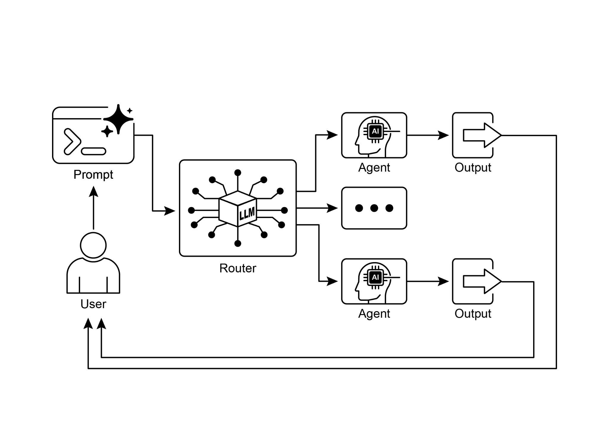

[print("-------------------------- 已调用 Info Handler ][----------------------------") ]

[return f"关于 '{request}' 的信息请求。结果：模拟的 ][信息检索。" ]

 

[def unclear_handler(request: str) -> str: ]

["""处理无法被委派的请求。""" ]

[return f"Coordinator 无法委派请求：'{request}'。 ][请澄清。" ]

 

[# --- 从函数创建工具 --- ]

[booking_tool = FunctionTool(booking_handler) ][「Info」智能体。" ]

[), ]

[description="一个将用户请求路由到 ]

[正确专业智能体的协调器。", ]

[# 定义 sub_agents 后，默认启用由大语言模型驱动的委派 ][（Auto-Flow）。 ]

[sub_agents=[booking_agent, info_agent] ]

[) ]

 

[# --- 执行逻辑 --- ]

 

[async ]

[ def run_coordinator(runner: InMemoryRunner, request: str): ]

["""使用给定请求运行协调器智能体并 ][进行委派。""" ]

[print(f"\n--- 正在以请求 '{request}' 运行 Coordinator ---") ][response ]

[break ]

 

[print(f"Coordinator 最终响应：{final_result}") ]

[return final_result ]

[except Exception as e: ]

[print(f"处理你的请求时发生错误：{e}") ]

[return f"处理你的请求时发生错误：{e}" ]

 

[async ]

[ def main(): ]

["""运行 ADK 示例的主函数。""" ]

[print("--- Google ADK 路由示例（ADK Auto-Flow 风格） ---") ]

[print("注意：这需要已安装并 ][完成认证的 Google ADK。") ]

Coordinator 智能体的主要角色（由其指令所定义）是分析

传入的用户消息，并将它们委派给 Booker 或 Info 智能体。由于

Coordinator 定义了 sub_agents，这种委派由 Google ADK 的 Auto-Flow 机制自动处理。run_coordinator 函数会设置一个

InMemoryRunner，创建用户与会话 ID，然后使用该 runner 通过

协调器智能体处理用户的请求。runner.run 方法处理该请求并产出事件，代码再从

event.content 中提取最终响应文本。

 

main 函数通过使用不同请求运行协调器来演示系统的用法，

展示它如何将预订请求委派给 Booker，将信息请求委派给 Info 智能体。

 

[一览 ]

赋能我们的智能体，使其能够就如何处理信息、

响应用户输入，以及利用可用工具或子智能体做出智能决策。

 

我们已经看到，路由可应用于多个领域，从客户服务

聊天机器人到复杂的数据处理流水线。分析输入并

有条件地引导工作流的能力，是构建能够应对

现实世界任务固有可变性的智能体的基础。

 

使用 LangChain 与 Google ADK 的代码示例展示了两种不同却

有效的路由实现方式。LangGraph 基于图的结构

提供了一种直观且显式的方式来定义状态与转移，因而非常适合

具有复杂路由逻辑的复杂、多步骤工作流。另一方面，Google ADK 通常侧重于定义不同的能力（Tools），并依赖

框架将用户请求路由到相应工具处理程序的能力，这可以
