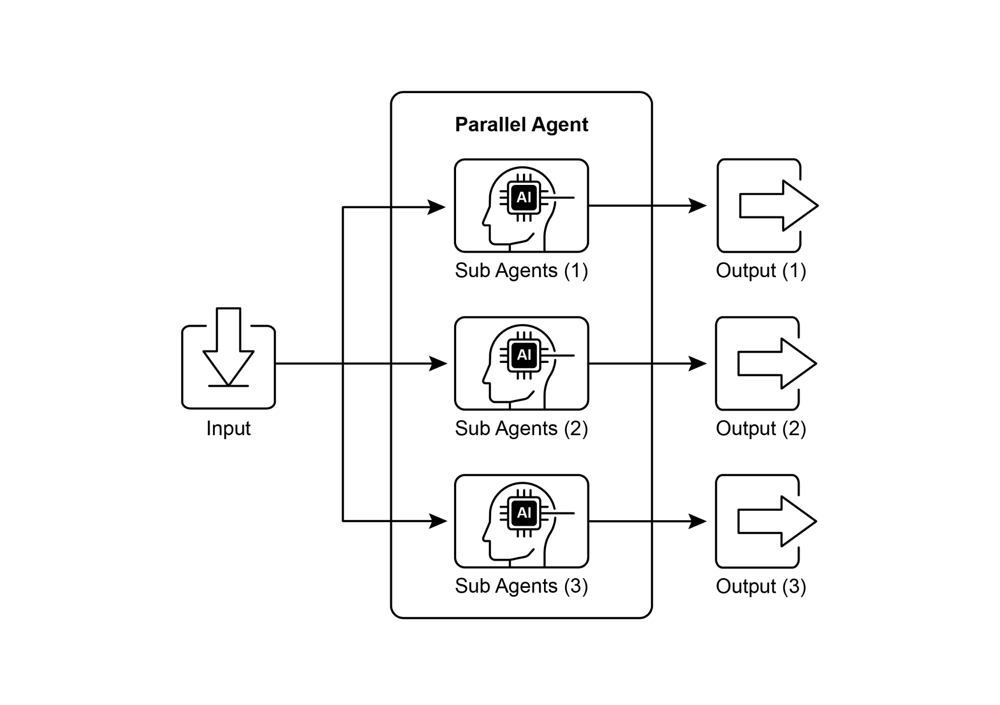

## [第 3 章：并行化 ]

 

[并行化模式概览 ]

 

在前面的章节中，我们探讨了用于顺序工作流的提示链，

以及用于动态决策与不同路径之间转移的路由。

虽然这些模式至关重要，但许多复杂的智能体式任务包含多个可*同时*而非依次执行的子任务。这正是

**并行化**模式变得关键之处。

 

并行化涉及并发执行多个组件，例如大语言模型调用、工具使用，

乃至整个子智能体（见图 1）。并行执行无需等待某一步完成再开始下一步，而是让独立任务

同时运行，从而显著缩短那些可按异步操作思路设计的任务的总体执行时间，使你可以轻松定义能够

并行运行的步骤。

并行化模式对于提升智能体式系统的效率与响应能力至关重要，

尤其是在处理涉及多次独立查询、计算或与外部服务交互的任务时。它是优化复杂智能体工作流性能的

关键技术。

 

[实际应用与用例 ]

 

并行化是一种强大的模式，可用于在各类应用中优化智能体性能：

 

1\. 信息收集与研究：

同时从多个来源收集信息是一个经典用例。

● **用例：** 一个研究某家公司的智能体。

○ **并行任务：** 搜索新闻文章、拉取股票数据、检查社交媒体 同时执行多项独立检查或验证。

● **用例：** 一个验证用户输入的智能体。

○ **并行任务：** 检查电子邮件格式、验证电话号码、对照数据库核验地址，

并同时检查是否含有不当用语。

○ **收益：** 更快地反馈输入是否有效。

 

6\. 多模态处理：

并发处理同一输入的不同模态（文本、图像、音频）。

● **用例：** 一个分析带有文本与图像的社交媒体帖子的智能体。

○ **并行任务：** 分析文本的情感与关键词，*同时*分析

图像中的物体与场景描述。

○ **收益：** 更快地整合来自不同模态的洞察。

 

7\. A/B 测试或多种方案生成：

并行生成多种响应或输出变体，以选出最佳方案；也可针对单个用户查询并发执行多项独立操作。这些

并行流程被实例化为不同的链或函数，随后将其各自的输出聚合为统一结果。

 

该实现的前提包括安装所需的

Python 包，例如 langchain、langchain-community，以及模型提供方库

如 langchain-openai。此外，必须在本地环境中为所选语言模型配置有效的 API 密钥以完成身份验证。

 

[import os ]

[import asyncio ]

[from typing import Optional ]

 

[from langchain_openai import ChatOpenAI ]

[from langchain_core.prompts import ChatPromptTemplate ]

[(\"system\", \"Generate three interesting questions about the ][following topic:\"), ]

[(\"user\", \"{topic}\") ]

[\]) ]

[\| llm ]

[\| StrOutputParser() ]

[) ]

 

[terms_chain: Runnable = ( ]

[ChatPromptTemplate.from_messages(\[ ]

[(\"system\", \"Identify 5-10 key terms from the following topic, ][separated by commas:\"), ]

[(\"user\", \"{topic}\") ]

[\]) ]

[\| llm ]

[\| StrOutputParser() ][full_parallel_chain = map_chain \| synthesis_prompt \| llm \| ][StrOutputParser() ]

 

[\# \-\-- 运行该链 \-\-- ]

[async def run_parallel_example(topic: str) -\> None: ]

[\"\"\" ]

[使用特定主题异步调用并行处理链 ]

[并打印综合结果。 ]

 

[Args: ]

[topic: 将由 LangChain 链处理的输入主题。 ]

[\"\"\" ]

[if not llm: ]

[print(\"LLM not initialized. Cannot run example.\") ]

代码首先从 langchain_openai 和

langchain_core 导入必要模块，包括用于语言模型、提示、输出解析以及可运行结构的组件。代码尝试初始化一个 ChatOpenAI 实例，

具体使用 \"gpt-4o-mini\" 模型，并指定 temperature 以

控制创造性。在语言模型初始化过程中使用 try-except 块以增强稳健性。

随后定义了三条独立的 LangChain「链」，每条链被设计为对输入主题执行不同任务。第一条链用于

简洁地总结该主题，使用系统消息以及包含主题占位符的用户消息。

第二条链配置为生成三个与该主题相关的有趣问题。第三条链设置为从输入主题中识别 5 到 10 个关键术语，并要求以逗号分隔。

这些独立链中的每一条都由针对其

特定任务定制的 ChatPromptTemplate 组成，后接已初始化的语言模型以及用于将输出格式化为字符串的 StrOutputParser。

ParallelAgent 与 SequentialAgent，可用于构建利用并发执行以提升效率的

智能体流程。

 

[from google.adk.agents import LlmAgent, ParallelAgent, ][SequentialAgent ]

[from google.adk.tools import google_search ][GEMINI_MODEL=\"gemini-2.0-flash\" ]

 

[\# \-\-- 1. 定义研究员子智能体（并行运行） \-\-- ]

 

[\# 研究员 1：可再生能源 ]

[researcher_agent_1 = LlmAgent( ]

[name=\"RenewableEnergyResearcher\", ]

[model=GEMINI_MODEL, ]

[instruction=\"\"\"You are an AI Research Assistant specializing in ][energy. ]

[name=\"CarbonCaptureResearcher\", ]

[model=GEMINI_MODEL, ]

[instruction=\"\"\"You are an AI Research Assistant specializing in ][climate solutions. ]

[Research the current state of \'carbon capture methods\'. ][Use the Google Search tool provided. ]

[Summarize your key findings concisely (1-2 sentences). ][Output \*only\* the summary. ]

[\"\"\", ]
