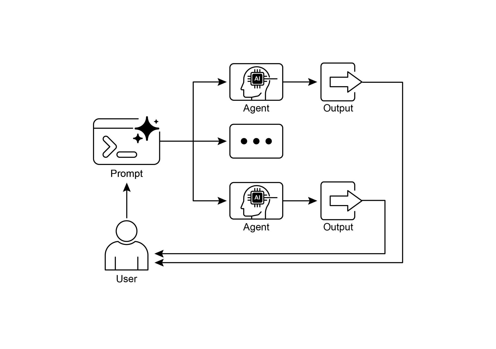

## [\-\-- ]

[\# This is the main agent that will be run. It first executes the ][ParallelAgent ]

[\# to populate the state, and then executes the MergerAgent to produce ][the final output. ]

[sequential_pipeline_agent = SequentialAgent( ]

[name=\"ResearchAndSynthesisPipeline\", ]

[\# Run parallel research first, then merge ]

[sub_agents=\[parallel_research_agent, merger_agent\], ]

[description=\"Coordinates parallel research and synthesizes the ][results.\" ]

[) ]

[root_agent = sequential_pipeline_agent ]

 

这段代码定义了一个用于研究与综合信息的多智能体系统，其设计旨在高效地并行从多个来源收集信息，然后

将其合并为一份结构化的单一报告。

 

[一览 ]

 

**是什么：** 许多智能体式工作流涉及多个必须完成的子任务，才能

达成最终目标。纯顺序执行——即每个任务都等待前一个任务

完成后才开始——往往效率低下且缓慢。当任务依赖外部 I/O 操作（例如调用不同的 API 或查询多个数据库）时，这种延迟会成为显著的

瓶颈。若没有并发执行机制，

总处理时间便是所有单个任务耗时之和，从而妨碍

系统的整体性能与响应能力。

 

**为何：** 并行化模式提供了一种标准化解决方案，通过使

● Google ADK 可通过大语言模型驱动的委派促进并行执行，

由协调器智能体的大语言模型识别独立子任务，并触发由专门化子智能体对其进行并发处理。

● 并行化有助于降低整体延迟，并使智能体式系统在复杂任务中更加

响应迅速。

 

[结论 ]

 

并行化模式是一种通过并发执行独立子任务来优化计算工作流的方法。该方法可降低整体延迟，

尤其适用于涉及多次模型推理或调用

外部服务的复杂操作。

 

各框架为该模式提供了不同的实现机制。在 LangChain 中，
