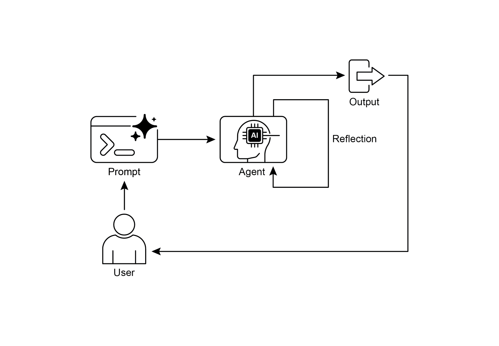
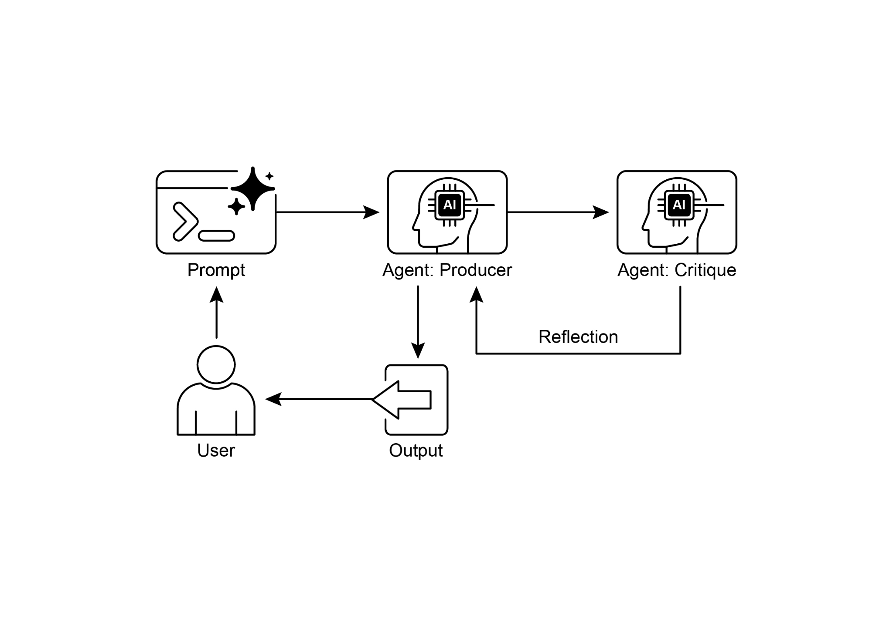

在每一步中，对话历史都会被维护并传递给语言模型，以便为

生成/完善与反思阶段提供上下文。最后，

脚本在循环结束后打印最后生成的代码版本。

 

[动手代码示例（ADK） ]

 

下面我们来看一个使用 Google ADK 实现的概念性代码示例。

[\"\"\", ]

[output_key=\"review_output\" \# 结构化字典保存在此处。 ]

[) ]

 

[\# SequentialAgent 确保生成器在审查者之前运行。 ][review_pipeline = SequentialAgent( ]

[name=\"WriteAndReview_Pipeline\", ]

[sub_agents=\[generator, reviewer\] ]

[) ]

 

[\# 执行流程： ]

[\# 1. generator 运行 -\> 将其段落保存到 state\[\'draft_text\'\]。 ][\# 2. reviewer 运行 -\> 读取 state\[\'draft_text\'\]，并将其 ][字典输出保存到 state\[\'review_output\'\]。 ]

[一览 ]

 

 

**是什么：**[ 智能体的初始输出往往并不理想，存在不准确、不完整， ][或未能满足复杂需求等问题。基本的智能体式工作流缺乏内置流程， ][使智能体能够识别并修正自身错误。解决办法是让智能体评估自己的 ][工作，或更稳健地引入一个独立的逻辑智能体充当批评者，从而避免 ][无论质量如何都将初始响应作为最终结果。 ]

 

**为何：**[ 反思模式通过引入自我纠正与 ][完善机制提供了解决方案。它建立了一个反馈环：由「生产者」智能体生成输出， ][然后由「批评者」智能体（或生产者自身）对照预定义标准对其进行评估。该批评 ][随后被用于生成改进版本。这种生成、评估与 ][完善的迭代过程逐步提升最终结果的质量，从而得到更准确、 ][连贯且可靠的结果。 ]

● 然而，这些收益是以增加延迟和

计算开销为代价的，同时也会提高超出模型上下文窗口或被 API 服务限流的风险。

● 虽然完整的迭代反思通常需要有状态工作流（如 LangGraph），

但可以使用 LangChain 的 LCEL 实现单次反思步骤，将

输出传递给批评与后续完善。

● Google ADK 可通过顺序工作流促进反思：由一个

智能体的输出接受另一智能体的批评，从而允许后续

完善步骤。

● 该模式使智能体能够进行自我纠正，并随时间提升其

表现。

 

[结论 ]

4\. Google Agent Developer Kit (ADK) Documentation (Multi-Agent Systems):

<https://google.github.io/adk-docs/agents/multi-agents/>
