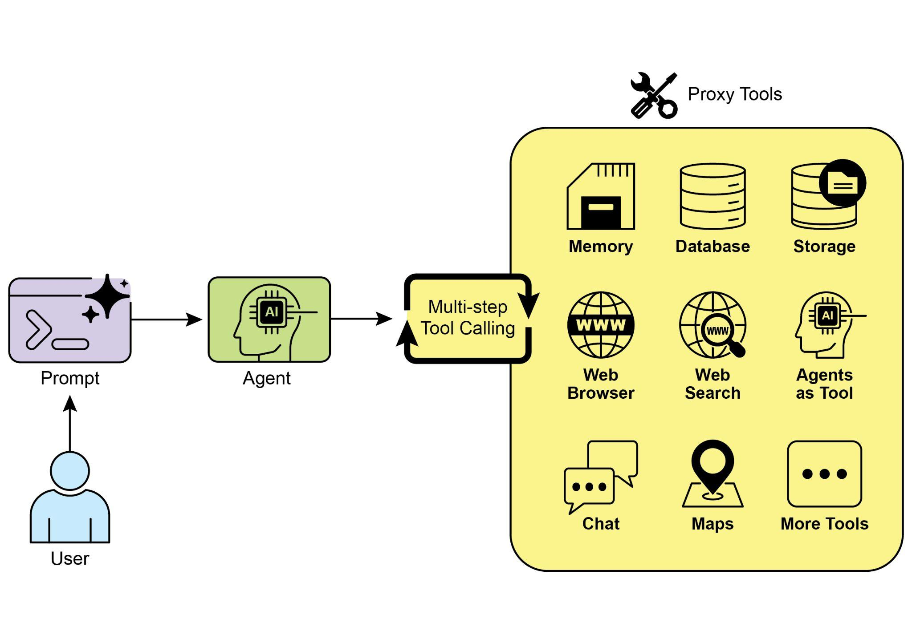

## [第 5 章：工具使用（Function Calling） ]

 

[工具使用模式概览 ]

 

到目前为止，我们讨论的智能体式模式主要涉及编排

大语言模型之间的交互，以及管理信息在

智能体内部工作流中的流转（提示链、路由、并行化、反思）。然而，要使智能体真正有用，并与现实世界或外部系统交互，它们

需要具备使用工具的能力。

 

工具使用模式通常通过一种称为函数调用（Function

Calling）的机制实现，使智能体能够与外部 API、数据库、服务交互，甚至执行代码。它使作为智能体核心的大语言模型能够根据用户请求或当前状态，决定何时以及如何

使用特定的外部函数。函数调用是弥合大语言模型推理

能力与海量可用外部功能之间鸿沟的技术机制。

 

虽然「函数调用」恰当地描述了调用特定、预定义代码函数的行为，

但考虑更宽泛的「工具调用」概念也很有益。这一更广的术语

承认智能体的能力可以远远超出简单的函数

执行。一个「工具」可以是传统函数，也可以是复杂的 API 端点、对数据库的请求，甚至是发给另一个

专用智能体的指令。这一视角使我们能够构想更复杂的系统：

例如，主智能体可以将复杂的数据分析任务委派给

专用的「分析师智能体」，或通过 API 查询外部知识库。以「工具调用」来思考，能更好地把握智能体作为

编排者、跨越多样数字资源与其他智能

实体生态的全部潜力。

对结构化数据执行查询、更新或其他操作。

● **用例：** 电商智能体。

○ **工具：** 用于检查产品库存、获取订单状态或处理

支付的 API 调用。

○ **智能体流程：** 用户询问「产品 X 有货吗？」，大语言模型调用库存 API，

工具返回库存数量，大语言模型告知用户库存状态。

 

3\. 执行计算与数据分析：

使用外部计算器、数据分析库或统计工具。

● **用例：** 金融智能体。

○ **工具：** 计算器函数、股市数据 API、电子表格工具。 ○ **智能体流程：** 用户询问「AAPL 当前价格是多少，如果我以 \$150 买入 100 股，

潜在利润是多少？」，大语言模型调用股票 API，获取

当前价格，再调用计算器工具，得到结果，格式化回复。

所选语言模型服务——通常通过在本地

环境中配置的 API 密钥——是必要的先决条件。

 

[import os, getpass ]

[import asyncio ]

[import nest_asyncio ]

[from typing import List ]

[from dotenv import load_dotenv ]

[import logging ]

 

[from langchain_google_genai import ChatGoogleGenerativeAI ][from langchain_core.prompts import ChatPromptTemplate ][from langchain_core.tools import tool as langchain_tool ][from langchain.agents import create_tool_calling_agent, AgentExecutor ]

 

[\# UNCOMMENT ]

[\"capital of france\": \"The capital of France is Paris.\", ]

[\"population of earth\": \"The estimated population of Earth is ][around 8 billion people.\", ]

[\"tallest mountain\": \"Mount Everest is the tallest mountain ][above sea level.\", ]

[\"default\": f\"Simulated search result for \'{query}\': No specific ][information found, but the topic seems interesting.\" ][ } ]

[ result = simulated_results.get(query.lower(), ][simulated_results\[\"default\"\]) ]

[ print(f\"\-\-- TOOL RESULT: {result} \-\--\") ][ return result ]

 

[tools = \[search_information\] ]

 

[\# \-\-- 创建工具调用智能体 \-\-- ][ \"\"\"并发运行所有智能体查询。\"\"\" ][ tasks = \[ ]

[run_agent_with_tool(\"What is the capital of France?\"), ]

[run_agent_with_tool(\"What\'s the weather like in London?\"), ]

[run_agent_with_tool(\"Tell me something about dogs.\") \# 应 ][触发默认工具响应 ]

[ \] ]

[ await asyncio.gather(\*tasks) ]

 

[nest_asyncio.apply() ]

[asyncio.run(main())]

 

这段代码使用 LangChain 库与 Google

Gemini 模型搭建了一个工具调用智能体。它定义了一个 search_information 工具，用于模拟对特定查询提供事实性

答案。该工具对「weather in

[\# \-\-- 最佳实践：配置日志 \-\-- ][\# 基本的日志设置有助于调试并跟踪 crew 的 ][执行。 ]

 

[logging.basicConfig(level=logging.INFO, format=\'%(asctime)s - ][%(levelname)s - %(message)s\') ]

 

[\# \-\-- 设置你的 API 密钥 \-\-- ]

[\# 在生产环境中，建议对密钥管理采用更安全的方法， ][例如在运行时加载环境变量或使用密钥管理器。 ][\# ]

[\# 为所选的大语言模型提供商设置环境变量（例如 ][OPENAI_API_KEY) ]

[\# os.environ\[\"OPENAI_API_KEY\"\] = \"YOUR_API_KEY\" ][\# os.environ\[\"OPENAI_MODEL_NAME\"\] = \"gpt-4o\" ]

[\# \-\-- 2. 定义智能体 \-\-- ]

[\# 智能体定义保持不变，但现在将利用 ][改进后的工具。 ]

[financial_analyst_agent = Agent( ]

[ role=\'Senior Financial Analyst\', ]

[ goal=\'Analyze stock data using provided tools and report key ][prices.\', ]

[ backstory=\"You are an experienced financial analyst adept at using ][data sources to find stock information. You provide clear, direct ][answers.\", ]

[ verbose=True, ]

[ tools=\[get_stock_price\], ]

[ \# 允许委派可能有用，但对于这个 ][简单任务并非必要。 ]

[ allow_delegation=False, ]

[) ]

[\# 使用 \_\_name\_\_ == \"\_\_main\_\_\": 块是标准的 Python 最佳 ][实践。 ]

[def main(): ]

[\"\"\"运行 crew 的主函数。\"\"\" ]

[\# 启动前检查 API 密钥，以避免运行时错误。 ]

[if not os.environ.get(\"OPENAI_API_KEY\"): ]

[print(\"ERROR: The OPENAI_API_KEY environment variable is not ][set.\") ]

[print(\"Please set it before running the script.\") ]

[return ]

 
