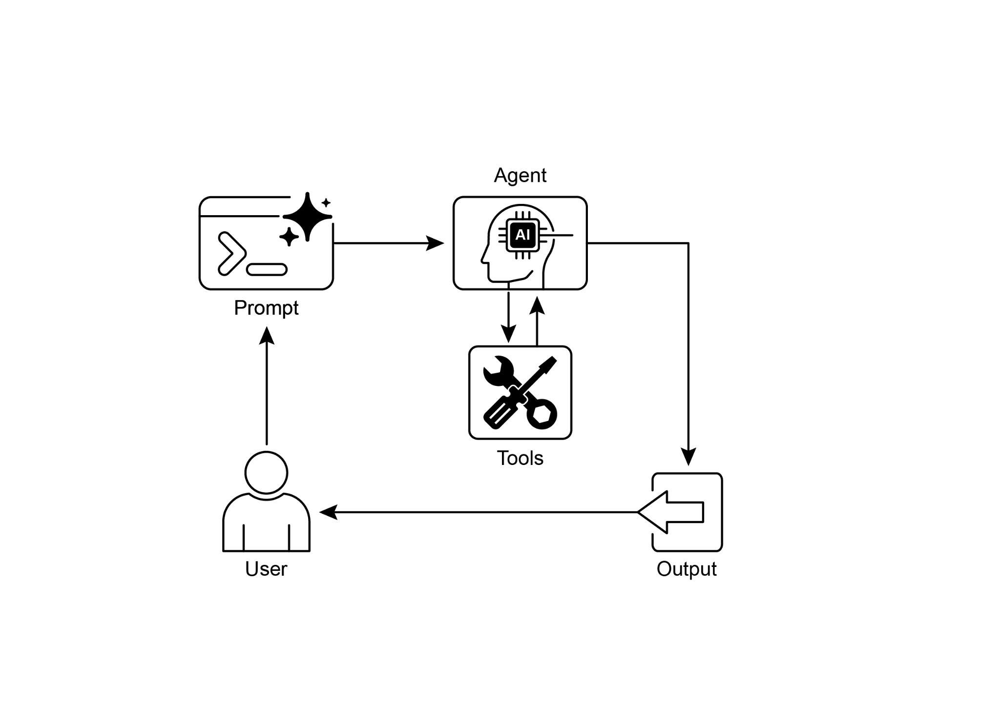

[print(\"\\n## Starting the Financial Crew\...\") ]

[print(\"\-\-\-\-\-\-\-\-\-\-\-\-\-\-\-\-\-\-\-\-\-\-\-\-\-\-\-\-\-\-\-\--\") ]

 

[\# kickoff 方法启动执行。 ]

[result = financial_crew.kickoff() ]生产环境。简而言之，核心逻辑展示了如何定义工具、

智能体与任务，从而在 Crew.ai 中创建协作工作流。

 

[动手代码（Google ADK） ]

 

Google Agent Developer Kit（ADK）包含一组原生集成的工具，

可直接纳入智能体的能力之中。

 

**Google 搜索：** 此类组件的一个主要示例是 Google 搜索工具。

该工具充当 Google 搜索引擎的直接接口，使智能体具备执行网页搜索并检索外部

信息的功能。

[ session_service = InMemorySessionService() ][ session = await session_service.create_session(app_name=APP_NAME, ][user_id=USER_ID, session_id=SESSION_ID) ]

[ runner = Runner(agent=root_agent, app_name=APP_NAME, ][session_service=session_service) ]

 

[ content = types.Content(role=\'user\', ]

[parts=\[types.Part(text=query)\]) ]

[ events = runner.run(user_id=USER_ID, session_id=SESSION_ID, ][new_message=content) ]

 

[ for event in events: ]

[if event.is_final_response(): ]

[final_response = event.content.parts\[0\].text ]

[print(\"Agent Response: \", final_response) ]

**代码执行：** Google ADK 提供了面向专项

任务的集成组件，其中包括用于动态代码执行的环境。built_in_code_execution 工具为智能体提供了一个沙箱化的 Python 解释器。

这使模型能够编写并运行代码，以执行计算任务、

操作数据结构，并执行过程性脚本。此类功能对于

处理需要确定性逻辑与精确计算的问题至关重要，而这些超出了单纯概率性语言生成的范畴。

 

[import os, getpass ]

[import asyncio ]

[import nest_asyncio ]

[from typing import List ]

[from dotenv import load_dotenv ]

[import logging ][ session = await session_service.create_session(app_name=APP_NAME, ][user_id=USER_ID, session_id=SESSION_ID) ]

[ runner = Runner(agent=code_agent, app_name=APP_NAME, ][session_service=session_service) ]

 

[ content = types.Content(role=\'user\', ]

[parts=\[types.Part(text=query)\]) ]

[ print(f\"\\n\-\-- Running Query: {query} \-\--\") ][ final_response_text = \"No final text response captured.\" ][ try: ]

[\# 使用 run_async ]

[async for event in runner.run_async(user_id=USER_ID, ][session_id=SESSION_ID, new_message=content): ]

[print(f\"Event ID: {event.id}, Author: {event.author}\") ]

 

[\# \-\-- 首先检查特定部分 \-\-- ][ print(\"-\" \* 30) ]

 

[\# 用于运行示例的主异步函数 ][async def main(): ]

[ await call_agent_async(\"Calculate the value of (5 + 7) \* 3\") ][ await call_agent_async(\"What is 10 factorial?\") ]

 

[\# 执行主异步函数 ]

[try: ]

[ nest_asyncio.apply() ]

[ asyncio.run(main()) ]

[except RuntimeError as e: ]

[ \# 处理在已有 ][运行中的事件循环（如 Jupyter/Colab）中调用 asyncio.run 时的特定错误 ]

[ if \"cannot be called from a running event loop\" in str(e): ]

[print(\"\\nRunning in an existing event loop (like ]历史记录。定义了一个异步函数 call_vsearch_agent_async，用于与

智能体交互。该函数接收查询，构造消息内容对象，并调用 runner 的 run_async 方法将查询发送给智能体。随后该函数

在响应到达时将智能体的响应流式输出到控制台。它还会打印

关于最终响应的信息，包括来自数据存储的任何来源归属。错误处理用于捕获智能体执行期间的异常，并针对错误的数据存储 ID

或权限缺失等潜在问题提供有用的提示信息。另提供一个异步函数 run_vsearch_example，

用于演示如何以示例查询调用该智能体。主

执行块会检查 DATASTORE_ID 是否已设置，然后使用 asyncio.run 运行示例。其中还包括一项检查，用于处理代码运行在

已有事件循环的环境中的情况，例如 Jupyter notebook。

[) ]

 

[\# \-\-- Runner 与会话初始化 \-\-- ][runner = Runner( ]

[agent=vsearch_agent, ]

[app_name=APP_NAME, ]

[session_service=InMemorySessionService(), ][) ]

 

[\# \-\-- 智能体调用逻辑 \-\-- ]

[async def call_vsearch_agent_async(query: str): ]

[\"\"\"初始化会话并流式输出智能体的响应。\"\"\" ]

[print(f\"User: {query}\") ]

[print(\"Agent: \", end=\"\", flush=True) ]

 

[try: ]

[service account has the necessary permissions.\") ]

[print(\"-\" \* 30) ]

 

[\# \-\-- 运行示例 \-\-- ]

[async def run_vsearch_example(): ]

[\# 替换为与你的数据存储内容相关的问题 ]

[await call_vsearch_agent_async(\"Summarize the main points about ][the Q2 strategy document.\") ]

[await call_vsearch_agent_async(\"What safety procedures are ][mentioned for lab X?\") ]

 

[\# \-\-- 执行 \-\-- ]

[if \_\_name\_\_ == \"\_\_main\_\_\": ]

[if not DATASTORE_ID: ]

[print(\"Error: DATASTORE_ID environment variable is not set.\") ]

[else: ]企业级管控以及与其他 Google 产品的无缝集成。扩展与

函数调用之间的关键区别在于其执行方式：Vertex AI 会自动执行扩展，而函数调用则需要由用户或客户端

手动执行。

 

[一览 ]

 

**是什么：** 大语言模型是强大的文本生成器，但它们从根本上与

外部世界脱节。其知识是静态的，仅限于训练数据，并且缺乏执行动作或检索实时信息的能力。这一

固有局限使它们无法完成需要与

外部 API、数据库或服务交互的任务。若没有通向这些外部系统的桥梁，

它们解决现实世界问题的效用将受到严重制约。

