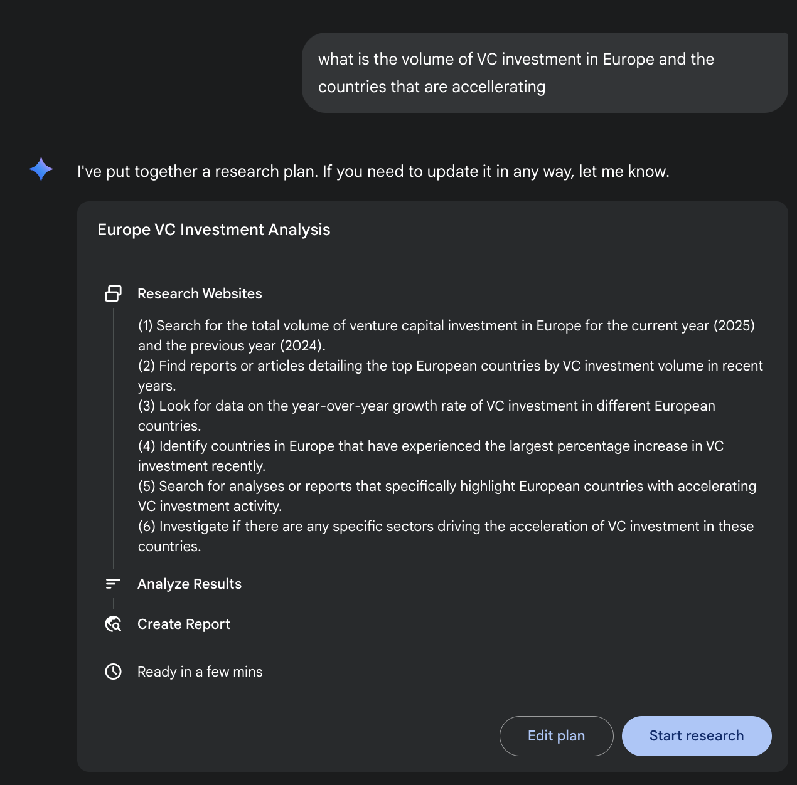
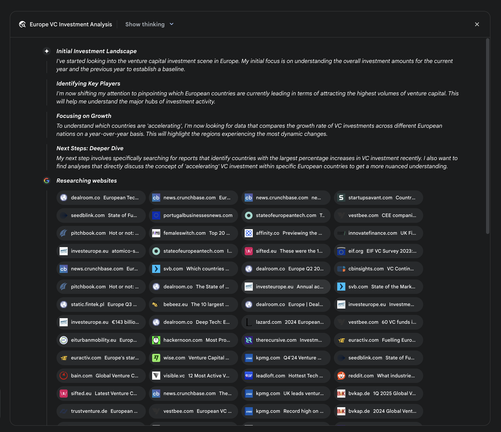
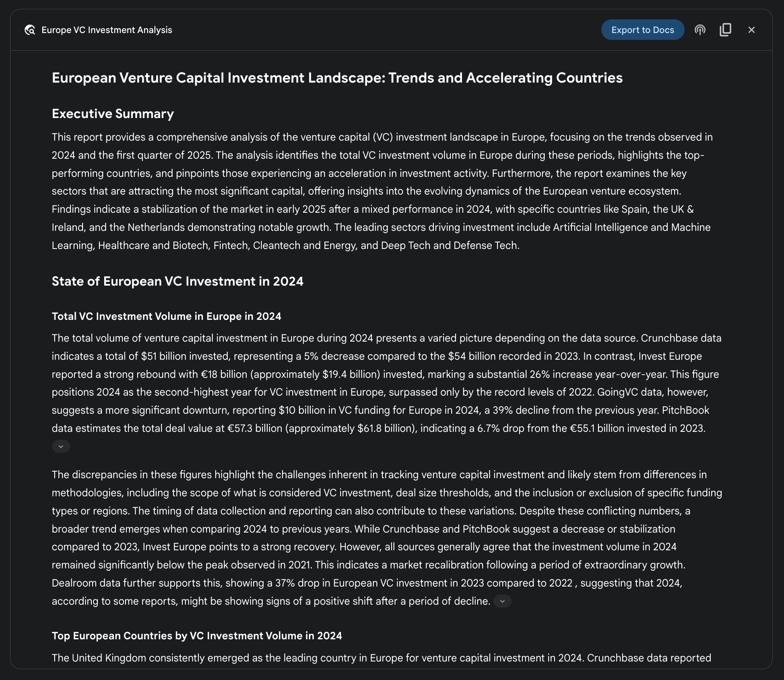

## [第 6 章：规划 ]

 

智能行为往往不止于对即时输入做出反应。它

需要前瞻性，将复杂任务拆解为更小、可管理的步骤，并制定策略以实现期望结果。这正是规划模式

发挥作用之处。就其核心而言，规划是智能体或智能体系统

制定一系列动作、从初始状态迈向目标状态的能力。

 

[规划模式概览 ]

 

在 AI 语境中，不妨把规划智能体看作一位专家，你将复杂目标委派给它。

当你请它「组织一次团队团建」时，你是在

定义「做什么」——目标及其约束——而非「怎么做」。智能体尤其是在动态或复杂环境中。这一过程将

高层目标转化为由离散、可执行步骤组成的结构化计划。

 

在过程性任务自动化等领域，规划用于编排

复杂工作流。例如，新员工入职这类业务流程

可被分解为有向的子任务序列，例如创建系统

账户、分配培训模块，以及与不同部门协调。智能体生成计划，按逻辑顺序执行这些步骤，调用

必要工具或与各类系统交互以管理依赖关系。

 

在机器人技术与自主导航中，规划对于状态空间

遍历至关重要。一个系统——无论是实体机器人还是虚拟实体——必须生成路径或动作序列，以从初始状态过渡到目标状态。这涉及

在优化时间或能耗等指标的同时，遵守

[\# 1. 为清晰起见显式定义语言模型 ][llm = ChatOpenAI(model=\"gpt-4-turbo\") ]

 

 

[\# 2. 定义一个清晰且专注的智能体 ]

[planner_writer_agent = Agent( ]

[role=\'Article Planner and Writer\', ]

[goal=\'Plan and then write a concise, engaging summary on a ][specified topic.\', ]

[backstory=( ]

[\'You are an expert technical writer and content strategist. \' ]

[\'Your strength lies in creating a clear, actionable plan ][before writing, \' ]

[\'ensuring the final summary is both informative and easy to ][digest.\' ]

[), ]

[) ]

 

[\# 执行任务 ]

[print(\"## Running the planning and writing task ##\") ][result = crew.kickoff() ]

 

[print(\"\\n\\n\-\--\\n## Task Result ##\\n\-\--\") ]

[print(result) ]

 

这段代码使用 CrewAI 库创建一个会规划并撰写给定主题

摘要的 AI 智能体。它首先导入必要的库，包括 Crew.ai

和 langchain_openai，并从 .env 文件加载环境变量。为智能体

显式定义了一个 ChatOpenAI 大语言模型。随后创建名为 planner_writer_agent 的智能体，赋予特定角色与目标：先规划再

撰写简洁摘要。该智能体的背景故事强调其在规划方面的专长。它所收集的信息，主动识别知识缺口，交叉核验数据点，

并消解不一致之处。

用户提供的文档，将私有来源的信息与其

基于网络的研究相结合。最终输出并非仅仅是发现结果的拼接列表，而是一份结构化的多页报告。在综合阶段，模型对

所收集信息进行批判性评估，识别主要主题，并将

内容组织为具有逻辑章节的连贯叙事。报告被设计为

交互式，通常包含音频概览、图表，以及指向原始引用来源的链接，便于用户核实与进一步探索。除

综合结果之外，模型还会显式返回它所搜索并

查阅的完整来源列表（见图 2）。这些以来源引用形式呈现，提供

完全透明性，并可直接访问原始信息。整个过程将简单查询转化为一份全面、综合的

知识成果。

图 2：深度研究计划执行示例，结果是将 Google 搜索

作为工具，用于检索各类网络来源。

 

通过降低人工数据采集与综合所需的大量时间与资源投入，

Gemini 深度研究提供了一种更结构化、更全面的

信息发现方法。该系统的价值在跨领域的复杂、多面向研究任务中尤为明显。

 

例如，在竞争分析中，可引导智能体系统化地收集

并整理市场趋势、竞品规格、来自多元在线来源的公众情绪，以及营销策略等数据。这一自动化流程

取代了手动跟踪多个竞争对手的繁琐工作，使分析师

得以聚焦更高阶的战略解读，而非数据采集（见图 3）。

图 3：由 Google 深度研究智能体生成的最终输出，代表我们

分析了借助 Google 搜索工具获得的来源。

 

同样，在学术探索中，该系统是进行广泛文献综述的强大工具。

它能够识别并摘要奠基性论文，追踪

概念在众多出版物中的发展脉络，并勾勒特定领域内的新兴研究前沿，从而加速学术探究中最初且最

耗时的阶段。

 

这一方法的效率源于对迭代式「搜索—筛选」循环的自动化，而这正是人工研究中的核心瓶颈。

全面性则来自系统能够处理比人类研究者在

可比时间范围内通常可行的更大体量与更多样的

信息来源。这种更广的分析范围有助于降低

● **透明性：** 与 ChatGPT 中被抽象化的过程不同，该 API 暴露全部
